# 大型语言模型实践：1.1：人工智能简史与演进 🧠

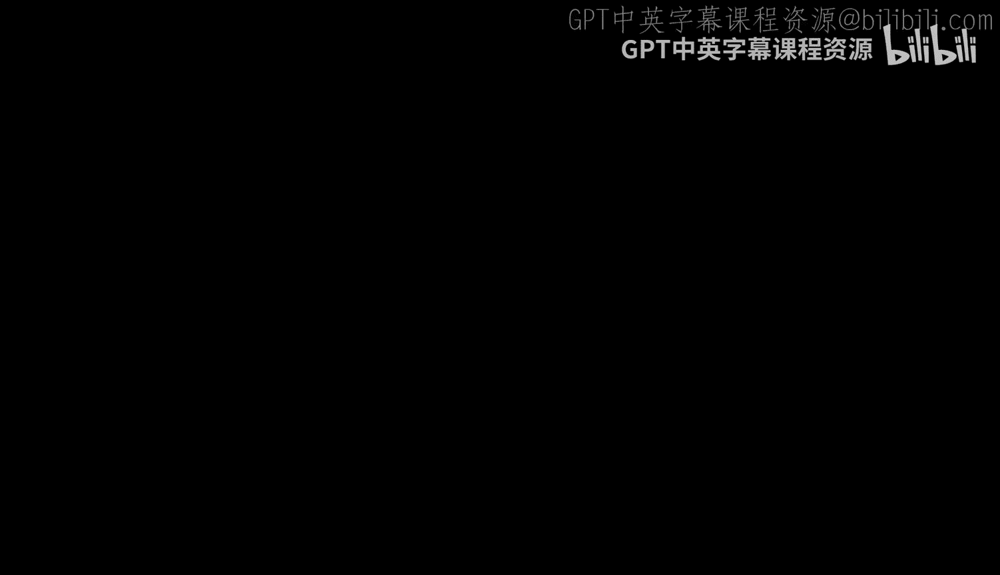

在本节课中，我们将一起回顾人工智能（AI）的发展历程，了解从最初的构想到如今生成式AI的关键里程碑。这段历史将帮助我们理解当前大型语言模型（LLM）兴起的背景。

## 概述

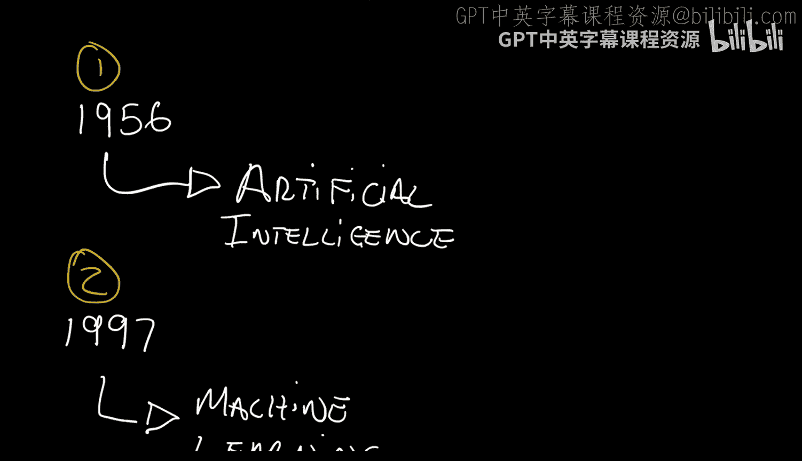

人工智能的研究始于20世纪中叶。我们将从1956年的达特茅斯会议开始，这是AI领域公认的诞生标志。随后，我们将看到AI如何经历了几十年的发展与沉淀，并在近些年，特别是随着**Transformer架构**和**GPT-3**等大型语言模型的出现，迎来了爆发式的增长。

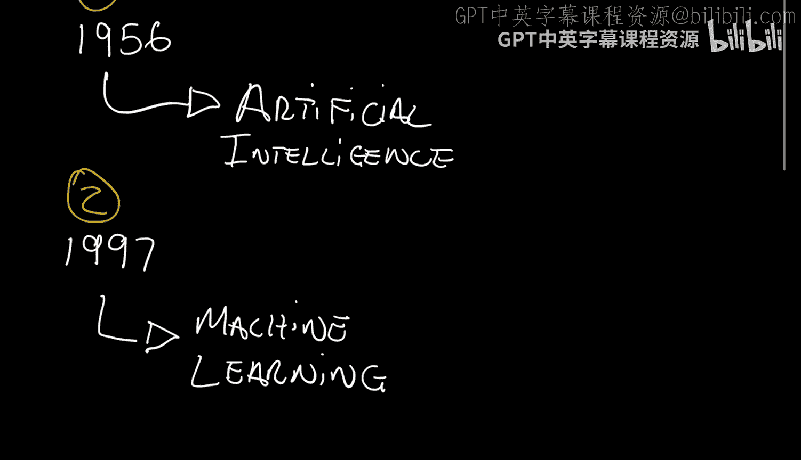

## 人工智能的演进历程

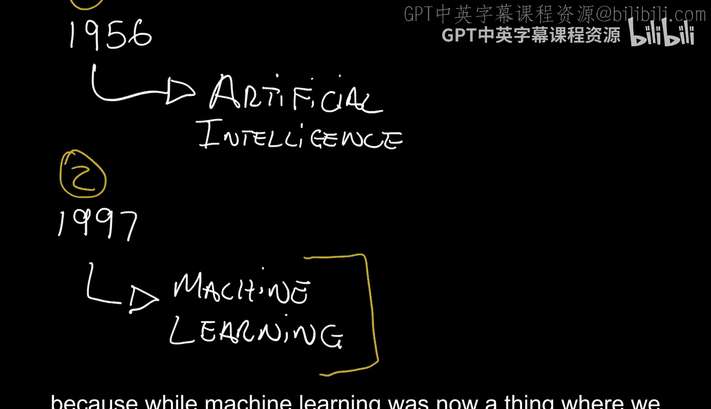

上一节我们概述了课程目标，本节中我们来看看人工智能发展史上的几个决定性时刻。

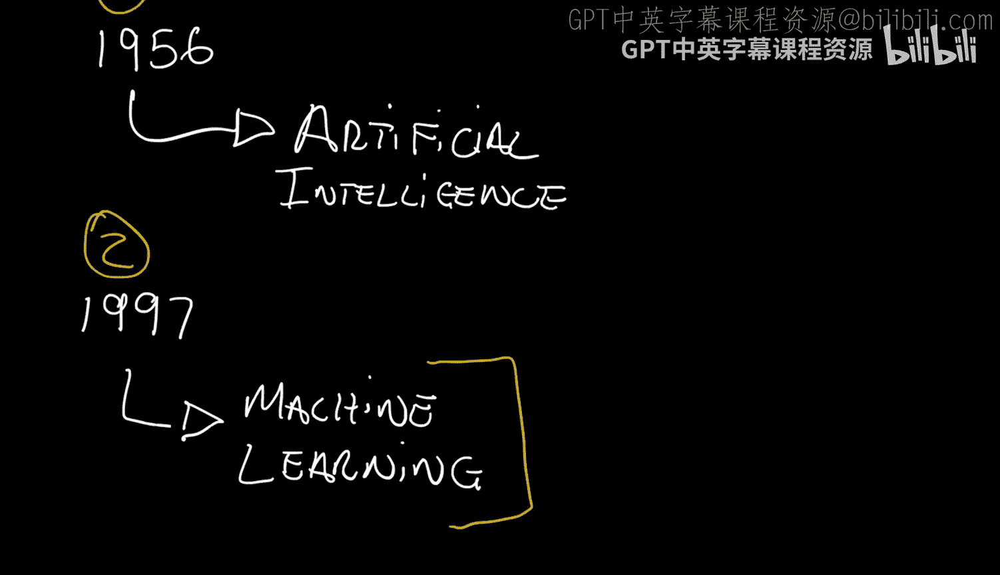

以下是人工智能发展过程中的关键节点：

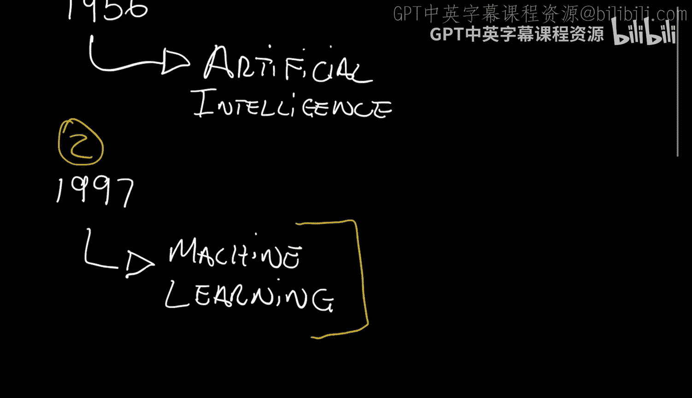

*   **1956年：AI的诞生**
    *   艾伦·图灵等人在达特茅斯会议上提出了“人工智能”的概念，标志着该研究领域的正式诞生。图灵也被誉为人工智能之父之一。他提出的核心思想是：让机器学会思考。
    *   著名的**图灵测试**也在这一时期被提出，用于判断回答问题的主体是机器还是人类。

*   **1997年：机器在复杂决策中的突破**
    *   IBM开发了超级计算机“深蓝”。它在国际象棋比赛中击败了世界冠军加里·卡斯帕罗夫。
    *   这一胜利具有里程碑意义。虽然当时的机器学习技术已能让机器从结构化数据中学习，但国际象棋每一步都存在海量可能性。深蓝的胜利证明了AI系统有能力在特定复杂领域超越顶尖人类。

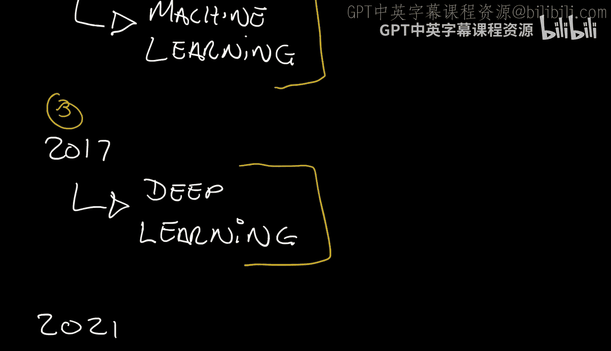

*   **2017年：新架构与新的挑战**
    *   谷歌推出了AI系统“AlphaGo”，它在更复杂的围棋游戏中击败了人类冠军。围棋的可能性数量远超国际象棋。
    *   与此同时，**Transformer**架构被引入。这是一种高效的自然语言处理机制。
        *   **核心机制**：Transformer能够处理文本、口语、翻译等自然语言，并理解其内在特征。其核心是**自注意力机制**，公式可简化为 `Attention(Q, K, V) = softmax(QK^T/√d_k)V`，它允许模型在处理一个词时关注输入序列中的所有相关词。
    *   这项突破为后来的生成式AI大发展奠定了基础。

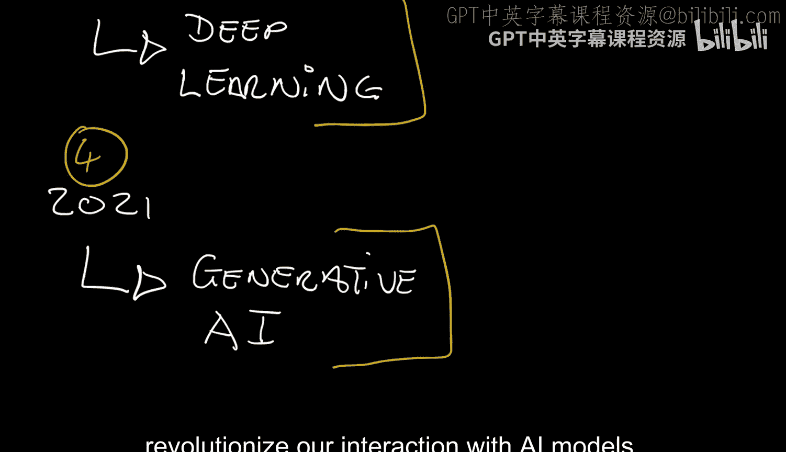

*   **2021年：生成式AI的兴起**
    *   **GPT-3** 等大型语言模型达到了足够的性能水平，开始被广泛用作生成式AI。
    *   GPT-3的参数量非常庞大，使得人们可以与之进行交互。这彻底改变了我们与AI模型的互动方式，并催生了像ChatGPT这样如今无处不在的服务。

## 总结

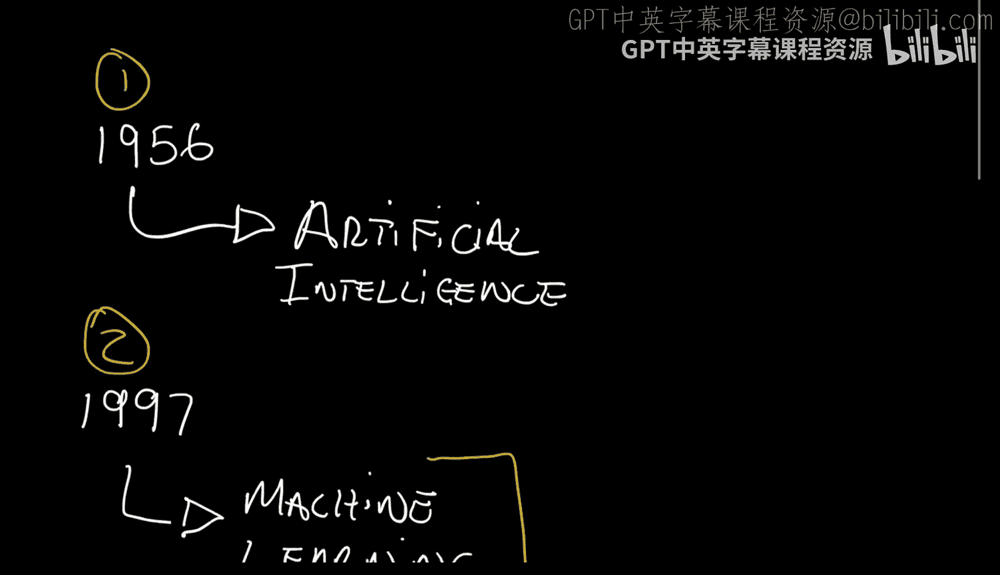

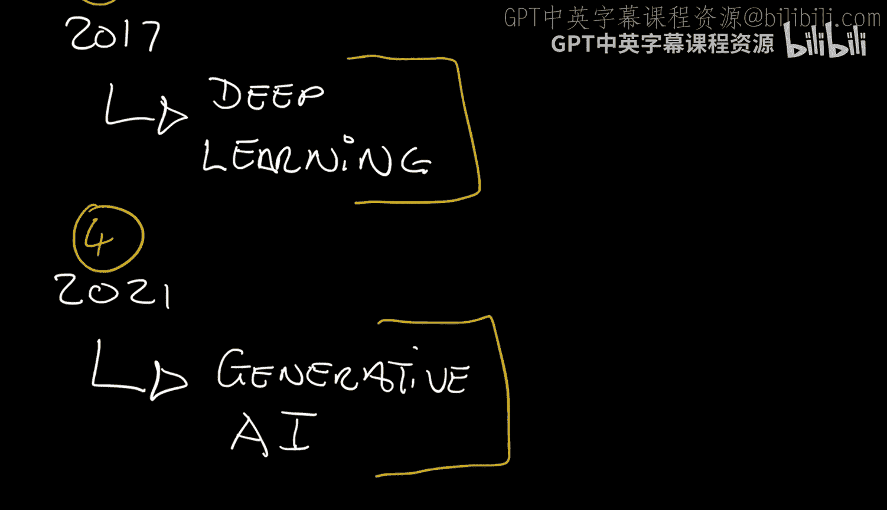

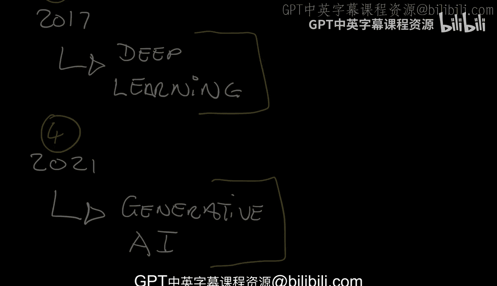

本节课中，我们一起学习了人工智能从1956年诞生到2021年后生成式AI爆发的简要历史。可以看到，AI的发展在近年来显著加速，特别是在大型语言模型领域。不仅ChatGPT，许多其他开源和商业模型都在快速推进。我们可以预见，未来AI不仅会有更多突破，而且变革的步伐会越来越快。