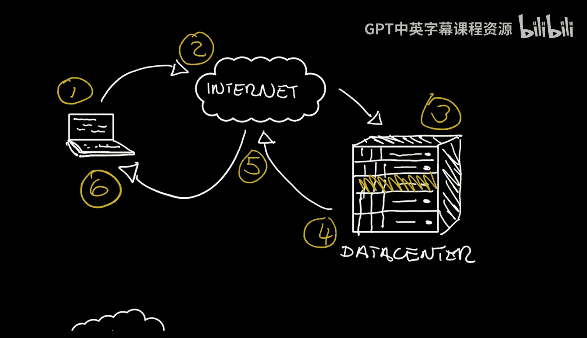
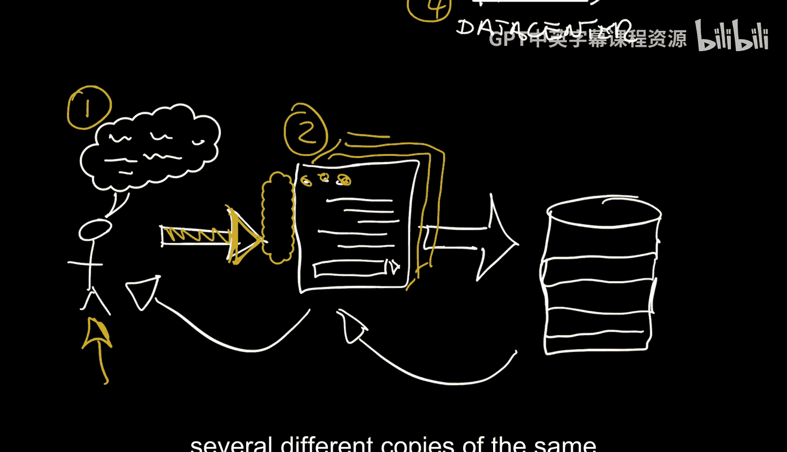
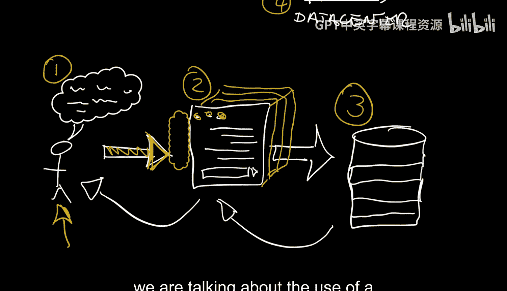
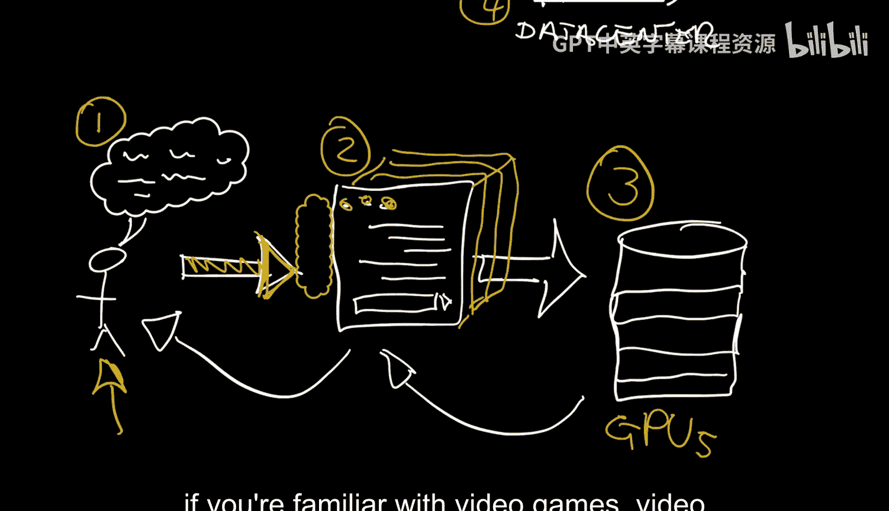
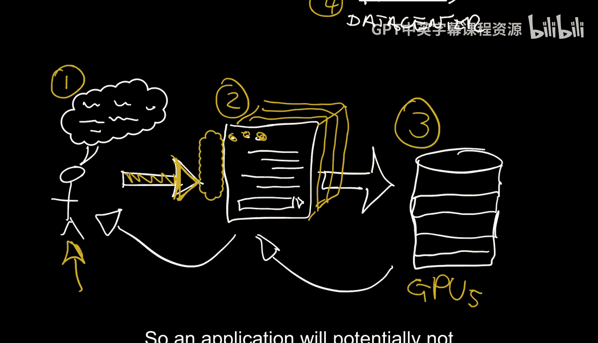
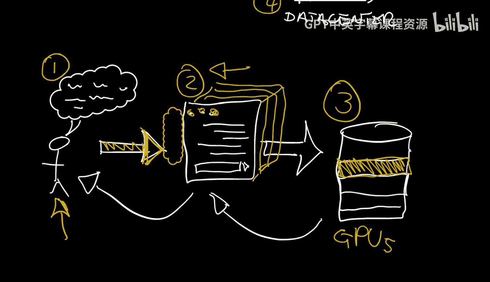
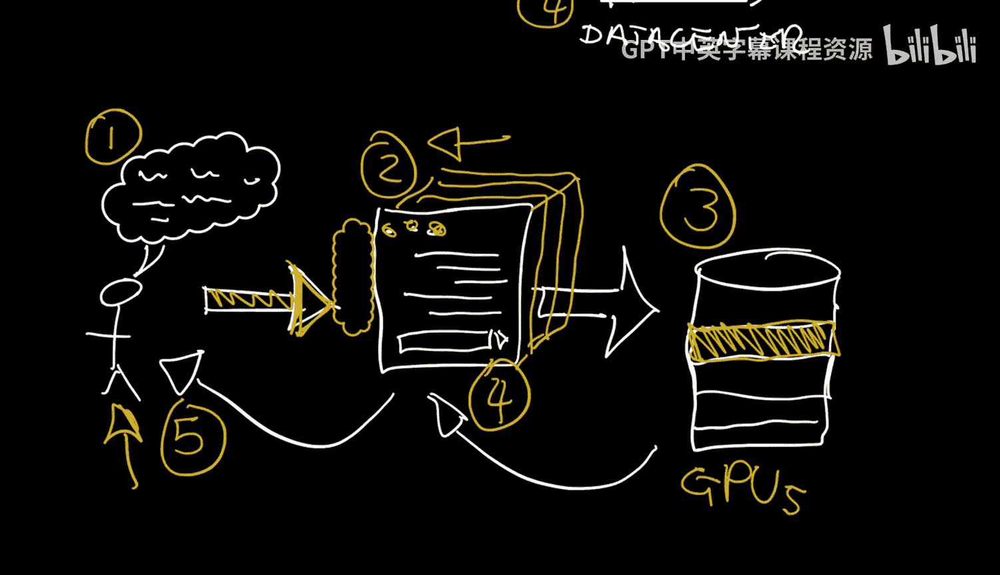
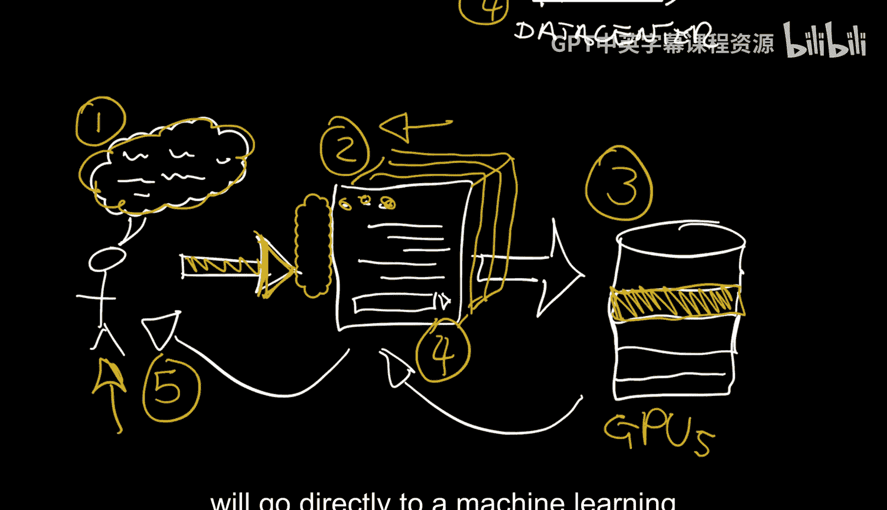
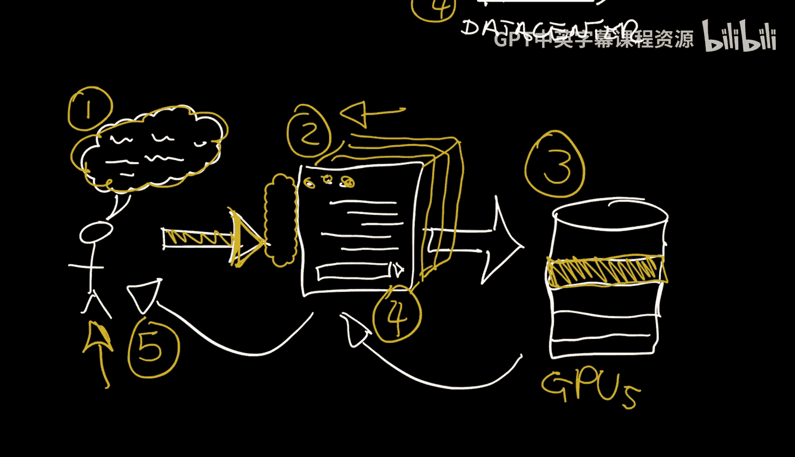
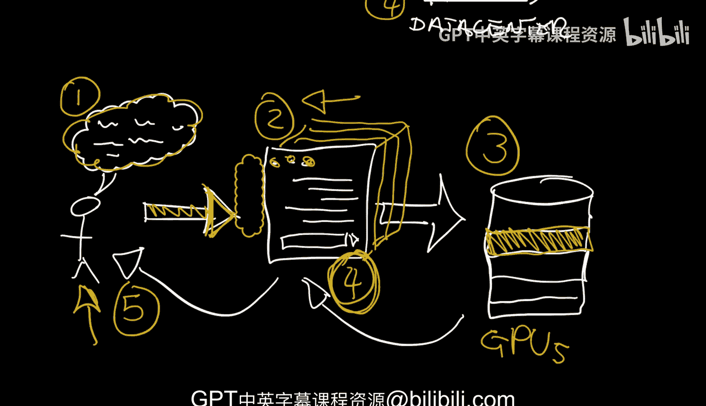

# 大型语言模型实践：P7：大型语言模型在应用中的工作原理 🧠

在本节课中，我们将要学习大型语言模型（LLM）在面向用户的应用中是如何工作的。我们将从用户界面开始，逐步深入到数据中心、应用代码、GPU处理等环节，了解一个完整的生成式AI应用的工作流程。

---

## 用户界面与互联网连接 💻

当我们谈论生成式AI时，主要指的是面向用户的应用。这些应用如何工作呢？让我们从最左边的用户界面开始。你可能已经体验过，即使你不是软件工程师或机器学习专家，也可以通过电脑连接互联网，访问像ChatGPT这样的网站来使用这些服务。互联网使我们能够连接到这些服务。

## 数据中心与云端服务 ☁️

这些服务通常运行在一种数据中心里。当我们谈论数据中心或“云端”时，指的是那些在多个地点拥有数据中心的大型公司，他们的应用程序就托管在这些数据中心的某个服务器上。其中一台服务器会负责处理你的请求并提供答案和功能。

本质上，大多数互联网应用的工作方式非常广泛：通过互联网连接到某个数据中心的计算机，然后该计算机产生某种输出，输出再通过互联网传回给用户界面。

## 应用代码与可扩展性 ⚙️

上一节我们介绍了基本的连接流程，本节中我们来看看应用内部的复杂性。应用通常比这更复杂一些。我们从最开始的用户提示（Prompt）开始。在生成式AI或AI应用中，我们总是讨论某种输入。

这个输入会进入**应用代码**。应用代码可能运行在一台或多台服务器上，这取决于输入量的可扩展性需求。通常，大多数系统都会接入某种云环境。

云环境允许应用程序自动扩展，并具有弹性。如果你不熟悉“云”，它基本上允许应用程序根据需求增长或收缩。想象一下，用户突然从一个人变成一百万人，这个应用如何工作？云的工作方式是创建同一应用的多个副本，进行复制和扩展。

## GPU：人工智能的专用硬件 🎮

那个应用可能会被分成不同的部分或区段。一部分肯定是应用本身，另一部分是实际的数据，或者对于大多数人工智能工作负载来说，是一个计算更密集的系统。

我们谈论的是使用一种称为**GPU**的特定硬件。GPU代表**图形处理单元**。在个人电脑起步时，GPU基本上使计算机能够处理图形，处理那些让计算机具有交互性的东西。例如，电子游戏之所以可能，就是因为GPU。

这些图形处理单元允许人工智能进行海量计算，使我们能够实现生成式AI等功能。因此，一个应用程序可能不仅执行第二步这里的代码，还会尝试使用数据中心、云端某处部署的某个机器上的GPU来进行密集计算工作。

## 完整工作流程与决策 🔄

现在有不同类型的应用程序，我们稍后会介绍其中几种。但本质上，这就是我们所看到的情况：处理过程会返回给应用程序。

应用程序将根据生成的数据做出一些决定，然后最终返回给用户。有一点我需要确保你理解：用户输入在第一步直接进入机器学习模型或大型语言模型的情况很少见，甚至根本不会发生。

它通常会经过一个应用层，以及许多其他潜在层，到达GPU进行处理，然后返回应用程序。正如我在第四步提到的，应用程序会做出一些决定，然后返回给用户。

---

本节课中我们一起学习了大型语言模型应用的基本架构。我们了解了从用户提示开始，经过互联网、云端服务器、应用代码处理，到利用GPU进行密集型计算，最后再将结果经过应用决策返回给用户的完整流程。关键在于理解，用户输入并非直接与模型交互，而是通过一个多层级的应用架构来协调处理。