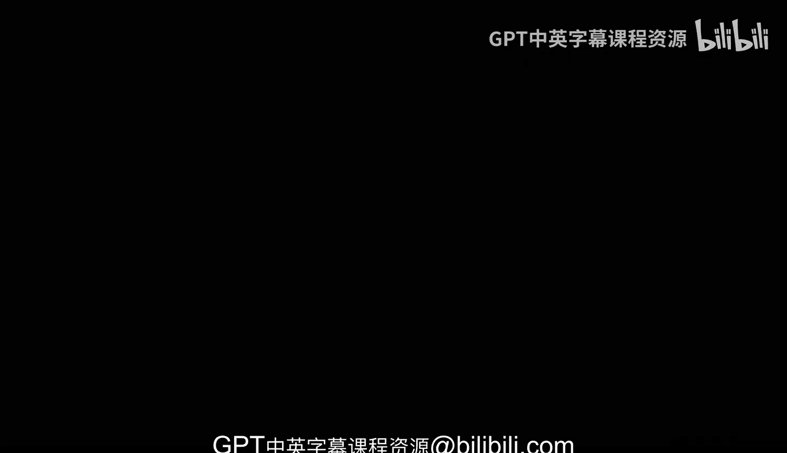
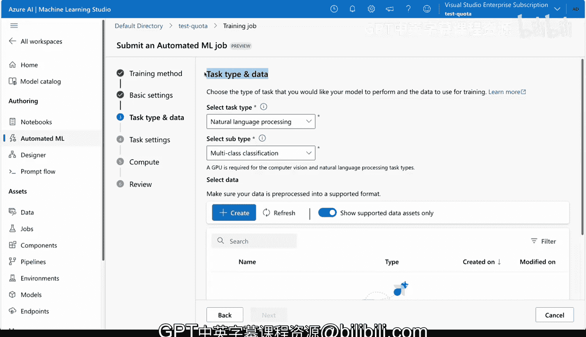

# 大型语言模型实践：1.1：大型语言模型的创建方式 🏗️

在本节课中，我们将要学习大型语言模型是如何被创建出来的。这是一个非常基础和概览性的介绍，旨在帮助初学者理解其背后的核心概念和基本流程。

## 概述

创建大型语言模型是一个复杂的过程，通常涉及海量数据的收集、清洗和训练。本节将首先通过不同来源的定义来理解其概念，然后通过一个云平台示例来直观展示机器学习模型的训练设置，从而类比理解大语言模型的创建步骤。

## 理解大型语言模型

首先，我们来看看如何定义大型语言模型。如果你从未接触过机器学习相关内容，可能会感到有些困惑，但我们将从基础开始。

我们以维基百科的定义作为起点。选择维基百科的原因是，它通常提供广泛而概括的答案，这有助于我们获得一个宏观的认识。

根据维基百科，大型语言模型是一种因其强大能力而著称的语言模型。然而，它并没有详细说明如何具体创建一个这样的模型。这引出了一个关键点：通常，个人或普通团队并不会从头开始构建一个大型语言模型，这是不常见的。

本质上，创建过程涉及获取数据，然后利用这些数据来训练模型，最终使其能够生成输出。维基百科的描述虽然宽泛，但指出了核心：你需要处理作为数据源的数据集。

## 数据准备的核心

数据准备是创建模型的起点。这个初始阶段至关重要。

以下是数据准备过程中需要考虑的几个关键方面：
*   **数据来源与规模**：例如，想象一下抓取互联网上所有可用的文本，你可能会得到大量无用的或有毒信息。
*   **数据清洗**：因此，你需要进行数据清洗，确保数据符合你的要求。例如，如果你在医疗领域，只想收集与医疗相关的数据，那么确保数据是匿名且不包含个人可识别信息就非常重要。
*   **领域针对性**：数据相关工作涉及许多方面，需要根据目标进行精心处理。

## 模型的训练过程

接下来是训练阶段以及其具体工作原理。你将使用不同类型的训练方法。

这些方法将使你最终得到一个真正的大型语言模型。现在，我想转向另一个描述，这次是基于微软学习平台的定义。

一个大型语言模型是一种能够处理和生成自然语言文本的人工智能。它通过从海量数据（如书籍、文章、网页，在生成式AI中还包括图像）中学习，来发现语言的模式和规则。

这正是我想强调的部分：它是如何具体实现的。基于海量文本（这就是为什么列出书籍、文章和网页），在某些涉及图像的生成式AI中还包括图像数据，模型通过训练来发现这些语言的模式和规则。

## 实践窥探：云平台训练示例

我不会去实际创建一个大型语言模型，但我想使用一项云服务来展示这个过程。这里我们将使用 Azure AI 机器学习工作室，这是 Azure 提供的一项云服务，允许你进行一些训练。

我只是展示一下实际尝试训练机器学习模型时，这个过程看起来是什么样的。我们将从这里开始，使用“自动化 ML 作业”。我知道我还没有具体介绍平台是什么、我们在那里做什么以及如何到达这里，但让我们先专注于一些概念。

你基本上需要理解训练方法，设置一些参数、任务类型和数据。

然后，你需要某种计算系统，接着就可以启动作业开始训练。让我们看看这里有什么：我们将进行自动化训练，创建一个自动化机器学习作业。这意味着我们将让机器来决定何时训练得足够好，可以停止。

我们进入基本设置。在这里，我们需要设置作业的名称。然后，在“任务类型和数据”部分，这是我想重点关注的，我们必须始终理解你要进行什么类型的训练。

如果我点击这个下拉菜单，你会看到有不同类型的训练：分类、回归、时间序列预测。

例如，分类允许你预测是或否、蓝色/红色/绿色、开或关。想象一下，如果你想创建一个机器学习模型，使其能够根据特定文本来理解一个故事是否开放，那么你将需要多种不同类型的数据来定义开放和关闭的状态，并基于这些数据进行训练。

对于基于或创建大型语言模型的机器学习模型，你会进行自然语言处理（NLP）。它基于纯文本数据类型，使用多类或多标签分类进行预测。这些是大词和术语，本质上意味着你将使用大量纯文本来训练你的模型，使其能够基于特定语言来理解如何处理语言。

## 训练任务设置

一旦你决定了任务类型，接下来就需要选择具体的分类方式。

以下是几种主要的 NLP 分类任务：
*   **多类分类**：预测每个样本的正确类别。
*   **多标签分类**：预测每个样本的所有类别。
*   **命名实体识别**：从结构化文本中提取特定领域的实体。

这里涉及很多内容，但归根结底，这就是你如何设置一个能够创建类似大型语言模型的东西的方式。请注意，我只是在举例说明如何创建一个机器学习模型。

## 创建真正大语言模型的挑战

对于一个真正的大型语言模型，过程会复杂得多。它肯定从数据开始，但我没有海量的文本数据来训练，所以这实际上不是一个好的用例。

正确的方式是组建一个完整的数据科学家团队，他们理解深度学习概念（如神经网络及其工作原理），懂得如何以能够实际创建模型的方式处理数据，并且拥有使用多个 GPU 和基础设施进行训练的能力。但这应该能让你很好地了解这个过程可能是什么样子，以及可能涉及哪些步骤。

再次强调，随着课程的深入，你会听到我多次提到数据。我们需要海量的数据，而且这些数据不仅要量大，还必须像之前描述中看到的那样，是干净的。

## 总结

本节课中，我们一起学习了大型语言模型创建的基本框架。我们了解到，创建过程始于海量、高质量的数据准备，包括收集、清洗和领域聚焦。接着，通过特定的训练方法（如自然语言处理中的分类任务）让模型从数据中学习语言的模式。虽然实际创建一个大语言模型需要专业的团队和巨大的计算资源，但通过云平台（如 Azure）的示例，我们直观地看到了训练一个机器学习模型的核心设置步骤，从而类比理解了构建大语言模型的复杂性与核心流程。记住，**高质量的数据**和**正确的训练任务**是其中的关键。