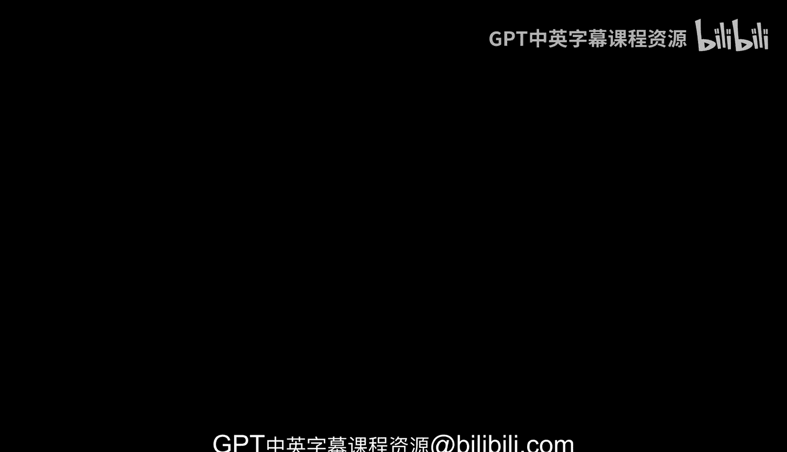

# 大型语言模型实践：1.1：人工智能简史与现状 📜

在本节课中，我们将回顾人工智能的发展历程，了解其当前所处的阶段，并初步探讨大型语言模型的创建与应用基础。

我们得以窥见人工智能历史的一角，了解我们今日所处的位置。我们看到了那些引领我们走到今天的关键事件。正如你所见，整个人工智能领域的创新正在加速，这不仅仅局限于我们当前所处的生成式AI阶段。我们可以预见，事物将继续以极快的速度演进，发展将持续保持极高的速度。

上一节我们回顾了AI的发展脉络，本节中我们来看看大型语言模型是如何被创建的。

我们还简要了解了大型语言模型的创建过程及其所需条件。我们现在知道，这需要海量的数据。这个过程有些复杂，我们将在后续课程中深入探讨这些模型的本质。但凭借目前关于模型工作原理及其在不同应用中表现的基础知识，以及对生成式AI一些应用场景的了解，你将为进一步理解大型语言模型背后的细节做好准备。

以下是生成式AI的一些主要应用方向：
*   内容创作与文本生成
*   代码编写与辅助
*   语言翻译
*   问答与知识检索
*   对话与聊天机器人

本节课中我们一起学习了人工智能的简要发展历程、当前创新的加速趋势，以及构建大型语言模型所需的海量数据基础。这些知识为我们后续深入理解大型语言模型的细节奠定了基石。