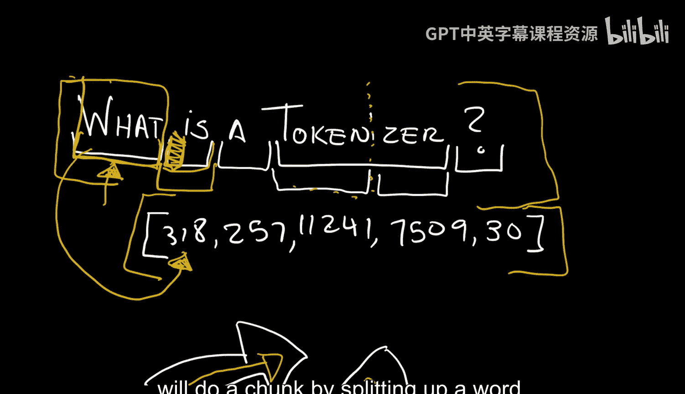
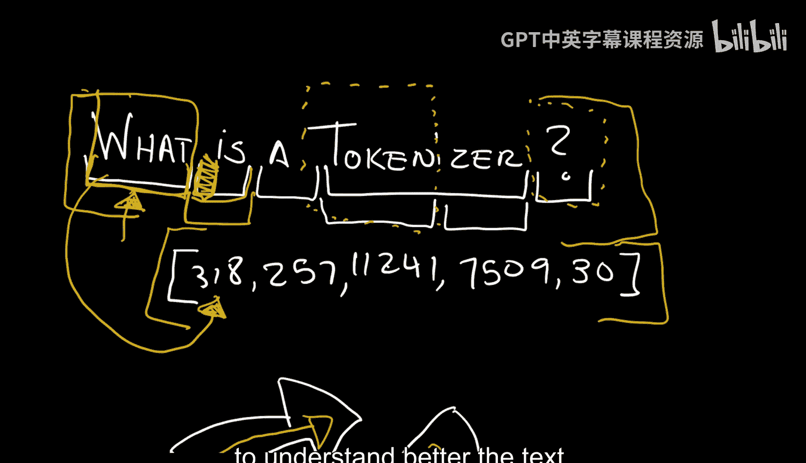
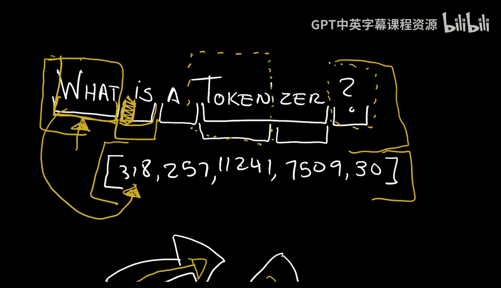
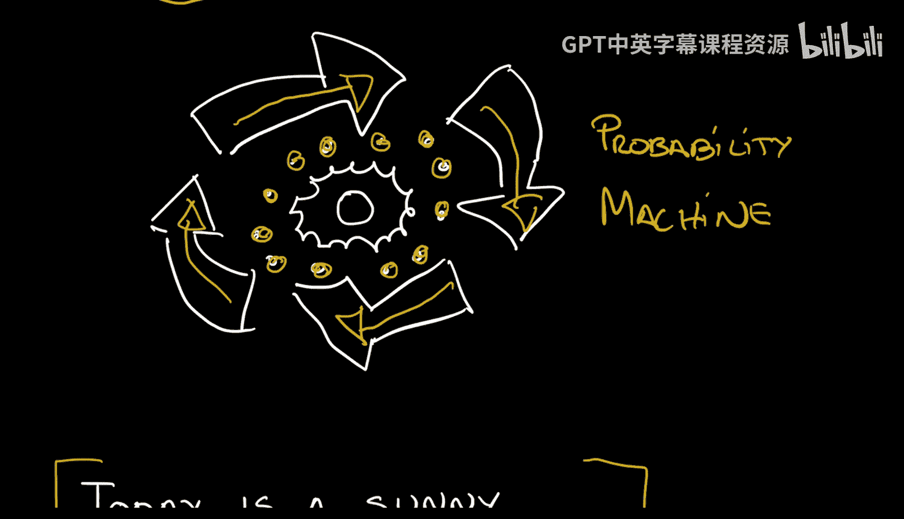
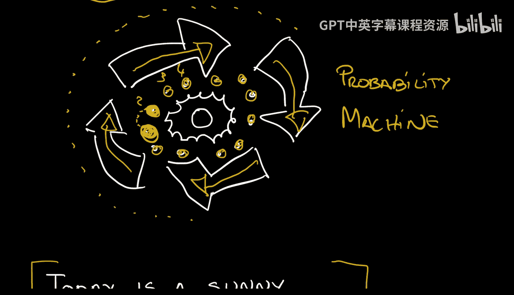
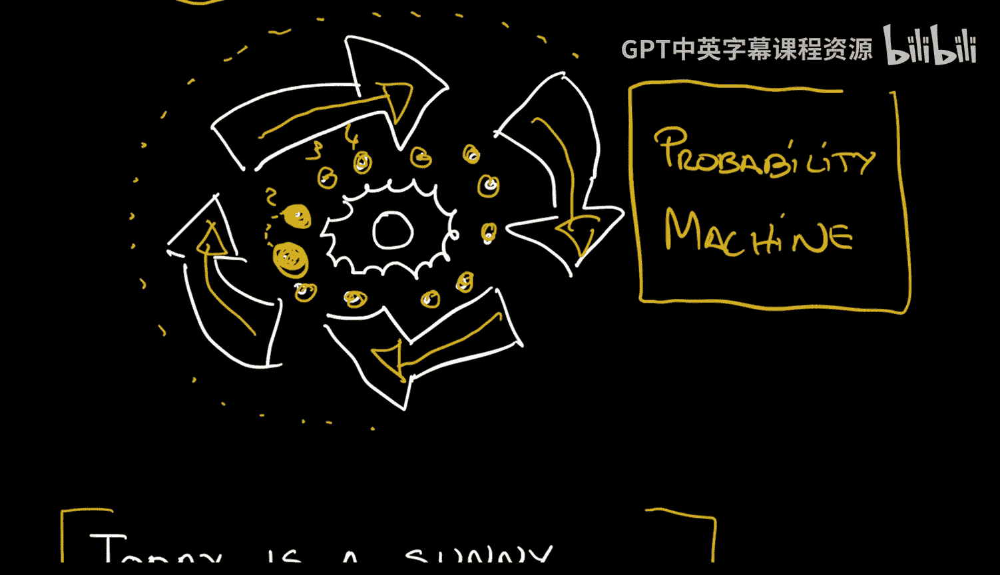
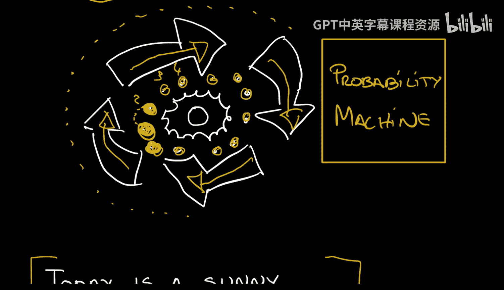

# 大型语言模型实践：1.3：什么是大型语言模型及其工作原理 🧠

在本节课中，我们将要学习大型语言模型（LLM）的基本概念及其核心工作原理。我们将从理解文本如何被模型处理开始，逐步揭示其作为“概率机器”的本质。

## 概述

要理解大型语言模型及其确切的工作原理，我们首先需要从“词元”开始，了解什么是“词元化器”。大型语言模型以文本作为输入，并生成文本作为输出。但这个过程具体是如何发生的呢？它通过将输入的文本分解成更小的片段，并将这些片段转换为数值来实现。

## 从文本到数字：词元化

上一节我们提到了模型处理文本的起点。本节中我们来看看文本是如何被转换成机器可以理解的格式的。

一段文本，例如“what is a tokenizer”，会通过一个称为“词元化”的过程被转换成数字。这个过程将文本分割成更小的块，我们称之为“词元”。每个词元随后会被转换成一个数值。

例如，词元“what”可能被转换为数值 **318**。所有词元最终都会被转换成数字，并放入一个数组中。这种方式使得机器能够处理它们，并尝试更好地理解这些由数值表示的片段。

我们实际上是在创建一个索引。这个索引是对原始文本块的编码。我们称之为“块”或“片段”，是因为划分方式并不总是以单词为单位。

以下是词元化可能产生的一些片段示例：
*   单词本身，如“what”。
*   可能包含一些空格。
*   一个单词可能被拆分成两部分。
*   标点符号，如问号，也可能单独成为一个词元。

所有这些表示方法都旨在让机器学习模型更容易理解文本。这是目前让机器理解文本的最佳方法。这个过程就是文本的分析、分解或分割，将其转化为数值。

## 核心机制：概率机器

在了解了文本如何被转换为数字之后，我们现在可以探讨模型的核心工作机制。我喜欢将大型语言模型称为一个“概率机器”。

为什么是概率机器？模型试图理解所有这些小的文本块（词元），并尝试预测从一个词元到下一个词元的概率。简而言之，给定一个词元序列，模型会计算下一个最可能出现的词元是什么。

这是一个极度简化的解释：它本质上就是一个基于海量文本训练得出的概率计算器。机器学习模型会尝试根据给定的文本片段，确定所有可能的后续词元的概率。

这一点非常重要，需要强调：大型语言模型本质上就是一个概率机器。这样思考这些模型会更容易理解，因为有时它们表现得非常出色，像一个能吐出事实的机器。

即使某些生成的文本看起来准确、正确且符合现实，我们也不应将其视为事实生成机。它所做的一切，都只是基于给定特定输入和大量训练文本，计算下一个词元可能是什么的概率。

## 实例解析：理解概率预测

为了更具体地理解概率预测，让我们看一个例子。

假设我们有一个短语：“今天天气晴朗，并且……”。这个短语是理解“……”部分可能是哪个特定词的完美例子。

在这种情况下，“今天天气晴朗，并且”后面很可能是“一天”。这意味着什么？基于大量的训练文本、对这些文本进行词元化处理后生成的索引，机器理解到，在这里你很可能想要的是“天”这个词，甚至前面可能还有一些空格，以确保生成的文本格式正确。

## 总结

本节课中，我们一起学习了大型语言模型的基本工作原理。

首先，模型通过**词元化**过程将输入文本分解并创建索引，转换为数值数组。这是机器理解文本的基础。

随后，模型作为一个**概率机器**运行。它基于从海量文本中学到的模式，计算给定词元序列后下一个词元出现的概率，并以此生成文本。

记住，LLM的本质是概率预测，而非事实检索。理解这一点是有效使用和评估大型语言模型输出的关键。