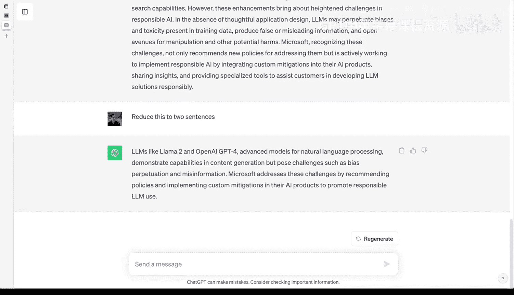

# 大型语言模型实践：P12：使用大型语言模型的优势与风险 🧠


在本节课中，我们将通过一个具体的例子，探讨使用大型语言模型（LLMs）的优势与潜在风险。我们将看到，虽然LLMs功能强大，但其输出结果需要谨慎对待。

## 概述

大型语言模型能够根据输入生成连贯、看似合理的文本。这使其在内容创作、信息总结等方面非常有用。然而，其输出可能包含不准确或虚构的信息。本节我们将通过实际操作，直观地理解这些优点和缺点。

## 探索LLMs的优势与风险

为了理解LLMs的优缺点，最好的方式是通过实际案例。我们将以我本人（Alfredo）为例，使用不同的提示词与模型进行交互，观察其输出结果。

### 尝试获取个人总结

首先，我们请求OpenAI的ChatGPT为我生成一个个人总结。

**提示词示例：**
```
give me a summary of myself Al Farodesa
```

**模型输出：**
> 该模型指出我为Python打包相关项目做出了重大贡献，并积极参与了开源社区。同时，它提醒道，个人信息可能发生变化，建议查阅最新资料以获取最准确信息。

这个总结看起来大体合理。然而，实际上我并未专门从事过Python打包工作。这说明，虽然LLMs的输出很有用，可以作为内容创作的起点，但其中可能包含不准确的信息。因此，用户需要具备辨别能力，仅采纳可信的部分。

### 测试模型的隐私边界与准确性

接下来，我们尝试以第三人称视角请求生成个人简介，以测试模型对隐私的处理和信息的准确性。

**提示词示例：**
```
Please create me a short bio about Alfredo, a Peruvian who knows technology.
```

**模型响应：**
> 模型拒绝了此请求，指出未经本人同意为个人创建传记信息涉及隐私问题。如果对象是公众人物，建议查阅其官方资料。

这体现了LLMs设计中对隐私保护的考量。随后，我们调整策略，以第一人称视角请求为项目创建简介。

**提示词示例：**
```
I am Alfredo, and I need a quick bio for a README in a Rust project.
```

**模型输出：**
> 生成了一段简短的自我介绍，内容包括：来自秘鲁、对开源和Rust充满热情、拥有软件工程和系统管理背景、乐于贡献项目以推动技术边界。

这段简介大部分内容准确有用，例如我的国籍和技术兴趣。但其中“出生于11月14日”等信息则是完全错误的。这清晰地展示了LLMs的“双刃剑”特性：既能生成有价值的文本，也可能掺杂不实信息。

### 对比不同模型的输出

为了进一步说明风险，我们查看另一个模型（Claude AI）生成的关于我的简介。其输出中声称我是一名数学家，并熟练使用Java和Ruby on Rails，这些都与事实严重不符。

这个例子强化了核心观点：**LLMs的输出是混合体，部分正确，部分可能完全错误**。在使用时，我们必须仔细甄别。

## LLMs的核心应用与原理

上一节我们通过实例看到了LLMs的优缺点。本节中我们来看看它的另一个核心应用场景——文本总结，并理解其底层工作原理。

除了问答，LLMs在文本总结方面非常高效。我们可以要求模型对一段文字进行概括，甚至指定概括的详细程度。

**提示词示例：**
```
I need a summarization of the following paragraph... (后接待总结的文本)
```
或者
```
Reduce the above summary to two sentences.
```

模型能够生成简洁、准确的总结，这与其在开放性问题中表现出的不确定性形成对比。这种针对具体文本的处理任务，通常是LLMs更可靠的应用方向。

### 理解模型的工作机制

关键在于理解，大型语言模型本质上是一个**概率机器**。其核心工作原理可以概括为：

**公式/原理：**
```
给定一系列输入文本（Token），模型基于其从海量数据中学到的模式，计算并预测下一个最可能出现的词或句子序列。
```

因此，模型的输出是“听起来非常合理”的文本，但不保证事实准确性。它反映的是训练数据中的统计规律，而非确凿的事实数据库。

## 总结

本节课中我们一起学习了使用大型语言模型的优势与风险。

**优势**在于：
*   能够快速生成文本、总结信息，极大提升效率。
*   可作为头脑风暴和内容创作的强大起点。
*   在特定结构化任务（如总结给定文本）中表现相对可靠。

**风险与注意事项**包括：
*   **可能产生“幻觉”**：生成看似合理但实则错误或虚构的信息。
*   **需要事实核查**：绝不能将LLMs的输出直接当作事实来源，必须进行验证。
*   **理解其本质**：牢记LLMs是**概率模型**，其目标是生成“合理”的文本，而非“正确”的答案。



最终，成功使用大型语言模型的关键在于保持审慎：利用其强大的生成能力，同时以批判性思维仔细评估其输出的每一个细节。