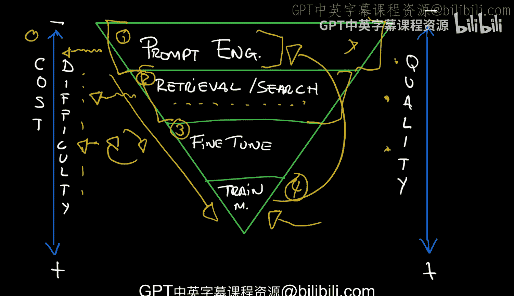

# 大型语言模型实践：13：缓解大型语言模型的风险 🛡️

在本节课中，我们将学习如何理解和缓解大型语言模型（LLMs）可能带来的风险。我们将介绍四种主要的风险缓解策略，并分析它们在实施难度、成本和输出质量方面的权衡。

为了有效缓解并深入理解如何降低大型语言模型的风险，下面这张图表非常有用。

## 1. 提示工程 💬

我们从最顶层的“提示工程”开始。提示工程是我们向专门从事语言生成的机器学习模型提供输入、准确描述问题或需求的方式。当我们精心设计一个高质量的提示时，我们通常会得到更好的结果。

在图表顶部，这代表了最容易实施的方法。它的难度最低，是您在这个层面上最容易做的事情。随着我们向下深入，难度和成本都会增加。提示工程的成本**几乎为零**，难度也**非常低**。这意味着我们的主要任务是为机器学习模型提供一个良好的输入描述。

然而，在质量方面，我们得到的结果质量可能较低。即使我们有一个非常好的提示，如果模型本身不擅长手头的任务，效果也会有限。例如，如果您试图获取与特定国家法律程序或法律问题相关的准确回答，而模型没有接受过相关训练或不具备相关知识，那么仅靠提示工程可能帮助不大。

## 2. 检索增强生成（RAG）🔍

接下来，我们讨论检索或搜索，即检索增强生成。这意味着我们可以将搜索与提示工程结合起来。

具体做法是，您可以先根据提示内容进行搜索，然后将搜索结果作为提示的一部分输入给模型。这种方法本质上比单纯的提示工程要复杂一些，也会涉及更高的成本。可以说，它比提示工程的成本更高。

为了实现检索增强生成，您需要某种存储系统和搜索引擎。质量方面，相比单纯的提示工程，其输出质量会有所提升。例如，某些模型是基于过去事件训练的，可能存在信息过时的问题。通过检索增强生成，您可以不断用更新、更相关的数据来更新搜索内容，从而缓解这个问题。

## 3. 微调 🎯

继续深入，我们将进入“微调”环节。微调要复杂得多，您需要**海量的数据**，并且需要一个**持续的过程**来用这些额外数据训练模型。

微调的难度远高于检索增强生成或提示工程，当然成本也更高。为了快速完成微调，您可能需要使用一些**GPU**。然而，如果微调执行得当，您将获得更高的输出质量。就个人偏好而言，我仍然更倾向于使用检索增强生成和提示工程，因为微调的难度较大。

## 4. 从头训练模型 🏗️

最后一项，我在这里标为第四点，就是“从头训练模型”。这正是大多数大型语言模型必须做的事情，因为它们需要生成一个全新的模型。

这将是**难度最高**且**成本最昂贵**的操作。至于质量，根据您的目标，它有可能达到最高、最好的水平。

## 总结与综合应用 📝

理解如何缓解风险，意味着您需要清楚了解所有可用的不同步骤和选项，并明白从提示工程到从头训练模型意味着什么。

这关系到成本、难度，当然也关系到质量。有些方法在缓解特定风险时可能更有效，但您通常需要结合使用一些防护措施。

需要强调的是，这些部分——例如提示工程——并不是孤立的。即使您在训练一个模型，您也**100%可以同时使用提示工程**，同样也可以结合微调、检索增强生成或搜索，将这些工具全部有效地利用起来。

因此，您对这些策略的理解越深入，您手中可用的工具和方法就越多，也就越能有效应对在处理大型语言模型时可能遇到的各种问题。

本节课中，我们一起学习了四种缓解大型语言模型风险的核心策略：提示工程、检索增强生成、微调和从头训练模型。我们分析了它们在实施难度、成本和输出质量上的权衡，并理解了这些方法可以综合运用，以构建更强大、更可靠的AI应用系统。