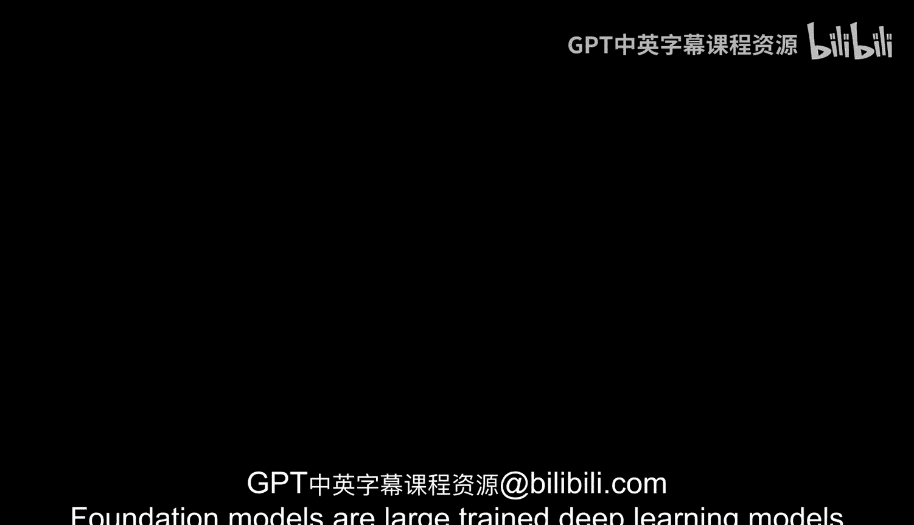
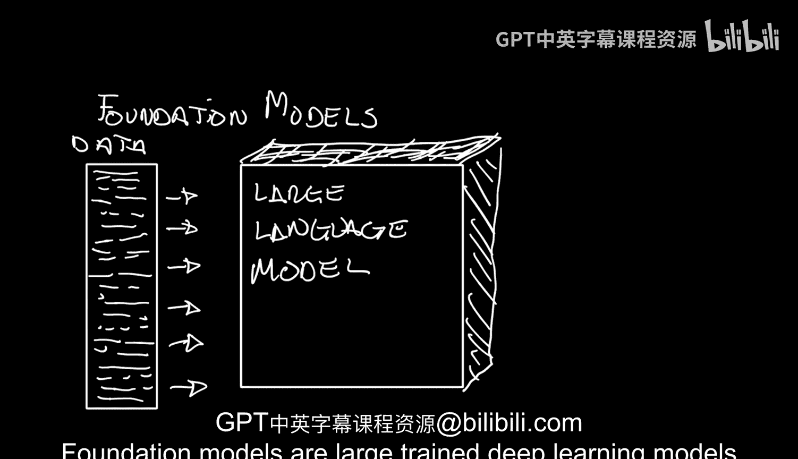
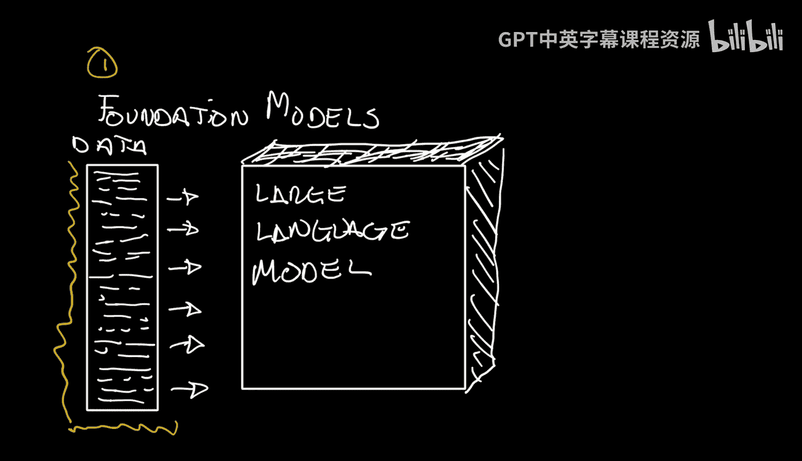
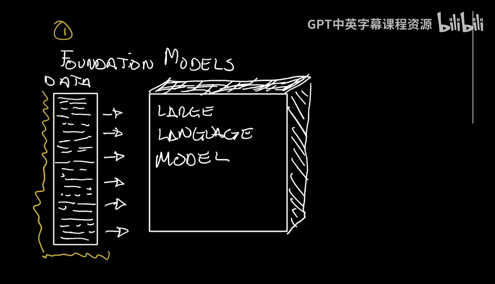
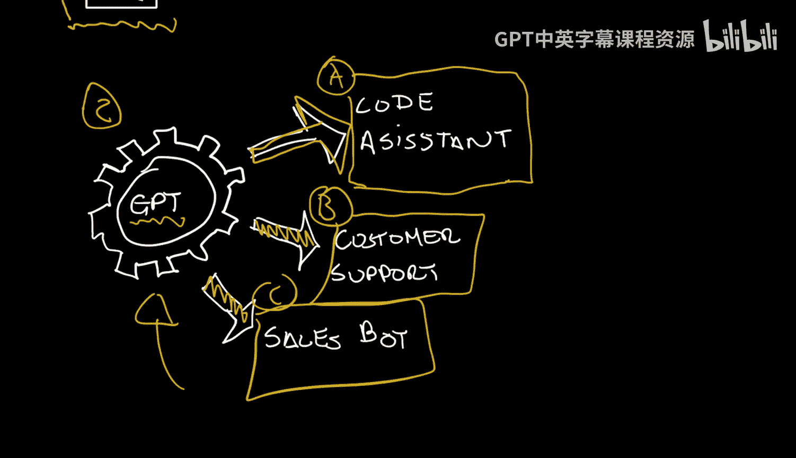
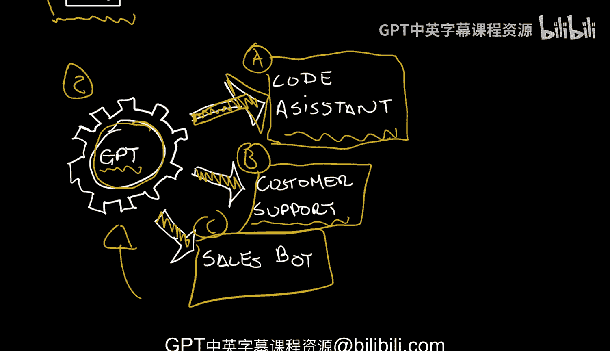

# 大型语言模型实践：1.1：什么是基础模型 🧱

在本节课中，我们将要学习**基础模型**的核心概念。基础模型是现代生成式AI应用的基石，理解它对于后续学习如何使用和定制大型语言模型至关重要。

基础模型是经过大规模训练的大型深度学习模型，它们具备很强的适应性。

这些模型在设计之初就考虑了自然语言处理，因此可以被应用于其他类型的任务。它们为构建基于AI的应用程序提供了一个坚实而优秀的起点。这里的关键点在于，这些模型建立在海量数据之上。这些数据主要是文本，正是这些文本使得大型语言模型的创建和存在成为可能。这些数据量极其庞大，并且是必要的，因为数据越多，模型的质量就越好。在这种情况下，一个非常大的语言模型就是起点。

那么，为什么说它是一个起点呢？一旦模型具备了处理自然语言多个方面的能力，就有可能将这个模型重新用于其他类型的任务。

接下来，我们来看看这些任务具体是什么。这里我们以GPT模型为例。

GPT模型可以被重新用于更具体的任务。一个常见的例子就是**代码助手**。代码助手现在变得非常普遍，开发者、软件工程师、机器学习工程师、数据科学家都在他们的开发环境中使用代码助手。这使他们能够基于大型语言模型的文本生成功能，更轻松、更快速地开发代码。在这种情况下，像GPT这样的大型语言模型提供了一个基础起点，以便可以在此基础上添加特定任务，并将其整合起来，创建一个单一用途或更具体的应用，而不是像基础模型那样通用。

另一个很好的例子是**客户支持**。你可能遇到过这样的聊天机器人：当你访问一个网站并说“嘿，我遇到问题了”，它会回应你。它会询问你遇到了什么样的问题，并根据你的描述，为你创建一张支持工单。这就是一个客户支持聊天机器人。类似地，**销售机器人**也能实现类似的功能。

然而，这些应用并非直接基于基础模型。不好的聊天机器人实现例子，就是那些没有任何过滤就直接与基础模型对话的应用程序。为了让这些应用成为可能，需要进行过滤和提供特定指令，在某些情况下，还需要对模型进行**微调**，使其适应特定任务，比如代码助手或客户支持。

以下是实现这一过程的关键步骤：
*   **过滤与处理**：在基础模型和具体任务之间，需要有一层过滤和处理机制。
*   **指令引导**：通过指令使模型的行为更具体。
*   **数据微调**：对于像代码助手这样的任务，需要让模型学习大量已有的代码数据，在理解自然语言的基础模型之上进行额外的训练。

正是这些特点使得基础模型与众不同。因此，每当你听到“基础模型”这个词时，它指的就是那些允许其他更具体任务（如代码助手、客户支持和销售机器人）得以实现的**基础模型**。

本节课中，我们一起学习了基础模型的定义与核心作用。我们了解到，基础模型是经过海量文本数据训练的大型语言模型，它为各种AI应用提供了通用起点。通过**过滤**、**指令引导**和**微调**等技术，我们可以将通用的基础模型转化为解决特定任务（如代码生成、客户服务）的专用工具。理解基础模型是理解整个生成式AI应用生态的第一步。