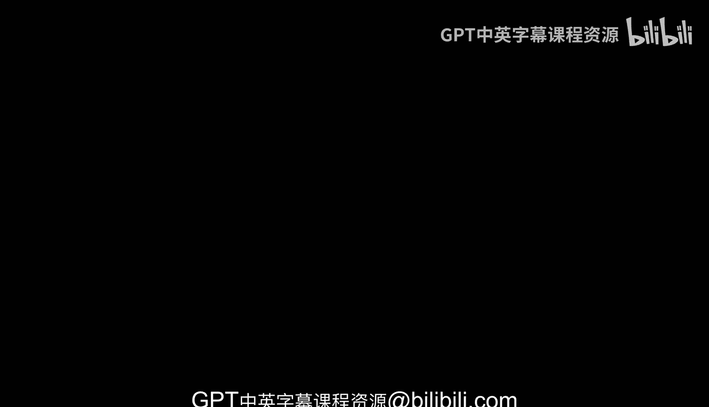
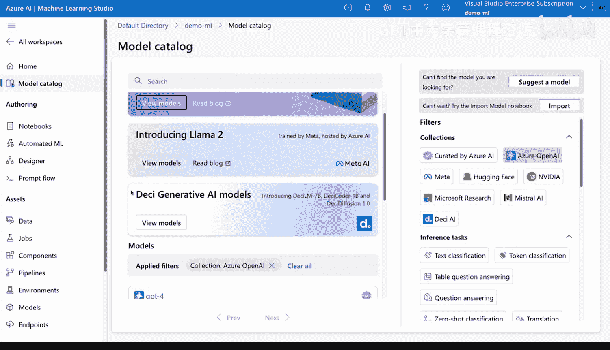
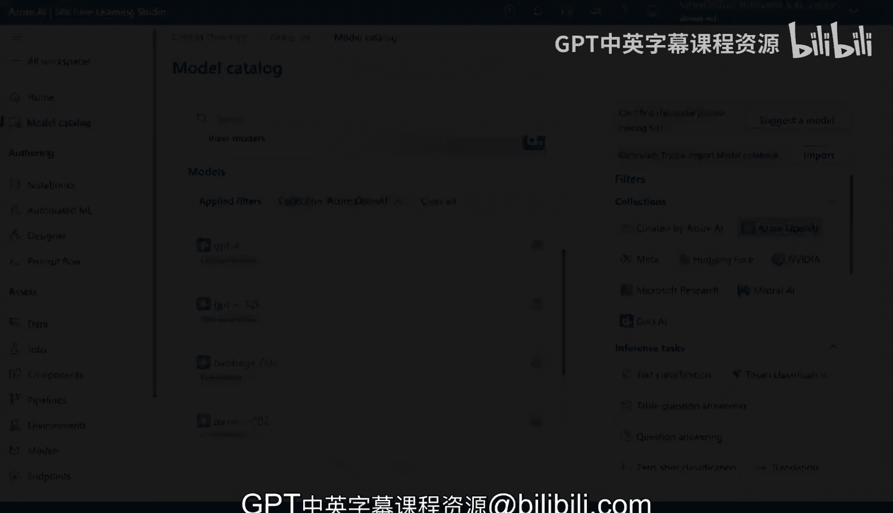

# 大型语言模型实践：1：生成式AI概览与OpenAI ChatGPT



## 概述

在本节课中，我们将学习生成式AI的概况，并重点了解OpenAI与ChatGPT。我们将从ChatGPT的起源开始，解释其基本工作原理，并澄清一些容易混淆的术语。同时，我们也会介绍其他提供类似服务的平台，例如Anthropic和微软Azure，帮助你理解整个生态系统的构成。

## 生成式AI的现状

当前生成式AI的格局可能令人有些眼花缭乱。让我们从一切的起点开始，即ChatGPT和OpenAI。

你会看到一些容易混淆的术语，以及一些被广泛使用但可能造成误解的词汇。市场上存在许多AI和AI生成公司及服务，它们有时会重复使用某些词语，这可能会带来一些困惑。

## 起点：ChatGPT与OpenAI

我们从ChatGPT开始，它是最早推出的生成式AI之一，可以说是这场变革的先驱。

在左上角，我们实际交互的是一个大型语言模型，在本例中是ChatGPT 3.5。当你开始探索这些模型时，你会发现其他选项，例如GPT-4。但目前免费版本允许使用的是GPT-3.5。这就是一切的起点，可以说是生成式AI的开端。

在这里，你可以直接通过聊天框进行交互。需要注意的一点是，你会在大多数此类服务的底部看到这样的警告：“ChatGPT可能会犯错，请考虑核实重要信息。”这一点至关重要，并且我会在整个课程中反复强调：**它不是一个事实机器**。

它不会处理或提供来自数据库的数据。它会基于概率生成内容。

例如，我们可以输入这样的提示：
```text
我正在写一个README文件或一个新项目，想扩展一些关于我自己的信息。我的名字是Ferdesa，请为我提供一个简短的描述。
```

你会发现，生成的内容不一定完全准确，需要你自己去核实事实。我们不会深入探讨这是什么以及它是如何工作的，但会探索整个格局。

## 其他服务提供商：Anthropic

尽管ChatGPT和OpenAI是最早开始这项服务的，但还有其他提供商。例如，我将向你展示Anthropic，它向我们表明还有其他选择。

这是它的欢迎界面，有一些细节说明。它再次强调了与ChatGPT相同的事情：**它可能显示不正确或有害的信息**，因为它同样不是一个事实机器。公开测试版不旨在提供专业建议（法律、金融、医疗），你完全不能依赖它。

接受所有条款后，你可以完成设置，并看到一个与开始聊天非常相似的界面。

## 云服务集成：以Azure为例

就像OpenAI和ChatGPT一样，你会发现许多服务与最初的ChatGPT非常相似。此外，云服务（例如接下来要展示的Azure）能够直接与这些模型交互，而无需通过第三方服务。

尽管这看起来可能非常复杂，但我将集中精力向你展示一些模型。我将直接转到模型目录。

在这里，你会看到一项名为“Azure OpenAI语言模型”的服务，它仅在Azure上可用。我之所以在概览中提及这一点，是因为你可能会感到困惑：为什么既有OpenAI语言模型，又有Azure OpenAI？它们之间是什么关系？

事实是，你可以在Azure内通过页面订阅与OpenAI的大型语言模型进行交互。当你在Azure上拥有某种部署和账户时，你就可以使用这些模型。

当你浏览这些模型时，你会看到GPT-4以及许多其他模型，就像我们之前看到的GPT-3.5一样。你在这里拥有这些能力，并且可以创建自己的环境来与这些模型交互。正如你所见，这些并不是唯一的模型，我们还有许多其他模型可用。其中一些功能将在我们的云服务提供商处可用。

## 核心概念澄清

理解这一点很有用：**并非一切都是ChatGPT**。OpenAI是一个独立的实体，还有其他类似的服务提供商。在像微软Azure这样的云提供商中，Azure云将允许你与其中一些模型进行特定的交互。

## 总结





本节课中，我们一起学习了生成式AI的概况，重点了解了OpenAI的ChatGPT作为该领域的起点。我们明确了ChatGPT是一个基于概率生成内容的大型语言模型，**不是一个事实机器**，使用时需要自行核实信息。我们还介绍了其他服务如Anthropic，以及云平台（如Azure）如何集成这些模型，帮助你理解了生成式AI服务多样化的生态系统。记住，关键是要区分不同的服务提供商和访问方式。