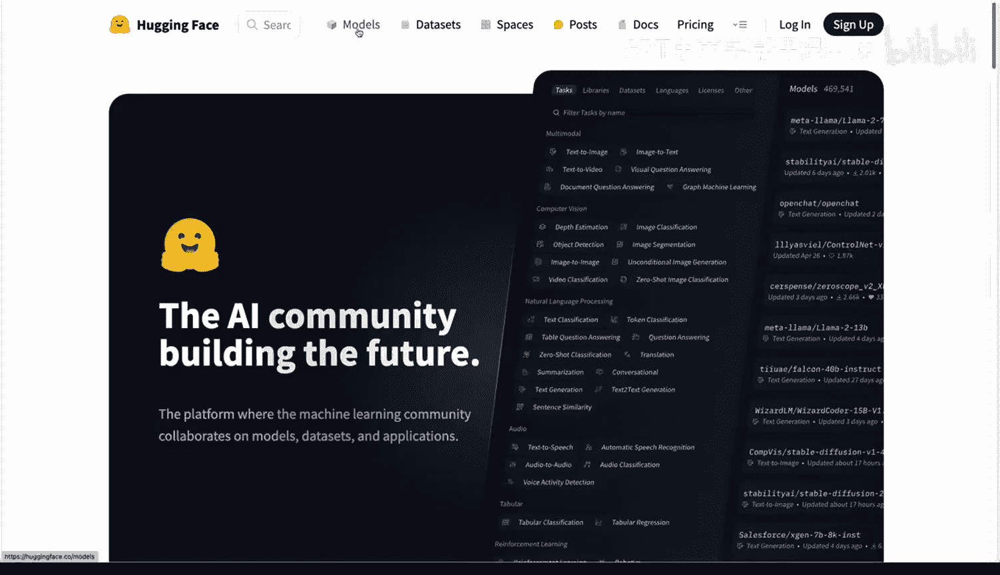
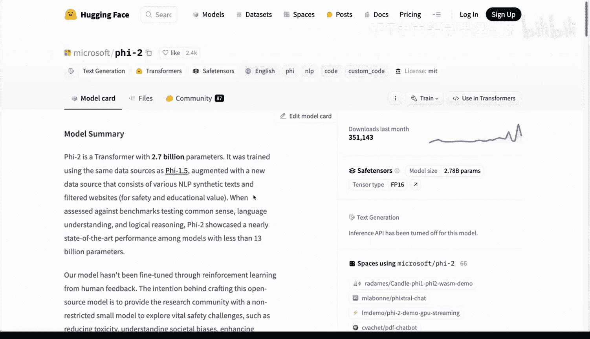
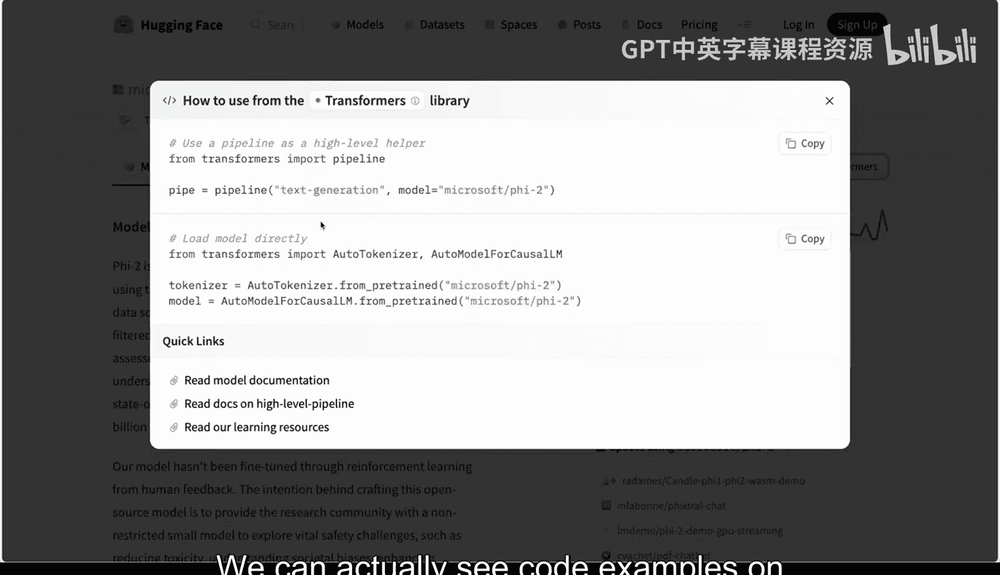
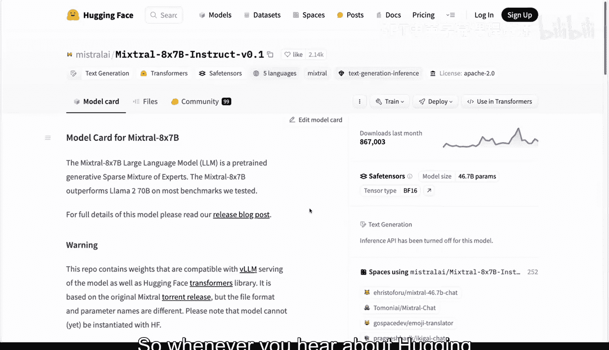
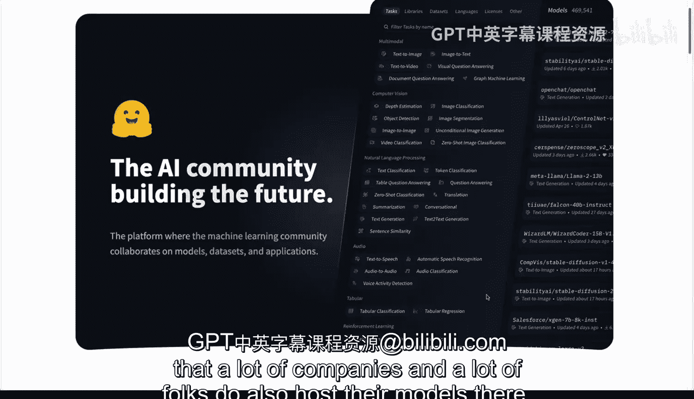

# 大型语言模型实践：1.4：Hugging Face与开源模型 🤗

在本节课中，我们将要学习Hugging Face平台及其与开源大型语言模型的关系。我们将了解Hugging Face是什么，它提供哪些核心功能，以及如何在该平台上探索和使用模型。

---

## 什么是Hugging Face？

当我们谈论开源模型时，无疑会提到Hugging Face这家公司。

Hugging Face是一家专注于……的公司，但更准确地说，Hugging Face就像一个代码仓库，一个我们可以托管和分享模型的地方。许多公司，包括许多云服务提供商，都允许将他们的模型托管在这个平台上。

因此，Hugging Face不仅是一家公司，也是一个平台，许多开源模型都托管在这里。

---

## Hugging Face平台的核心功能

那么，这具体意味着什么呢？在平台顶部，你会看到许多不同的选项：模型、数据集、空间。这些分别是什么？让我们快速了解一下。

以下是Hugging Face平台的主要功能模块：

*   **模型**：托管和分享机器学习模型的地方。
*   **数据集**：存储和共享用于训练模型的数据集。
*   **空间**：部署和演示模型应用的交互式环境。

---

## 探索模型库

上一节我们介绍了Hugging Face的核心功能，本节中我们来看看如何在其模型库中进行探索。

点击“模型”，你会看到即使是像微软这样的公司，实际上也在那里放置了模型。需要注意的一点是，其中一些模型非常具体。例如，这里的“Microsoft Phi-2”是一个专门用于文本生成的模型。

这意味着这个模型的主要任务和目的就是文本生成，其功能类似于我们之前看到的提供聊天服务的系统，如ChatGPT和其他服务提供商。这并非唯一，你还可以看到Mistral AI的“Mistral”模型，它也进行文本生成。

那么Hugging Face在这里扮演什么角色？它与所有这些模型是什么关系？它是一个流行且优秀的托管和存放这些模型的服务。

---

## 深入了解一个模型

如果我们想深入了解一个模型，例如“Phi-2”，可以点击进入。

点击后，你会获得关于这个模型是什么以及它如何工作的一些信息。你会看到一些描述，例如如何使用它，以及一些关于如何实现它的说明。

这非常棒，但我们还可以看到更多不同的内容。我们可以看到如何使用Python代码来调用这个模型的示例。你可以浏览构成这个模型的实际文件，例如一些配置文件以及分词器所需的一些文件（我们尚未深入探讨分词器）。所有这些文件共同构成了这个模型的功能。

你可以在这里看到模型的大小是**564 MB**，这看起来是一个大文件。你实际上可以下载这些文件，甚至……

---

## 模型的许可与多样性

……如果你已登录，可以立即尝试文本生成。不过，此模型的API试用功能已被关闭，我们暂时不会尝试。我将返回到模型列表。

你可以看到还有其他功能的模型，所有这些模型都关联着不同类型的任务：计算机视觉、自然语言处理、音频处理等等。模型种类繁多。

并非所有模型都是完全开源的。有些模型可能是闭源的。例如，我们来看看Mistral AI的模型，并尝试了解其许可证。你可以看到这里的许可证是**Apache 2.0**，这是一个非常宽松的许可证。但这些许可证会有所不同，并非所有模型都具有相同的许可证。

其中一些许可证允许你做更多事情，另一些则限制更多，例如仅允许用于研究。

---

## 总结

本节课中我们一起学习了Hugging Face平台。

每当你听到Hugging Face和开源模型时，请确保你理解：Hugging Face只是一个你可以分享、上传、托管模型的地方，其中包含了大多数开源模型。许多公司和个人也在那里托管他们的模型。