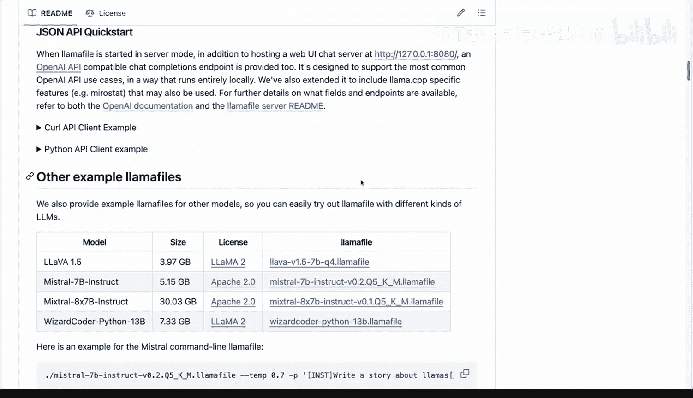
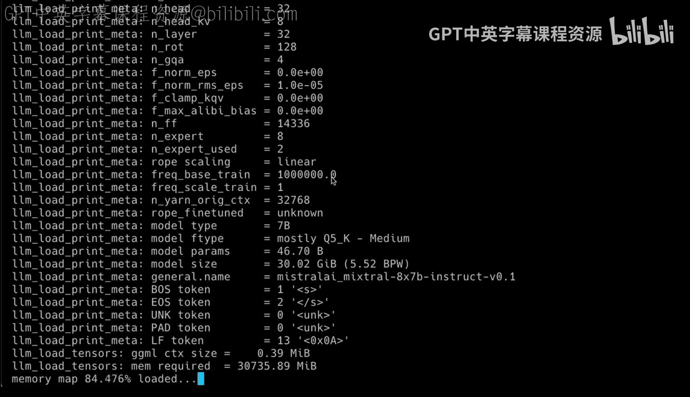
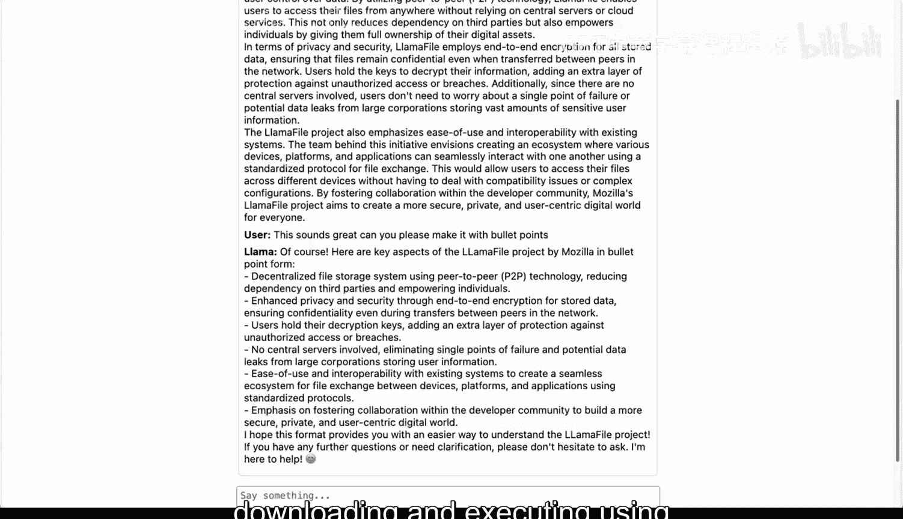

# 大型语言模型实践：P19：19_01_06_使用本地模型 🖥️

在本节课中，我们将学习如何在本地计算机环境中运行大型语言模型。我们将重点介绍由Mozilla Ocho团队开发的LlamaFile项目，它使得下载和运行多种模型文件变得简单直接。

## 概述

上一节我们探讨了云端LLM服务，本节中我们来看看如何在本地运行大型语言模型。使用本地模型是完全可行的，并且正变得越来越普遍。LlamaFile项目作为一个框架，允许用户轻松下载和运行多种类型的模型文件。

## 为什么选择LlamaFile？

以下是LlamaFile项目的几个关键优势：

*   **易于上手**：项目的快速入门指南非常清晰，只需几个简单步骤即可在您的操作系统上运行模型。
*   **跨平台兼容**：它可以在macOS、Linux或Windows系统上运行，没有障碍。
*   **硬件灵活性**：运行速度取决于您本地系统的配置，例如RAM大小和GPU类型。
*   **交互方式**：运行后，它会打开浏览器并加载一个本地主机地址，您可以通过网页界面与模型进行交互。

## 实践步骤：下载与运行

接下来，我们通过一个具体例子来演示如何操作。我将以Mixtral 8x7B模型为例，该模型文件大小约为30GB，采用Apache 2.0许可证。

我已经提前在系统上下载了该模型文件。我使用的是macOS系统，因此将切换到终端进行操作。

在我的终端临时目录中，存放着已下载的`mixtral-8x7b`模型文件。运行它非常简单，基本不需要额外配置。

您可以直接执行该文件。虽然可以通过参数（如`--threads`）进行一些配置，但运行`--help`命令可以查看所有可用选项和详细说明。该工具甚至支持跨多个GPU进行分割计算，不过我们暂不深入这些细节。

我们将直接运行它，看看效果如何。我打算使用2个线程来运行。

执行命令后，终端会输出大量信息。模型加载完成后，它将自动在浏览器中打开交互界面。让我们等待它完成，然后回到浏览器查看。

## 与本地模型交互

模型界面加载速度很快。界面上会显示一些系统要求和配置信息。您可以进行对话，查看聊天历史记录。

如果您只是想尝试一下，无需更改任何设置，可以直接滚动到页面底部开始使用。

例如，我们可以输入一个简单的请求：“请为我简要总结一下Mozilla的LlamaFile项目是什么，请分三段说明。”

模型需要一点时间处理。很快，我们就能看到一些输出结果。

需要注意的是，这个输出内容可能不完全准确，它似乎在描述文件存储和管理。这是因为该模型对于近期事件的准确性可能不高。不过，我们可以尝试其他类型的请求。

我们可以继续交互，例如说：“这听起来不错，能否请你改用项目符号列表的形式重新总结？”

您可以像与其他AI系统对话一样与它互动，效果通常不错。

## 总结

本节课中我们一起学习了如何通过下载并执行模型文件，在本地运行大型语言模型。我们利用Mozilla出色的LlamaFile项目，实现了在本地计算机上运行（而非基于云端的）大型语言模型，这完全是可行的。