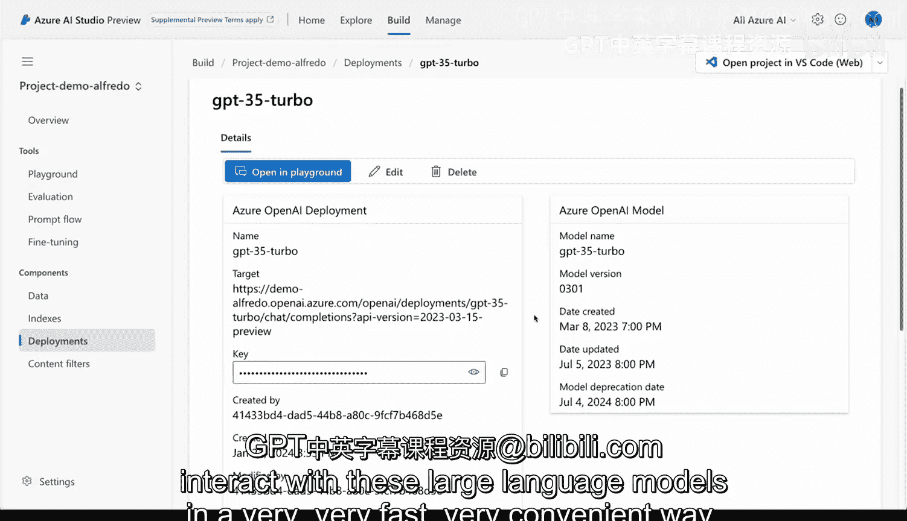

# 大型语言模型实践：P20：基于云的解决方案 ☁️

在本节课中，我们将学习如何使用基于云的解决方案来部署和管理大型语言模型。我们将以微软Azure平台为例，演示如何快速创建模型部署、通过API或交互式界面使用模型，并理解云服务带来的便利性。

---

上一节我们介绍了本地部署模型的基础知识，本节中我们来看看如何利用云服务来简化这一过程。基于云的系统，例如我们即将使用的Azure，提供了部署和管理大型语言模型的能力。不仅如此，它还提供了交互式API接口。

现在，我将向你展示Azure AI Studio。请注意，当你观看此视频时，相关功能可能已正式发布，不再处于预览阶段。我将点击进入，它会打开并欢迎你使用Azure AI Studio。由于我已经提前创建并打开了它，我将跳过初始设置步骤。这里列出了多个不同的项目，我将点击其中一个。具体是哪一个项目并不重要，我的目的是向你展示其核心功能。

首先，我需要创建一个部署。实际上，我已经完成了一个部署。我将点击“部署”选项，你可以看到我已经部署了一个名为“GPT-35 Turbo”的模型，这只是众多可用模型中的一个。创建部署的过程非常简单直接。**部署**本质上就是从一长串可用模型列表中选择一个模型。你甚至可以看到Hugging Face上的模型也在此列，所有这些模型都可以被部署，并准备好通过API调用。

如果我点击已部署的“GPT-3 Turbo”模型，我不仅可以通过一个暴露在互联网上的开放API与之交互（这意味着我可以从任何地方使用我的专属密钥访问它，出于安全考虑，密钥在此隐藏），还可以在“游乐场”中使用它。如果我点击“在游乐场中打开”按钮。

这将带我进入一个新页面。在这里，我可以设置系统消息、调整特定参数，并开始实际对话。我甚至可以语音输入（虽然现在不想这么做），然后关闭语音功能，输入一个查询。

例如，我想了解葡萄牙里斯本二月份的天气情况。我计划去那里，但不知道该穿什么衣服。那么，什么着装是合适的呢？让我们看看能否得到一些信息。

我立刻得到了回复。我正在使用那个部署到网络上的模型。回复非常完美：气温大约是61华氏度，即16摄氏度。这听起来非常温和宜人。我再次获得了多种操作选项，甚至有能力在VS Code桌面版或网页版中打开项目。

那么，为什么这种方式具有吸引力？为什么它很有趣？原因在于，当你不想在本地运行模型时，可以将它们放在云端。你可以看到，整个过程只需几次点击。当然，我提前完成了部署，所以我们才能看到已经部署好的模型。但这并非难事，过程相当直接。

以下是云平台提供的主要功能：
*   **游乐场**：一个交互式环境，用于测试和与模型对话。
*   **评估**：工具用于评估模型性能和输出。
*   **提示流**：用于管理和优化你给模型的提示（指令）的工作流。
*   **多样化操作**：你可以通过拖拽等多种方式与你的大型语言模型进行交互。

这是一个非常快速、直观的演示，展示了像Azure这样的云系统和云提供商如何让你能够运行这些模型。通过一个可以从互联网任何地方访问的部署，你可以实际运行模型、创建自己的应用程序，并以一种非常快速、便捷的方式与这些大型语言模型进行交互。

---

本节课中，我们一起学习了利用云平台（如Azure）部署和使用大型语言模型的基本流程。我们了解到，云服务通过简化的部署管理、灵活的API访问和交互式测试环境，大大降低了使用LLM的技术门槛和操作复杂度，使得开发者能够更专注于应用开发本身。