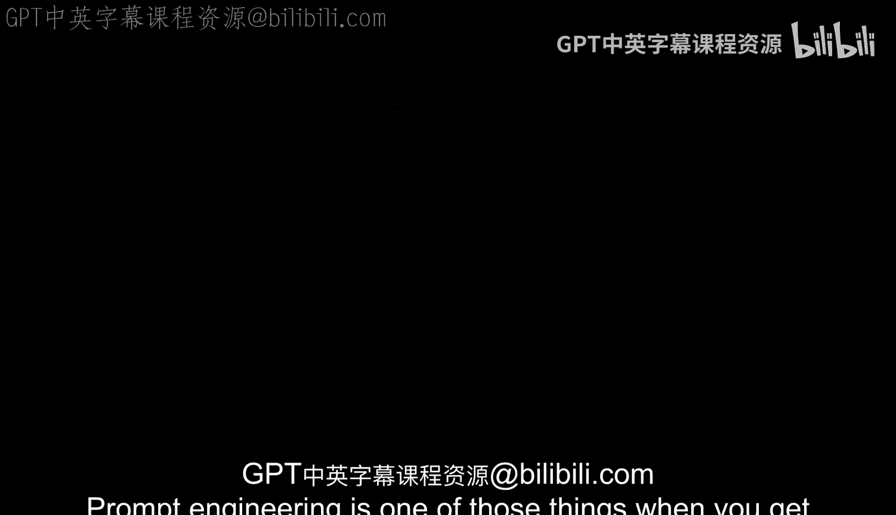

# 大型语言模型实践：P22：引言_4

在本节课中，我们将要学习提示工程的基础知识。虽然在与大型语言模型进行基于聊天的交互时，我们可能不会过多思考它，但确实存在一些技巧和方法，可以让交互更有效、获得更好的回答，并使整个过程对您更有用。

## 什么是提示工程？🤔

上一节我们介绍了课程的整体目标，本节中我们来看看提示工程的核心概念。提示工程是指通过设计和优化输入给大型语言模型的文本（即“提示”），来引导模型生成更准确、更相关、更高质量输出的过程。

其核心公式可以理解为：
**高质量输出 = 优化后的提示 + 模型能力**

## 提示工程的关键技术 🛠️

我们将深入探讨几种基础的提示工程技术，而不仅仅是更好的提问方式。

以下是几种重要的提示方法：

*   **零样本提示**：直接向模型提出一个问题或请求，不提供任何示例。例如，直接提问“法国的首都是哪里？”
*   **少样本提示**：在提出主要问题前，先提供少量示例来引导模型。这有助于模型理解任务格式和期望的输出类型。

## 如何优化提示？ ✨

为了获得更好的回答，我们需要改进提示本身。这主要涉及两个方面。

以下是优化提示的两个关键点：

1.  **提供更好的上下文**：在提示中清晰地说明背景、角色和任务目标，帮助模型更准确地理解意图。
2.  **提出更简洁直接的问题**：避免模糊或冗长的表述，使问题焦点明确，减少模型产生歧义的可能性。

## 评估模型响应 📊

最后，我们还需要学会评估模型返回的响应。检查回答是否准确、完整、相关，并符合提示的要求，是提示工程中不可或缺的一环。

本节课中我们一起学习了提示工程的基本概念，包括零样本提示和少样本提示等关键技术，以及如何通过优化上下文和提问方式来提升交互效果。同时，我们也认识到评估模型响应的重要性。掌握这些基础知识，将帮助您更有效地与大型语言模型进行交互。