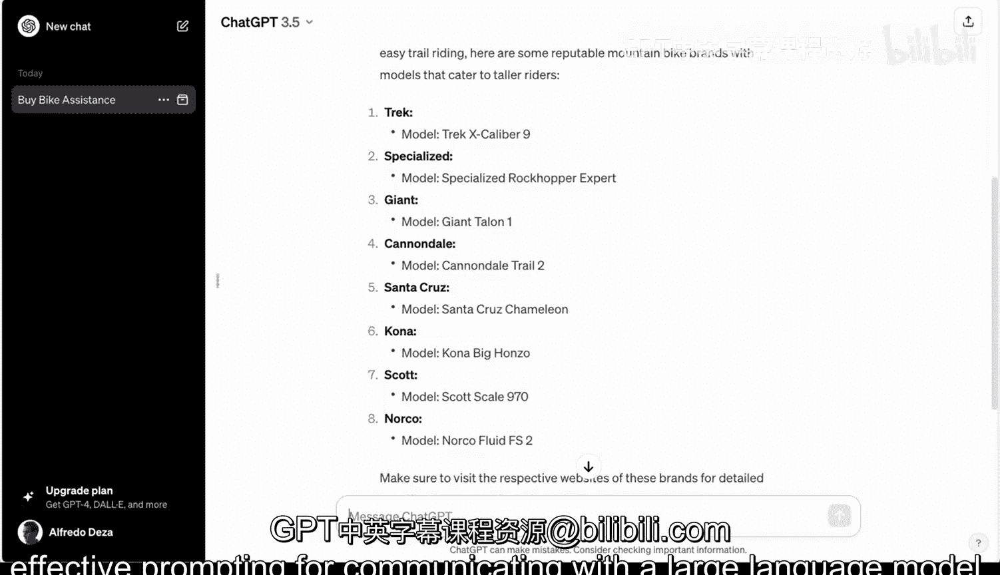

# 大型语言模型实践：P23：什么是提示工程 🧠


在本节课中，我们将要学习提示工程的基本概念。提示工程是有效与大型语言模型（如ChatGPT）进行沟通的关键技能。我们将通过具体示例，理解如何通过提供清晰的上下文来获得准确、有用的回答。

## 什么是提示工程？

提示工程听起来可能像是一个营销噱头或一堆没有实际意义的流行词汇。实际上，当人们提到“提示工程师”或“提示”时，其核心含义是**如何成为一个有效的沟通者**。

我们以ChatGPT为例。用户输入文本框中的内容就是“提示”，这是我们与AI应用程序或大型语言模型互动的方式。

## 理解提示的构成

以下是几个提示的例子：
*   Plan itinerary for a fashion-focused exploration of Paris.

请注意，“Plan itinerary for a fashion-focused exploration of Paris”这部分被加粗显示，它只是整个提示的一部分。提示工程的能力，就在于让这个提示为你提供一个有效的回应。

实现这一点的唯一方法，是提供大型语言模型能够理解并据此行动的**上下文**。如果我们说的话缺乏上下文，得到的回应就会不尽如人意。

## 从无效提示到有效提示

上一节我们介绍了提示需要上下文，本节中我们来看看一个缺乏上下文的例子。

假设我对购买一辆自行车感兴趣。我知道我想要什么类型的车，确切知道自己的尺寸，也清楚我将用于山地骑行。但AI，也就是这里的大型语言模型，对这些一无所知。

那么，一个不那么有效、不那么好的提示会是什么样的呢？我们可以这样说：

**代码示例：一个无效的提示**
```
I want to buy a bike.
```

输入这个提示后，大型语言模型会立刻识别出信息缺失。它不知道具体规格，不知道你是想要推荐，还是购买指导。它一无所知。

而提示工程，就是我能够以一种大型语言模型可以理解的方式提供更多上下文的能力，从而让它能为我提供准确、有用且可操作的信息。

## 构建一个有效的提示

让我们稍微修改一下这个提示。我们还没有深入探讨具体什么样的提示是有用的，但可以先让它变得好一些。

我可以这样说：

**代码示例：一个改进后的提示**
```
I am six feet four inches tall. I need a mountain bike for easy trail riding. I need recommendations of brands that I can investigate and look at some of their characteristics. List the brands and models.
```

现在，我们得到了一些更有意义的内容。通过这种方式与大型语言模型互动，我们提供的**信息对于寻找特定物品的人来说是立即有用的**。

这就像去超市问别人“我需要做些吃的”，却不提供任何细节一样，那不会奏效。AI应用程序不会神奇地理解你想要什么。而在这个案例中，我们能够提供一些输入，并获得非常好的输出，它准确地总结了我需要的信息。

这里的信息是可操作的，对我有用。我可以开始查看每一个选项，并可能从这些有趣的自行车品牌和型号中做出选择，以满足我的使用需求。

## 课程总结 🎯



本节课中，我们一起学习了提示工程的基础。我们了解到，提示工程的核心是**通过提供清晰、具体的上下文，与大型语言模型进行有效沟通**。从一个简单的“我想买辆自行车”到包含身高、用途和具体需求的详细描述，我们看到了上下文如何将模糊的请求转化为 actionable 的实用建议。记住，与AI沟通就像与一个知识渊博但需要明确指令的助手对话，你说得越清楚，它回答得就越有用。