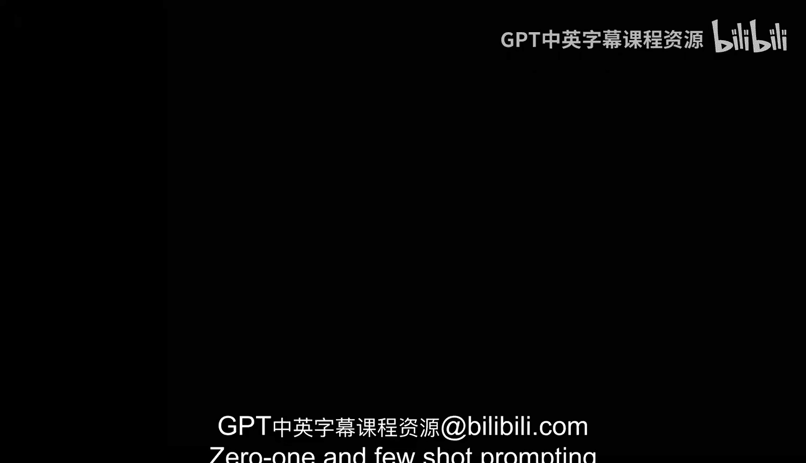
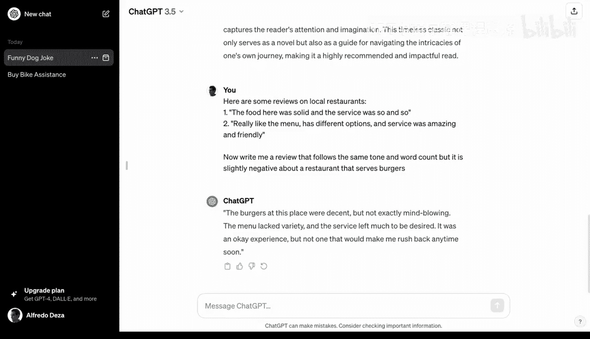
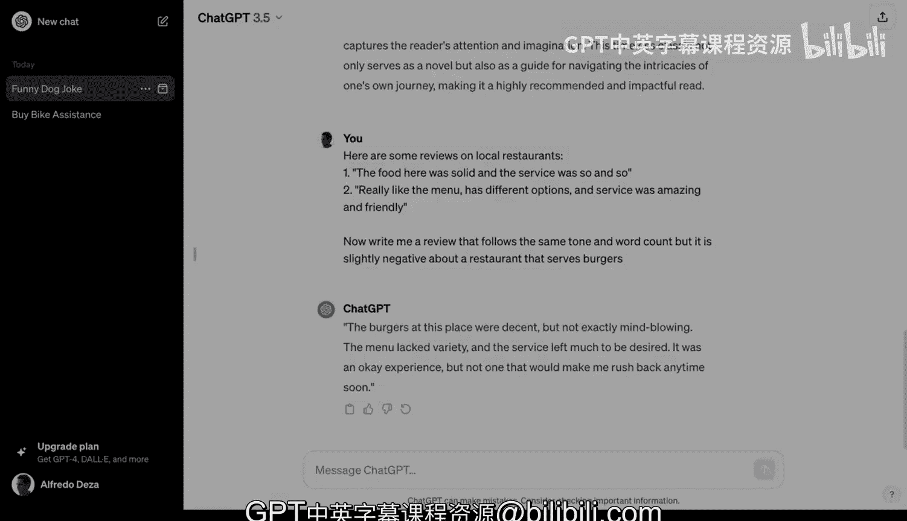

# 大型语言模型实践：P24：零样本、单样本与少样本提示 🎯



在本节课中，我们将要学习大型语言模型提示工程中的三个核心概念：零样本提示、单样本提示和少样本提示。理解这些概念是掌握有效提示技巧的基础。

## 概述

零样本、单样本与少样本提示是你在尝试优化提示时可能会听到的术语。它们描述了不同类型提示的良好特性。

## 零样本提示

让我们从零样本提示开始。我将给你一个例子。

这个例子是：“写一个关于狗的有趣笑话”。我没有提供任何示例。我实际上只是给大型语言模型一个单一的指令。我将得到一个非常直接的单一响应，没有其他内容。

这具体是关于什么呢？它不需要任何示例，因此我不需要提供任何额外的上下文。助手（大型语言模型）仅根据我给出的指令生成足够好的响应。

**核心概念**：零样本提示意味着仅提供任务指令，不提供任何示例。
```python
# 零样本提示示例
prompt = "写一个关于狗的有趣笑话"
```

## 单样本提示

那么什么是单样本提示呢？那就是提供一个示例。

例如，我需要说：“这里有一篇关于《Python测试》的书评，这是我之前写的一本书。这是一本扎实的Python测试入门书，特别适合软件工程。按句子来，我认为这很不错。”

现在我可以接着说：“现在用同样的语气和语言，为《炼金术士》写一篇书评。”《炼金术士》是一本非常受欢迎的书。我们来看看它是否能做到。

看，它生成了：“《炼金术士》是一段迷人的旅程……”这实际上并没有完全使用我的示例。但我们给了它一个示例，这就是我们得到的结果。

例如，如果我们改变我们实际所说的内容，并给它一些更具体的指示：“这是一本书，我会给它打9.9分（满分10分）。用同样的语气和语言，使用格式。为《炼金术士》写一篇书评。确保遵循我的示例。”

也许我们会看到它包含了一点《Python测试》的内容，这有点意思。虽然不完全是我想要的，但它确实做到了。这实际上很有趣，因为它说《炼金术士》的叙事是9.9分（满分10分）。它确实在评分中使用了9.9分。它还说“就像Python语法中发现的清晰度一样”，这非常有趣。

**核心概念**：单样本提示意味着提供一个任务示例，然后要求模型执行类似任务。
```python
# 单样本提示示例
prompt = """
示例：这是一篇关于《Python测试》的书评。这是一本扎实的Python测试入门书，特别适合软件工程。我会给它打9.9分（满分10分）。
任务：用同样的语气、语言和格式，为《炼金术士》写一篇书评。
"""
```

## 少样本提示

那么什么是少样本提示呢？我提供几个示例。

以下是关于本地餐厅的一些评论。😊

我说：“评论一：这里的食物很扎实，服务一般般。”我们可以做一个第一条评论。然后说：“评论二：真的很喜欢菜单。有不同的选择。服务很棒且友好。”

现在我能说的是：“现在为我写一篇遵循同样语气和字符数（或字数）的评论，但它是关于一家餐厅的略微负面的评论，比如说，一家供应汉堡的餐厅。”某种比较通用的东西。

我在这里做的是少样本提示。这意味着我提供了两个以上的示例。这就是为什么叫“少样本”。我要这么做，然后我会得到结果：“这个地方的汉堡还不错，不算特别惊艳。菜单缺乏多样性。”

你能看到我在谈论食物、菜单和服务。这与我之前提供的内容类似。这是一个关于如何交互和提供上下文的好例子。

**核心概念**：少样本提示意味着提供多个（通常大于一）任务示例，然后要求模型执行类似任务。
```python
# 少样本提示示例
prompt = """
示例1：这里的食物很扎实，服务一般般。
示例2：真的很喜欢菜单。有不同的选择。服务很棒且友好。
任务：用类似的语气和长度，写一篇关于一家汉堡店的略微负面的评论。
"""
```

## 总结





本节课中我们一起学习了零样本、单样本与少样本提示的区别。这些概念足够好，能让你理解单样本、单次提示或少样本之间的差异。这里是非常基础的例子，但它们将为你打下良好的基础，以便你能继续学习更好的提示技巧。