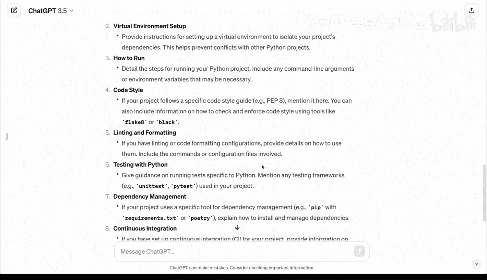

# 大型语言模型实践：P25：基于上下文的基础提示 📝


在本节课中，我们将学习如何在与大型语言模型（如ChatGPT）交互时，通过提供基础上下文来获得更优质、更准确的回答。这是有效利用大语言模型的关键第一步。

## 概述

与大型语言模型互动时，仅仅给出指令往往不够。为了让模型生成符合我们具体需求的输出，我们需要为其提供相关的背景信息。本节课将通过一个编写README文件的实例，演示如何构建包含有效上下文的提示词。

## 基础提示示例

上一节我们概述了提供上下文的重要性，本节中我们来看看一个具体的例子。假设我们需要为项目编写一个README文件。

首先，我们向模型提供一个包含基本上下文的提示。这个提示不仅包含指令，还说明了项目的关键信息。

```
我需要为一个用Python编写的项目写一个README文件。请为我提供一个能引起开发者共鸣的基本结构。不需要为各个部分虚构内容，提供一个标题框架，以便我填充项目细节。
```

在这个提示中，我们提供了几个关键信息点：
1.  **任务目标**：编写README文件。
2.  **项目语言**：使用Python。
3.  **目标受众**：开发者。
4.  **具体指令**：提供结构框架，而非虚构内容。

模型根据这个提示，生成了一个通用的README结构，通常包含以下部分：
*   项目标题
*   描述
*   安装
*   使用
*   贡献
*   许可证

## 优化上下文以获得更佳结果

虽然第一个回答不错，但我们注意到，尽管提到了“Python”，生成的结构却并非Python项目特有的。这说明初始的上下文信息可能不够精确。

因此，我们需要进一步优化提示，提供更具体的上下文。

以下是优化后的提示，它更明确地指出了对Python相关内容的期望：

```
我需要为一个用Python编写的项目写一个README文件。请为我提供一个能引起Python开发者共鸣的基本结构。建议几个专门与Python相关的部分。不需要为各个部分虚构内容，提供一个标题框架，以便我填充项目细节。
```

这个新提示将“开发者受众”具体化为“**Python开发者**”，并明确要求“**建议几个专门与Python相关的部分**”。这为模型提供了更清晰的上下文。

## 上下文优化后的效果

基于更精确的上下文，模型现在生成的README结构包含了更多Python项目特有的部分。以下是可能新增或强化的部分：

以下是模型可能建议的Python相关章节：
*   **环境要求**：明确列出所需的Python版本。
*   **虚拟环境设置**：指导如何使用`venv`或`conda`创建隔离环境。
*   **依赖安装**：通过`pip install -r requirements.txt`安装依赖。
*   **运行测试**：说明如何执行项目的测试套件（如使用`pytest`）。

通过提供“Python开发者”和“Python相关部分”这两个关键上下文，我们成功引导模型输出了更具针对性和实用性的结果。所有建议的部分对于一个Python项目来说都是高度相关的。

## 总结



本节课中我们一起学习了基于上下文的基础提示方法。关键在于，有效的提示应结合清晰的**指令**和具体的**背景信息**。通过示例我们看到，即使是很小的上下文补充（如从“开发者”细化到“Python开发者”），也能显著提升模型输出的相关性和质量。记住，你提供的上下文越精确，大型语言模型就越能理解你的真实意图，从而提供更有价值的帮助。