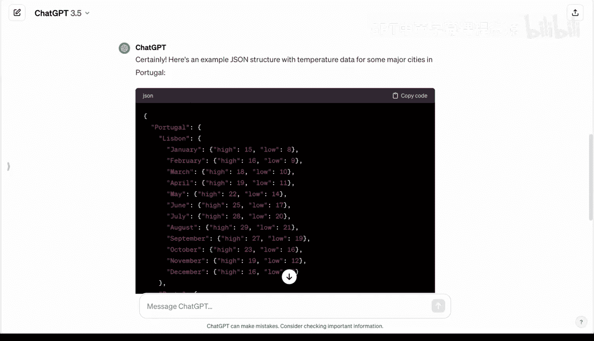

# 大型语言模型实践：P26：在提示中使用示例


## 概述
在本节课中，我们将学习如何在向大型语言模型（LLM）提问时，通过提供具体的示例来引导模型生成更符合我们期望的输出。这种方法被称为“少样本提示”，它能显著提升模型输出的准确性和格式规范性。

## 示例提示的作用
上一节我们介绍了提示的基本概念。本节中，我们来看看如何通过提供示例来具体指导模型。在之前的课程中，我们简要提到过可以使用“单样本”或“少样本”提示。这意味着我们可以在提示中直接包含我们希望模型模仿的格式或内容示例。

## 一个具体的应用案例
为了更清晰地说明，我将展示一个过去实际使用过的提示示例。在这个案例中，我尝试使用JSON格式来构建一个API。API和JSON这些术语对于非开发者可能有些陌生，但不用担心，我们会一步步解释。

以下是我当时使用的完整提示内容：

```
I'm building an example API that's basically an HTTP service, a programming API that's going to live on the web somewhere and uses JSON. JSON is a type of data formatting.
Uses a JSON file to load historical data on different temperature values for cities and countries.
I want to use the same but for different cities only in Portugal.
Please generate the JSON contents for me with as many major cities in Portugal as you can.
Here's the example JSON format:
{
  "England": {
    "London": {
      "January": {"high": 64, "low": 45},
      "February": {"high": 65, "low": 45}
    }
  }
}
```

## 提示的组成部分解析
让我们来分析一下这个提示的各个部分，理解它们如何共同作用来指导模型。

以下是这个提示包含的关键指令和信息：

1.  **任务描述**：明确告知模型我正在构建一个使用JSON的HTTP API服务。
2.  **数据用途**：说明JSON文件将用于加载城市和国家的历史温度数据。
3.  **具体范围**：将数据范围限定在葡萄牙的主要城市。
4.  **输出要求**：要求模型生成尽可能多的葡萄牙主要城市数据。
5.  **格式示例**：提供了一个以英格兰和伦敦为例的JSON结构示例，明确了国家、城市、月份以及高低温数据的嵌套关系。

## 模型输出结果分析
基于以上提示，模型生成了以下输出：

```json
{
  "Portugal": {
    "Lisbon": {
      "January": {"high": 14, "low": 8},
      "February": {"high": 15, "low": 8}
    },
    "Porto": {
      "January": {"high": 13, "low": 5},
      "February": {"high": 14, "low": 6}
    }
  }
}
```

可以看到，因为我提供了一个清晰的示例，模型准确地输出了我所需要的内容。生成的JSON格式规范，并且包含了里斯本和波尔图这两个葡萄牙的主要城市。

> **注意**：一个有趣的细节是，示例中英格兰的温度单位是华氏度（64°F），但模型为葡萄牙生成的数据似乎是摄氏度（14°C）。这提醒我们，示例中的每一个细节都可能被模型捕捉和学习。

## 使用示例提示的优势
这个案例很好地展示了在提示中添加示例的强大作用。通过提供一个具体的格式范例，我们可以：

*   **获得精确的输出格式**：确保模型返回的数据结构（如JSON的嵌套层级）完全符合我们的要求。
*   **引导内容生成**：模型能理解示例中的数据关系（国家-城市-月份-温度），并据此为新主题（葡萄牙）生成类似内容。
*   **加速开发流程**：生成的规范JSON数据可以直接被应用程序读取和使用，省去了手动整理数据的时间。



## 总结
本节课中，我们一起学习了如何在大型语言模型的提示中有效地使用示例。通过提供一个清晰、具体的格式范例，我们可以极大地提高模型输出结果的**相关性**和**格式规范性**。这是一种简单而强大的技巧，能够帮助你将LLM的输出更精准地应用到实际项目中去，例如生成特定结构的数据、转换文本格式或模仿某种写作风格。