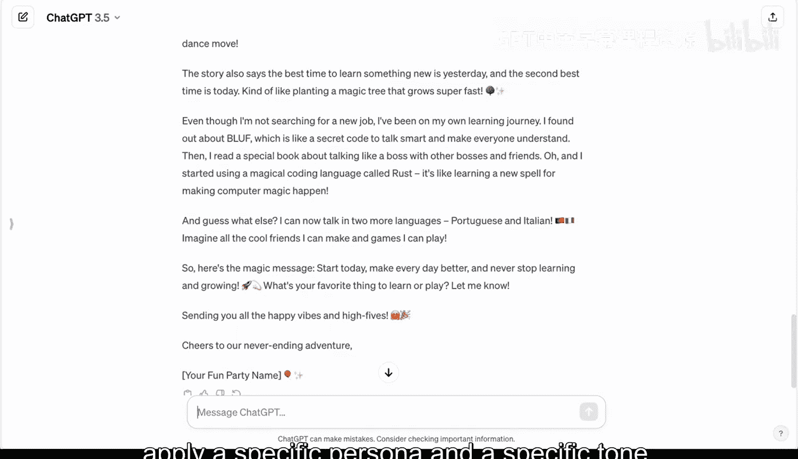

大型语言模型实践：P29：设定语气与角色

在本节课中，我们将学习如何在与大型语言模型交互时，通过设定语气和角色来引导其输出，以确保获得符合特定需求的结果。

设定语气和角色是与大型语言模型交互时一项非常可靠的策略。当你需要确保模型输出的信息在表达方式和风格上完全符合你的要求时，这项技术尤其有用。

上一节我们介绍了策略的重要性，本节中我们来看看具体的操作方法。我将通过一个简单的总结任务来演示。

首先，我将在ChatGPT中执行一个基础任务，不提供任何额外的上下文或指示。我会输入：“请总结以下文本”。这段文本是我之前在LinkedIn上发布的一篇关于个人学习经历和重要观点的博客文章。

以下是基础指令下的输出结果：
*   作者回忆了祖父的教诲，并对当前大规模裁员的现象表达了担忧。文章整体上是在陈述一种个人观点。

这个总结看起来不错，但我们可以通过添加角色和语气指令来改变它。

“角色”是指令大型语言模型扮演某个特定身份。例如，我们可以让模型扮演一位“高级高管教练”。

“语气”则是指定输出内容所使用的语言风格和正式程度。我们可以要求总结使用“高管级别的语言和语气”，甚至说明这份总结是“可以发送给董事会高管们的邮件”。

当我们同时应用了新的角色和语气指令后，输出发生了显著变化。开头变成了“我相信您一切安好。我写这封信是为了提请关注一篇近期富有洞察力的博客文章……”，整体语言变得非常正式和专业。

我们还可以尝试完全不同的组合。例如，将角色设定为“为小学生举办派对的活跃主持人”，并要求使用“能让孩子们理解的快乐语言”来总结。

应用这个新设定后，输出再次改变。开头可能是：“嘿，了不起的小朋友们！希望你们玩得开心！……” 并且可能会自动加入表情符号，使文本生动有趣。

这个例子可能略显夸张，但它清晰地展示了如何通过设定角色和语气来达成目标。你不需要同时使用两者，根据需求单独使用“角色”或“语气”指令同样有效。

本节课中，我们一起学习了如何通过设定“角色”和“语气”来精确控制大型语言模型的输出风格。你可以根据实际场景，灵活运用这些指令，让模型生成更符合特定场合和受众需求的文本。