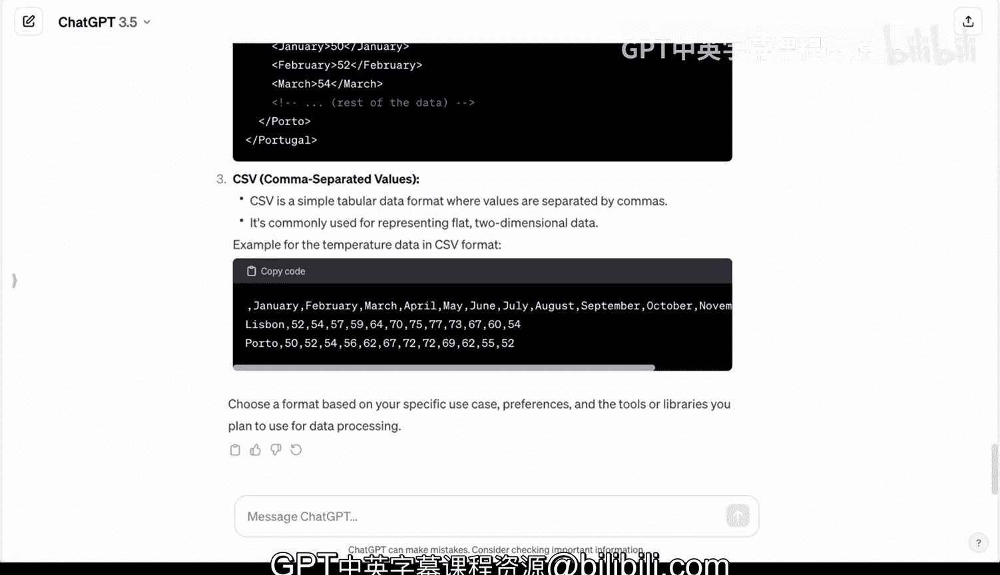

# 大型语言模型实践：P30：基于先前上下文的精炼 🎯


在本节课中，我们将学习如何基于与大型语言模型（LLM）的先前对话历史，来逐步优化和精炼我们的提示（Prompt），以获得更符合需求的输出。这是一种高效的交互策略，无需每次都重复完整的上下文。

## 回顾初始请求与响应

上一节我们介绍了如何通过提供示例来引导模型输出特定格式。我们曾请求模型以JSON格式提供葡萄牙两个城市的天气数据，并给出了一个示例。模型的响应基本符合要求。

以下是初始请求的示例代码：
```json
{
  "city": "示例城市",
  "temperature": 72,
  "unit": "Fahrenheit"
}
```
模型成功返回了里斯本（Lisbon）和波尔图（Porto）的数据，但温度单位使用了摄氏度（Celsius）且值为整数。这与我们期望的使用华氏度（Fahrenheit）不符。

## 进行首次精炼：更改温度单位

基于上述响应，我们可以直接在其基础上进行优化，而无需重述所有要求。以下是精炼过程的核心思路。

我们只需告诉模型：“你的回复看起来不错，但我需要华氏度而不是摄氏度。” 模型会利用整个对话历史来理解这个新指令，并生成更新后的响应。这样，我们就成功地将温度单位从摄氏度修正为华氏度。

## 进行深度精炼：调整数据结构

在获得符合单位的响应后，我们可以进一步优化数据结构。例如，我们可能觉得分别提供“最高温”和“最低温”不够简洁，希望合并为一个“平均温度”值。

此外，我们可能希望改变JSON的结构。在JSON中，由花括号 `{}` 包裹的部分称为一个对象（Object）。我们可以要求模型不再为每个城市返回一个对象，而是直接以城市名为键，平均温度为值。

我们可以这样提出要求：“请提供平均温度，而不是最高和最低温度。并且，我不想要对象格式，我希望数据像这样：`{“December”: 57}`”

通过提供这个简单的示例，模型能够理解我们的意图，并输出结构更精简、完全符合我们新要求的数据。

## 探索更多可能性：请求格式建议

基于不断精炼的对话上下文，我们还可以引导模型探索更多可能性。例如，我们可以询问模型：“除了JSON，这里还可以使用哪些其他数据格式？请为我建议三种不同的类型。”

模型可能会基于当前对话的上下文（即天气数据），推荐如YAML、XML或CSV等格式。这展示了如何通过迭代式对话，逐步将模型的输出引导至你所需要的任何特定形式或格式。

## 总结

本节课中我们一起学习了“基于上下文的提示精炼”技术。关键在于：
1.  **无需重复**：每次精炼时，无需重复之前已提供的所有上下文和示例。
2.  **迭代优化**：将模型的每次回复作为新起点，提出具体的改进要求。
3.  **明确指令**：通过简短指令或新示例，明确指出希望修改的部分（如单位、结构、格式）。
4.  **探索拓展**：在稳固的上下文基础上，可以轻松请求模型提供变体或建议。



这种方法极大地提升了与大型语言模型交互的效率和精准度，使你能够通过连续、聚焦的对话，逐步获得理想的结果。