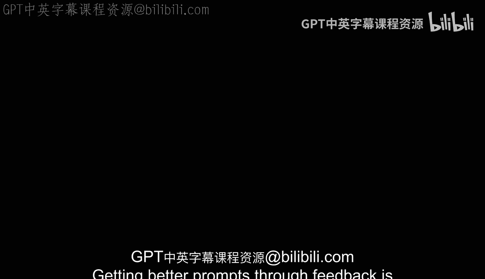
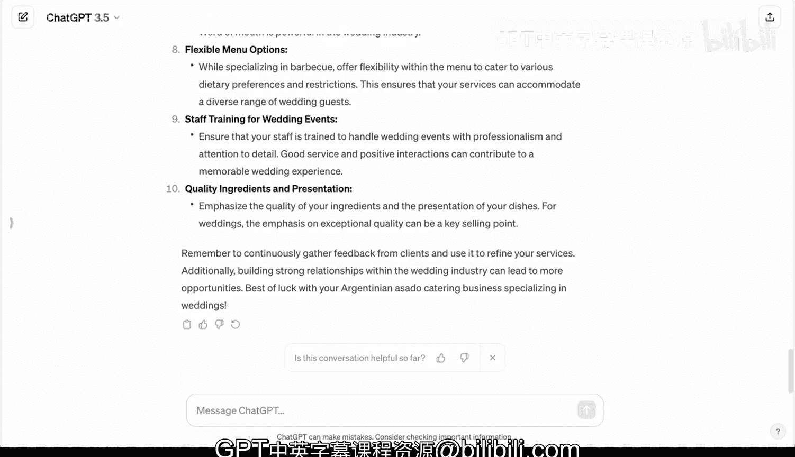

# 大型语言模型实践：P31：通过反馈优化指令 🎯



在本节课中，我们将学习一种强大但常被忽视的技巧：如何通过与大型语言模型的互动反馈，来优化你的提示词，从而获得更精确、更有用的回答。

## 概述

通过反馈优化提示词是一种非常有效的方法。其核心思想是，当你对模型的初始回答不满意时，不要放弃或重新开始，而是主动询问模型：“为了让你给出更好的回答，我还需要提供哪些信息？” 这种方法能帮助你发现自身思考的盲点，并引导模型生成更符合你需求的输出。

上一节我们介绍了如何构建一个基础的提示词。本节中，我们来看看如何通过迭代反馈，让这个基础提示词变得更强大。

## 从基础提示词开始

我们从一个非常基础的提示词示例开始。假设我们想创办一家专门做阿根廷烤肉（Asado）的餐饮公司。

**初始提示词示例：**
```
我想创办一家专门做阿根廷烤肉的餐饮公司。请为我提供一个商业计划书。
```

让我们看看模型会给出什么回答。

**模型初始回答示例：**
```
创办一家餐饮公司可能是一次激动人心的冒险。以下是一个基本的商业计划大纲：
1.  执行摘要
2.  市场分析
3.  服务与菜单
4.  营销策略
5.  运营计划
6.  财务预测
7.  监控与评估
请根据您的具体情况调整每个部分。
```

这个回答看起来不错，提供了一个标准的商业计划框架。但可能还不够具体，缺乏针对我们特定业务（阿根廷烤肉餐饮）的深度洞察。

## 主动寻求反馈：询问缺失信息

为了获得更精准的指导，我们可以主动向模型提问，了解我们遗漏了哪些关键信息。

以下是向模型寻求反馈的提示词示例：

```
感谢你提供的计划。为了让你能给出更好、更具体的回答，你能建议一些我在创办这个生意时可能没考虑到、但对你提供更好指导有帮助的事情吗？请列出最多10项，以便我审视并了解需要向你补充哪些背景信息。
```

模型可能会给出如下反馈列表：

**模型反馈示例（可能包含的项目）：**
1.  保险需求
2.  活动物流安排
3.  客户服务策略
4.  营销宣传材料
5.  定价策略
6.  长期目标（例如，是单一经营还是计划扩张）
7.  目标客户群体详情
8.  菜单的详细构成与定制选项
9.  供应商与食材来源
10. 法律法规与许可要求

这个列表很有用，但可能不完全符合我们的预期。由于大型语言模型固有的非确定性行为，每次回答可能略有不同。如果反馈不够精准，问题可能在于我们没有向模型清晰地解释自身需求。

## 澄清需求，获取精准指导

我们可以进一步澄清问题，引导模型给出更相关的建议。

**优化后的反馈请求示例：**
```
我可以提供哪些具体信息，以便你能就我的餐饮生意给我更好的指导？
```

这次，模型的回答可能更聚焦于商业计划的核心要素：

**模型更精准的反馈示例：**
```
为了提供更具体的指导，我需要了解以下信息：
- **定价策略**：你计划如何为服务定价？
- **长期目标**：是希望经营单一业务，还是有扩张计划？
- **活动规模**：你主要承接多大规格的活动？（例如，最多50人的活动）
- **菜单细节**：你的菜单具体包含哪些菜品？（例如，专注于2-3种特色烤肉）
- **目标市场**：你的主要目标客户是什么？（例如，婚礼、企业活动）
```

现在，我们获得了非常明确的指导。接下来，我们就可以根据这些要点，向模型补充具体信息。

## 提供补充信息，获得定制化方案

根据模型的反馈，我们向提示词中添加具体的背景信息。

**补充信息后的提示词示例：**
```
我想创办一家专门做阿根廷烤肉的餐饮公司。请为我提供一个商业计划书。
补充信息：
- **活动规模**：主要承接最多50人的活动。
- **菜单细节**：专注于提供2种特色烤肉。
- **目标市场**：主要瞄准婚礼市场。
- **长期目标**：初期经营单一业务，暂无扩张计划。
```

基于这些更丰富的上下文，模型现在能够生成一个高度定制化、更具操作性的商业计划，例如，可能会包含“婚礼套餐设计”、“客户推荐计划”、“灵活菜单选项以适应不同婚礼需求”等具体内容。

通过这种“提问-反馈-补充”的迭代过程，我们成功地将一个模糊的请求，优化成了一个能引导模型产出高质量、高相关性回答的精准提示词。

## 总结

本节课中，我们一起学习了如何通过反馈循环来优化指令。关键步骤可以总结为以下公式：

**优化流程 = 初始提示 → 模型回答 → 寻求反馈（“我还需要提供什么？”） → 根据反馈补充信息 → 获得优化回答**



这种方法的核心优势在于，它利用模型自身的“知识”来反推我们提问的不足，特别适合在你不确定从何入手或思考存在盲点时使用。记住，与大型语言模型的有效互动往往是一个迭代过程，清晰的沟通和基于反馈的持续改进是获得理想结果的关键。