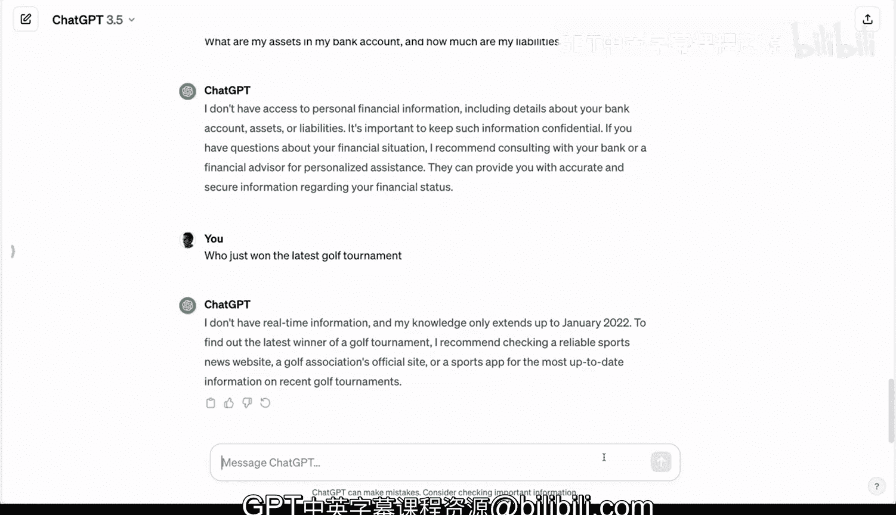

# 大型语言模型实践：P32：理解局限性 🧠


在本节课中，我们将探讨大型语言模型（LLM）在实际应用中的一些关键局限性。理解这些边界对于有效、安全地使用模型至关重要。

上一节我们介绍了如何通过提示工程引导模型，本节中我们来看看模型在哪些方面存在不足，以及如何应对这些限制。

## 提示的明确性至关重要

当您需要直接、准确的答案时，必须提出直接、具体的问题。如果问题过于宽泛，模型将很难给出精确的回应。

例如，一个非常宽泛的提示是：
```
bake me a cake
```
模型可能会感到困惑，因为它不清楚您具体想要哪种蛋糕。它可能会反问或给出一个通用的答案，例如建议烘焙一个生日蛋糕。

为了获得更精确的结果，您需要提供具体细节。以下是一个更具体的提示示例：
```
I want to bake a specific chocolate cake that has two layers, uses dulce de leche, and is meant for feeding five people.
```
通过指定蛋糕类型、层数、特殊配料和食用人数，您将获得一个更量身定制、更实用的食谱方案。模型可以据此提供关于糖霜和组装双层蛋糕的具体步骤。

## 模型的知识与访问限制

大型语言模型存在固有的知识边界。这是一个核心限制，主要源于其训练数据的性质。

**模型基于历史数据进行训练**，其知识存在截止日期。例如，许多公开模型的知识截止到某个特定时间点（如2022年1月）。因此，它无法知晓该日期之后发生的事件。

以下是模型无法回答的几类问题示例：

*   **实时信息查询**：例如，“今天佐治亚州赫雷里塔的天气如何？” 模型没有访问实时天气数据的能力。
*   **个人隐私信息**：例如，“我的银行账户里有多少资产和负债？” 模型无法获取任何用户的个人机密数据。
*   **最新事件**：例如，“谁刚刚赢得了最新一届高尔夫锦标赛？” 如果该赛事发生在模型知识截止日期之后，它将无法提供正确答案。

理解这些限制非常重要，可以避免对模型产生不切实际的期望。

## 应对知识局限性的策略

尽管模型有其知识边界，但我们可以通过提供上下文来帮助它完成特定任务。

一种有效的策略是：**将相关信息直接提供给模型**，然后让它基于这些信息进行分析或总结。

例如，您可以先将一篇关于最新高尔夫锦标赛的长篇新闻报道粘贴给模型，然后给出如下指令：
```
基于以上文章，告诉我谁赢得了比赛，并总结其获胜的主要原因和重要性。
```
通过这种方式，模型能够利用您提供的“即时”上下文，生成准确且有针对性的回答，从而绕过其自身知识库的时间限制。

---



本节课中我们一起学习了大型语言模型的两个主要局限性：**对模糊提示的敏感性**和**基于历史训练数据导致的知识时效性与访问限制**。我们了解到，通过提出具体、明确的问题，以及主动为模型提供相关上下文，可以在很大程度上克服这些挑战，从而更高效、更准确地利用大型语言模型。