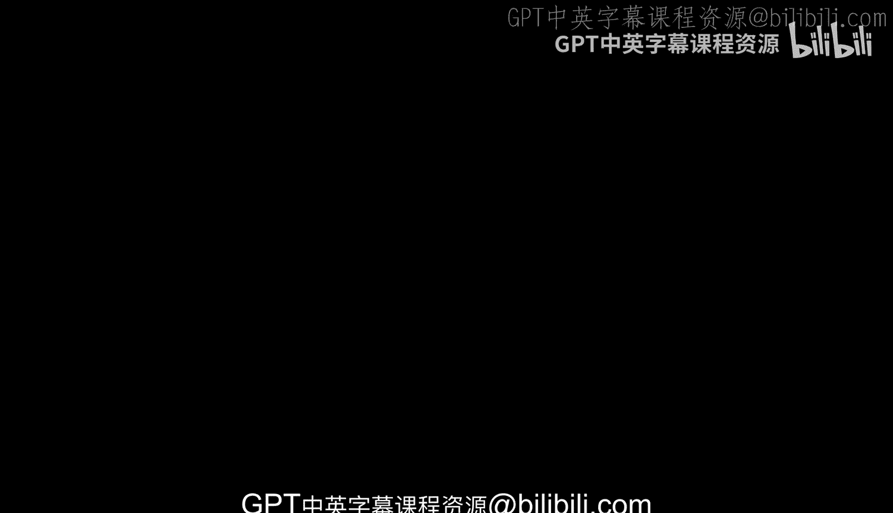

# 大型语言模型实践：第6章：高级提示工程技巧



在本节课中，我们将学习一系列高级提示工程技巧。我们将超越基础方法，探索一些不那么常见但非常有效的技术。通过学习这些技巧，你将能够更熟练地引导大型语言模型，从而获得更优质、更准确的回答。

## 认识模型的局限性

在深入高级技巧之前，我们首先需要了解大型语言模型的局限性。当我们向模型提出过于复杂或信息量过大的请求时，它可能会“不堪重负”，导致无法准确回答我们的问题。理解这种极限状态的表现，有助于我们设计更有效的提示。

上一节我们介绍了模型过载的概念，本节中我们来看看如何通过任务分解来规避这一限制。

## 任务分解：化繁为简

当面对复杂问题时，一个有效的策略是将大任务分解为一系列更小、更简单的子任务。这可以显著提升模型响应的质量和准确性。

以下是进行任务分解的几个关键步骤：

*   **识别核心问题**：首先，明确你需要解决的核心问题是什么。
*   **拆解逻辑步骤**：将解决核心问题所需的过程，分解成一系列连续的、逻辑清晰的步骤。
*   **分步请求**：依次向模型提出这些更简单的子任务请求，而不是一次性提出所有要求。

通过简化模型需要处理的任务，我们通常能得到好得多的回答。

## 思维链提示法

另一种强大的技巧是“思维链”提示。这种方法的核心是要求模型在给出最终答案前，先展示其推理过程。

思维链提示通常遵循以下结构：

```
用户：<复杂问题>
助手：让我们一步步思考。首先，[第一步推理]。接着，[第二步推理]。因此，最终答案是：[答案]。
```

这种技巧能迫使模型进行更深入的逻辑思考，从而减少“一本正经地胡说八道”的情况，并提高答案的可靠性。

## 其他有效的提示技巧

除了任务分解和思维链，还有许多其他提示结构可以帮助我们获得更好的结果。这些技巧通常涉及对指令的特定安排。

以下是一些值得尝试的提示技巧：

*   **指令前置**：在提示的开头就明确提出最重要的指令或角色设定（例如：“你是一位经验丰富的软件架构师…”）。
*   **指令后置**：在描述了具体场景或问题后，在提示的结尾处重申或总结关键要求。
*   **提供任务清单**：以清晰列表的形式列出模型需要完成的所有事项，确保没有遗漏。

这些技巧的常见程度各不相同，但通过学习和应用这些高级方法，你将能够在提示工程方面变得更为出色，并持续获得更优质的模型响应。

本节课中我们一起学习了如何通过认识模型局限性、运用任务分解、采用思维链提示以及其他结构化技巧，来显著提升大型语言模型的输出效果。掌握这些高级提示工程方法，是有效利用生成式AI的关键一步。