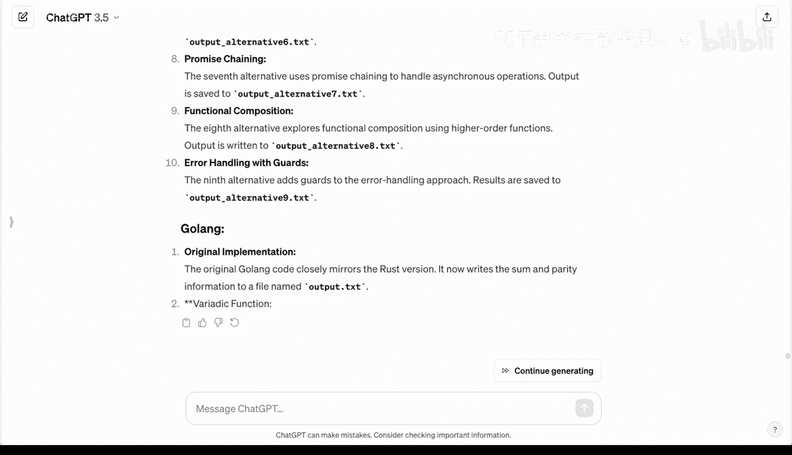

# 大型语言模型实践：第2课：上下文的局限性 🧠


在本节课中，我们将要学习大型语言模型在处理上下文信息时存在的局限性。我们将通过一个具体的演示，来观察当提供给模型的信息量过大或对话历史过长时，模型可能出现的“力不从心”的情况。

## 概述

大型语言模型的能力并非无限，其处理信息的容量存在上限。这个上限通常被称为“上下文窗口”。当输入的信息或对话历史超过这个窗口的限制时，模型可能无法准确理解或完整执行复杂的指令，导致输出不完整、错误或中断。

上一节我们介绍了模型的基本交互方式，本节中我们来看看当任务变得极其复杂时，模型会如何表现。

## 演示：测试上下文极限

为了直观地展示这种局限性，我们设计了一个非常复杂的任务。首先，我们向模型提供了一段R语言代码，并要求它完成一系列繁重的转换和描述工作。

以下是向模型提出的初始指令：
```
我将向你提供一段R语言代码。我需要你将其转换为包括Python、TypeScript、JavaScript、Golang、Scala、Ruby和Bash在内的多种语言。
然后，你需要为每种语言创建两个段落来描述这段代码。
接着，为每种语言提供一个测试用例。
最后，为每种语言列出三个可以改进代码的潜在机会，并包含每种语言的一个简短设置说明。
```

模型开始处理这个请求，并逐一生成各种语言版本的代码、描述、测试和改进建议。这个过程会持续一段时间，并产生大量的输出文本。

## 提出更复杂的要求

在模型完成了第一轮庞大的输出后，我们继续“加码”，提出了更荒谬的要求，以测试其极限。

现在，我们基于已有的代码示例，提出新的指令：
```
现在我已经有了一些代码示例，我需要你为之前提供的每一种语言，再给出五种不同的代码实现方案。
同时，为每一种方案提供相应的说明。
```

模型再次开始处理这个新任务。我们可以观察到，随着输出的内容越来越多，模型的响应开始出现一些异常迹象，例如部分代码的语法高亮显示消失。

## 触及上下文限制

当我们试图基于这海量的对话历史，提出第三个复杂请求时，模型的局限性就彻底暴露了。

我们尝试要求模型将之前的所有内容整合成一篇博客文章：
```
现在，请基于我们完成的所有内容，生成一篇博客文章。
例如，为每种语言撰写8到9个段落，解释我们做过的不同实现和代码片段。
```

此时，模型无法完整地执行指令。它的输出在“Scala”语言的部分突然中断，并显示“继续生成”的提示。Bash语言甚至没有出现在列表中。这表明模型已经无法承载和回顾整个冗长的对话历史。

为了进一步验证，我们回到对话的最顶部，尝试修改一个贯穿所有内容的指令：
```
更新所有的代码示例，让它们不再打印信息，而是将信息写入文件系统。
同时，更新所有相关的描述和建议。
```

执行这个指令后，我们得到的结果是不完整的。模型没有更新所有代码示例，只修改了部分段落。它进入了一种“崩溃”状态，无法完成我们提出的、需要依赖大量上下文的复杂指令。

## 总结

本节课中我们一起学习了大型语言模型上下文的局限性。关键点在于，模型能“记住”和有效处理的对话历史与输入信息是有限的。当任务过于复杂，生成的文本量超过其上下文窗口时，模型可能无法：
*   完整执行需要通篇理解的指令。
*   保持输出的连贯性和正确性。
*   避免在生成过程中中断。



这提醒我们，在与大型语言模型交互时，需要将复杂任务拆解为更小的、步骤清晰的子任务，并注意管理输入信息的长度，以确保获得可靠的结果。