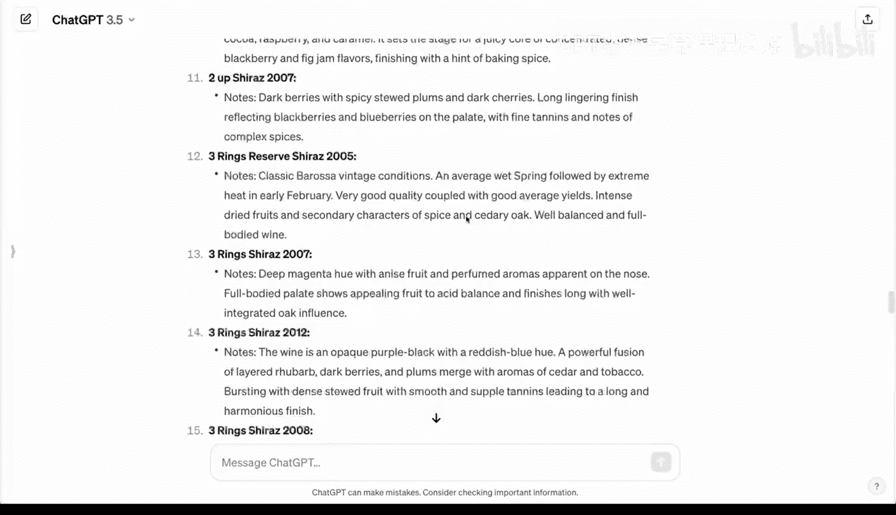
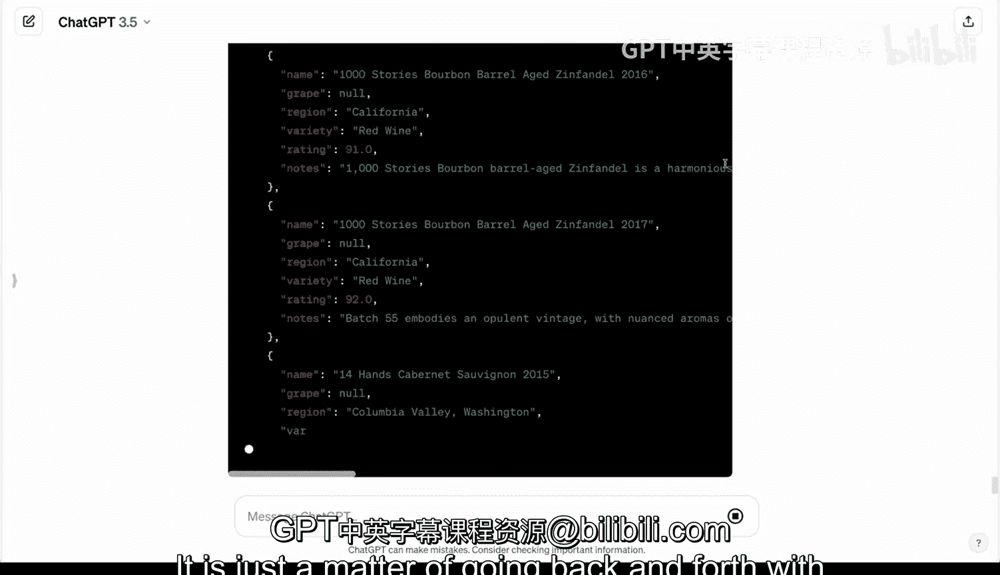

# 大型语言模型实践：P36：分解为更小的任务 🧩

## 概述
在本节课中，我们将学习一个处理复杂任务的核心策略：将大型任务分解为更小的、可管理的子任务。我们将通过一个具体的例子——从一大段CSV文本数据中提取特定信息——来演示如何通过分步提问，引导大型语言模型（如ChatGPT）精确地完成任务，避免因一次性请求过多信息而导致模型“不知所措”。

---

将一项大型任务分解成小块，听起来很简单，但当你面对一段复杂的文本或一个需要完成的目标时，情况可能并非如此直接。

我将粘贴一大段CSV格式的文本数据，并尝试提出一个请求，看看大型语言模型是否能真正帮助我们。我有一段很长的CSV文本，需要你帮我提取其中关于葡萄酒的“品酒笔记”部分。我即将粘贴的是一段包含世界各地不同葡萄酒信息的逗号分隔值文本。

以下是CSV内容。

我已经粘贴了大量内容，你可以看到它几乎难以理解。

让我们看看ChatGPT会给出什么。非常好，它能够准确地生成我要求的内容。

所以，你可以看到这里有一些重复，但又不完全是重复，因为这些是非常相似的葡萄酒。如果你需要更多条目的笔记，请随时提出。这很好。

然而，我们可以更进一步。

接下来我要做的是，我会说：记住我粘贴的数据。看起来数据量对它来说太大了，我实际上可以缩减请求。

我会说：有哪些方法可以减少这些数据？只生成2015年及以后年份的葡萄酒的笔记，并且不要提供超过15款葡萄酒。

这看起来是正确的，你可以看到现在我得到了2016和2017年的数据，并且我能够准确地得到我想要的东西。这很棒。

再次强调，我正在进行“分块”处理。我减少了我的请求，这样大型语言模型就不会因为同时处理太多不同的请求而不堪重负。这15款看起来是正确的。

现在我可以做的是，将你提供的内容更新为JSON格式，以便我能在应用程序中使用。

可以随意包含从我原始粘贴的CSV数据中提取的任何其他额外数据。

通过这样做，你可以看到现在它正在回溯我最初粘贴的内容，然后只找出我想要的这些特定内容，并以JSON格式呈现。这正是我所寻找的。

这种提出非常小的请求或控制需要大型语言模型处理的信息量的方式，是确保我能准确获得想要结果而不让模型不堪重负的好方法。

现在这会继续，你可以看到在这里它停止了，因为它开始变得非常冗长。我当然希望它继续生成，因为我非常感兴趣。但现在它开始产生负担了，因为你可以看到这里出现了2008年的数据，这并不好。

所以我开始遇到麻烦了，因为这太多了。

那么，我可以做的是，实际上到这里来。

复制这段代码，然后说：从这个JSON文件中移除任何不是2015年或更新年份的葡萄酒。

然后我会粘贴它生成的代码，并等待它完成。

当然，它会遍历并开始修剪，最终给我我想要的精确结果。

这只是一个与模型来回沟通、试图获得正确答案的过程。

---

## 总结
本节课中，我们一起学习了如何通过“任务分解”策略与大型语言模型有效协作。核心要点是：不要一次性向模型提出过于复杂或信息量过大的请求。相反，应将目标拆解为一系列清晰、具体的小步骤，例如先筛选数据范围，再转换格式，最后进行精炼。通过这种迭代和分步的交互方式，我们可以更可靠地引导模型输出精确、符合要求的结果，同时避免模型因信息过载而产生错误或不相关的输出。记住，与AI合作的关键在于清晰的指令和循序渐进的任务规划。