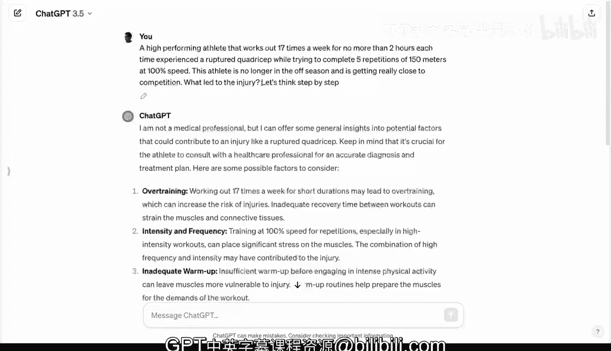

# 大型语言模型实践：第2章：使用思维链技术 🧠

在本节课中，我们将学习一种名为“思维链”的提示技术。这种技术能引导大型语言模型以逐步推理的方式生成回答，清晰地展示其得出结论的思考过程。

上一节我们介绍了提示工程的基本概念，本节中我们来看看一种更结构化的提示方法。

## 什么是思维链？

思维链是一种在提示中使用的技术。它允许大型语言模型尝试以逐步的方式回应，并试图复述导致特定结果的准确步骤。

## 示例对比：常规提示 vs. 思维链提示

为了理解其效果，我们通过一个实际案例来对比两种提示方式。本例不使用常见的数学问题，而采用一个更贴近生活的场景。

**场景描述：**
一位高水平运动员每周训练17次，每次不超过2小时。该运动员在尝试以100%速度完成5组150米跑时，遭遇了股四头肌撕裂。此时已非休赛期，比赛日益临近。

### 常规提示的回应

使用常规提示时，模型的回应会列出几个要点，指出一些可能导致受伤的因素。

以下是模型可能给出的要点列表：
*   训练过度
*   强度与频率问题
*   热身不足
*   肌肉不平衡

### 思维链提示的回应

现在，我们改用思维链提示。唯一的区别是在提示语末尾添加了“让我们一步步思考”这句话。

通过添加这个指令，模型的回应模式发生了变化。它首先会声明自己并非医疗专业人士，只能提供一般性见解，并强调运动员咨询专业医疗人员至关重要。

接着，模型会以枚举的方式逐步分析：
*   首先考虑训练量：每周17次可能属于过度训练。
*   其次分析训练强度：以100%速度进行冲刺训练强度极高。
*   然后评估准备活动：高强度训练前热身不足可能增加风险。
*   接着探讨肌肉状况：肌肉不平衡或疲劳可能导致受伤。
*   最后再次总结，建议寻求专业医疗建议。

## 思维链技术的价值

虽然两种方式得到的答案相似，但通过添加“让我们一步步思考”这个思维链指令，我们能够引导模型以特定的方式回应。这种方式揭示了大型语言模型用于得出潜在结论的思考链条。

在以下情况中，您可以考虑使用此技术：
*   当您获得的答案不够充分时。
*   当您想尝试其他方法时。
*   当问题涉及多方面事实，获得一个分解式的分析会非常有帮助。

本节课中我们一起学习了思维链提示技术。通过简单地添加“让我们一步步思考”这样的指令，我们可以引导模型进行更逐步、更结构化的推理，从而使思考过程更加透明，有时也能得到更细致的分析结果。这是一种在常规提示效果不佳时值得尝试的有效技巧。