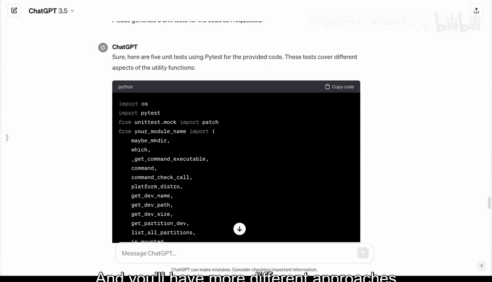

# 大型语言模型实践：P38：其他有用的提示技术 🧠

在本节课中，我们将学习两种能有效提升提示效果的高级技术。这些技巧能帮助你更精准地从大型语言模型中获取所需信息，尤其是在处理复杂或长篇内容时。

## 技巧一：先给指令，后提供内容

上一节我们介绍了如何构建清晰的指令。本节中，我们来看看一种更优的实践：将指令与待处理的内容分开发送。这种方法尤其适用于你有一段很长的文本（例如代码）需要模型分析时。


其核心思想是：先向模型清晰地说明任务和要求，然后再粘贴具体内容。这样做可以避免模型在理解冗长内容时分心，从而更专注于你设定的任务。

以下是具体操作步骤：

1.  **发送初始指令**：首先，向模型发送一个不包含具体内容的纯指令。例如：
    > 我需要你帮我处理一段代码的几个问题。我稍后会粘贴代码。请先准备好接收代码并提供改进建议。

2.  **等待模型确认**：模型通常会回复表示已准备好，例如“好的，请分享你的代码”。

3.  **发送实际内容**：接着，将你需要处理的代码或文本发送给模型。

**示例流程**：
```
用户：我需要你帮我分析并改进一段Python代码的质量。我稍后会粘贴代码。
AI：好的，请提供你的Python代码，我会进行分析。
用户：（粘贴大段Python代码）
AI：（根据初始指令，提供关于添加文档字符串、错误处理、命名规范等改进建议）
```

这种方法能确保模型在接触复杂内容前，已明确理解你的核心诉求。

## 技巧二：首尾呼应，强调指令

当你的指令比较复杂，或者模型在生成长篇回答时容易偏离主题，可以采用“首尾呼应”法。这个技巧是指，在提示的开头和结尾都重申你的核心要求。

这利用了模型对提示开头和结尾部分注意力更高的特性。通过重复关键指令，可以强化模型的记忆，使其输出更贴合你的要求。

以下是构建此类提示的要点：

1.  **开头明确任务**：清晰陈述首要任务。
2.  **中间提供上下文**：详细说明具体要求、约束条件或背景信息。
3.  **结尾重申任务**：用简洁的话再次强调核心要求。

**示例提示结构**：
```text
【开头】请为我接下来粘贴的代码生成5个单元测试。
【中间】代码将使用Pytest框架。请假设依赖已安装，环境就绪。测试需要颗粒度细，失败时应有准确的错误信息，并且每个测试都要有说明其目的的注释。
【结尾】请根据以上要求，生成5个单元测试。
```

**代码示例（指令中描述的目标）**：
```python
# 假设这是用户提供的代码
def calculate_average(numbers):
    return sum(numbers) / len(numbers)

# 模型根据“首尾呼应”的提示，应生成类似如下的测试代码：
import pytest

def test_calculate_average_with_positive_numbers():
    """测试使用正数列表计算平均值"""
    assert calculate_average([1, 2, 3, 4, 5]) == 3.0

def test_calculate_average_with_single_number():
    """测试使用单元素列表计算平均值"""
    assert calculate_average([5]) == 5.0

def test_calculate_average_with_negative_numbers():
    """测试使用负数列表计算平均值"""
    assert calculate_average([-1, -2, -3]) == -2.0

def test_calculate_average_returns_float():
    """测试返回值是否为浮点数"""
    result = calculate_average([1, 2])
    assert isinstance(result, float)

def test_calculate_average_with_empty_list_raises_error():
    """测试空列表输入是否引发ZeroDivisionError"""
    with pytest.raises(ZeroDivisionError):
        calculate_average([])
```

通过这种方式，即使指令细节很多，模型也能更可靠地产出符合你预期的结果。

---



本节课中我们一起学习了两种实用的高级提示技术：**“先指令后内容”** 和 **“首尾呼应强调”**。掌握这些技巧能让你在与大型语言模型交互时获得更准确、更有用的输出，特别是在处理代码分析、长文本生成等复杂任务时。请在实践中灵活运用它们。