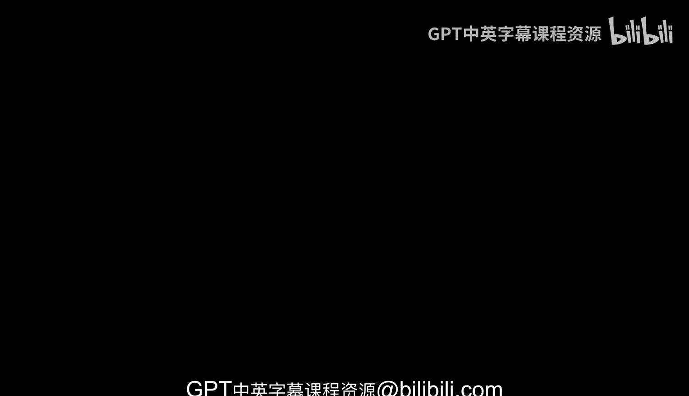
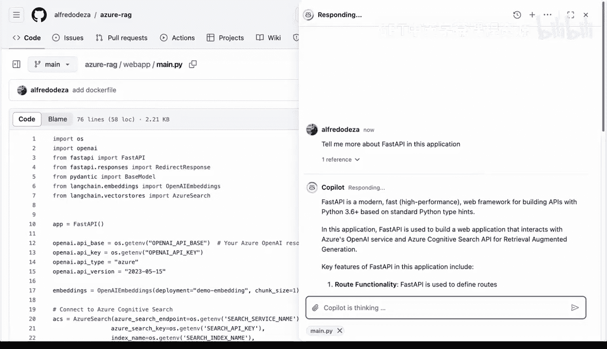

# 大型语言模型实践：第1章：生成式人工智能应用的常见类型 🧠

在本节课中，我们将学习生成式人工智能（Generative AI）在现实世界中的几种常见应用类型。我们将从最流行的文本聊天应用开始，逐步扩展到其他领域，了解生成式AI如何融入我们的日常工作与生活。

---

## 基于聊天的应用 💬

上一节我们介绍了课程概述，本节中我们来看看生成式AI最广为人知的应用形式：基于聊天的应用。这类应用的核心是用户与大型语言模型进行对话式的交互反馈循环。

以下是几种常见的聊天应用场景：

*   **通用聊天机器人**：例如ChatGPT，它通过与用户进行文本对话来提供信息、解答问题或协助创作，这类应用的普及极大地推动了生成式AI的发展。
*   **客户服务聊天机器人**：过去，许多客服机器人的体验可能很笨拙，无法准确理解用户的具体问题（例如订单延迟），反而提供不相关的回答（例如推荐新产品），导致用户体验不佳。
*   **集成式对话界面**：如今，各种具备对话功能的应用程序越来越普遍，它们将大型语言模型的能力嵌入到产品中，提供更自然的交互方式。

---

## 超越聊天：创意与内容生成 🎨

除了聊天应用，生成式AI在创意和内容生成领域也展现出巨大潜力。艺术家和创作者们正在利用它来生成图像、创作音乐甚至制作视频。

以下是生成式AI在内容创作方面的应用：

*   **图像生成**：根据文本描述自动创建视觉图像。
*   **音视频生成**：辅助或自动生成音乐、语音和视频内容。
*   **多模态融合**：结合文本、图像、音频等多种形式进行综合性内容创作。

---

## 融入日常工作的生产力工具 ⚙️

如果我们进一步思考，生成式AI的潜力远不止于聊天和创意。它正变得越来越具有生产力，并开始与我们的日常任务紧密结合。

以下是生成式AI提升工作效率的示例：

*   **邮件撰写**：辅助或自动生成电子邮件草稿。
*   **会议纪要摘要**：在会议结束后自动生成内容摘要。
*   **信息整合与创作**：基于多个不同来源的信息，整合并生成所需的文档或报告。

---

## 总结与展望 🔮

本节课中，我们一起学习了生成式人工智能的几种常见应用类型。我们从**基于聊天的应用**开始，看到了它从通用对话到专业客服的演进。接着，我们探讨了其在**创意与内容生成**领域的突破，如图像和音视频创作。最后，我们了解到生成式AI正作为**生产力工具**融入日常工作，例如处理邮件和会议摘要。

我们可以预见，未来会有更多突破，生成式AI将更深入地融合到日常任务中，尤其是那些需要总结、整合与创造性输出的工作。我们的工具将越来越多地通过生成式AI得到增强，与它的交互也会变得更加日常化。