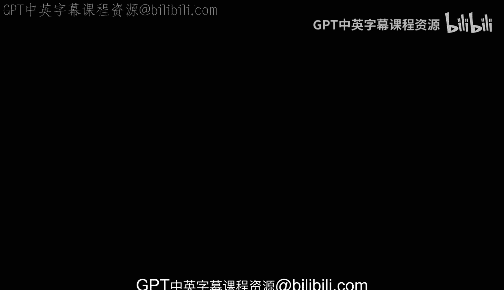
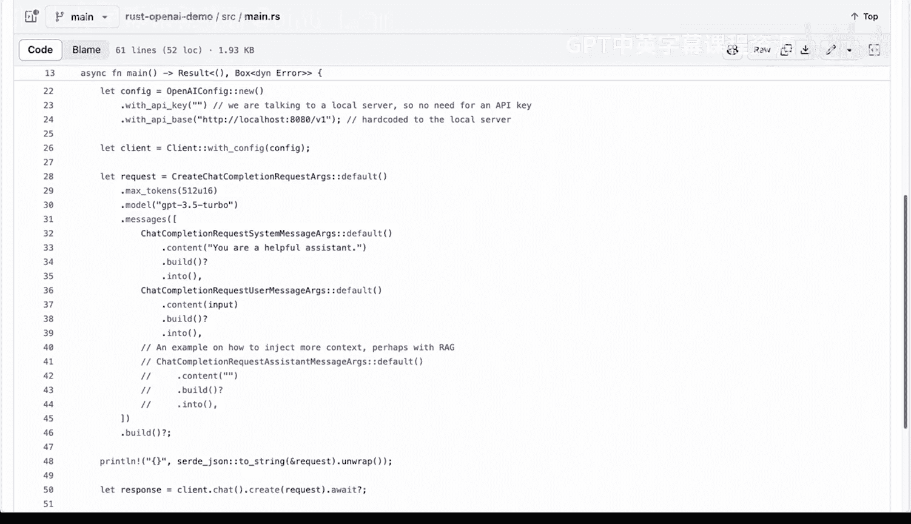
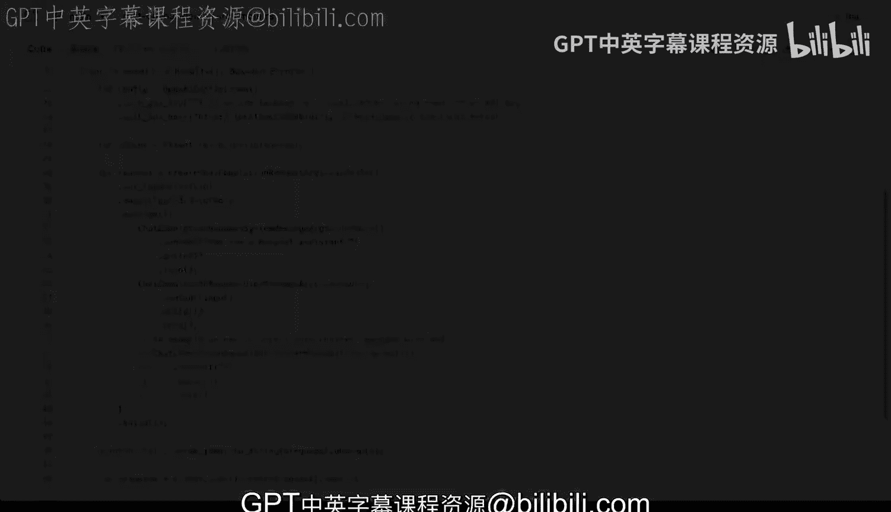

大型语言模型实践：P42：基于API的应用概览 🚀



在本节课中，我们将要学习什么是基于API的应用程序，特别是在讨论生成式AI时。我们将了解这种架构如何工作，并通过具体的代码示例来理解其核心概念。

---

基于API的应用程序正变得非常普遍，这不仅适用于交互式前端，也适用于后端服务。接下来，我们将解释这些含义。

这里有一个将通过HTTP工作的应用程序，它是一个HTTP API。这意味着，当我们的应用程序中的任何事物或用户需要交互时，可能会通过URL使用HTTP进行连接，发送一些信息并检索一些信息。这个过程将通过使用大型语言模型得到增强。

让我们快速浏览一下。你可以看到，具体到OpenAI，它提供了定义模型来源的能力。这里显示它正在与Azure OpenAI通信，并且API类型是Azure。这些是细节，我们尚未深入探讨其具体含义，但本质上，我们讨论的是这个API应用程序将向此处显示的URL发送信息。这意味着，大型语言模型并不存在于这个应用程序内部。

---

让我们看看代码。这是一个高度简化的单文件示例。我们来看一个更简单的例子。

以下是42行的Python代码。我们不必被Python代码的具体细节分散注意力，但你可以在这里看到我的意思：你在这个代码中看到任何地方定义了大型语言模型吗？没有任何定义。所有这些代码只是加载文件，传递密钥所需的内容，并尝试远程连接到一个OpenAI实例，连接到另一个位于别处的服务器，以帮助我们发送和处理信息。

以下是代码中的关键部分：
```python
# 连接到远程OpenAI服务
client = OpenAI(api_key=api_key)
# 发送提示并获取响应
response = client.chat.completions.create(...)
```

这里有一些Python服务或辅助函数，将帮助我们连接。当我提到连接位置和密钥时，我们将能够进行身份验证。

你可以看到，我需要理解制作一杯出色浓缩咖啡所涉及的变量。因此，我发送一个提示。当我收到回复时，我将打印并返回该回复。这是一种API类型的交互，我们将信息发送到远程服务器，并从远程接收响应。目前，这就像一个命令行工具，但它完全可以是一个HTTP服务。

---

我想展示的另一个例子不是Python Web应用程序，而是使用Rust的示例。

如果我进入SRC目录并展示代码，这也会相当简化。你可以看到，我们正在本地连接到一个大型语言模型应用程序。同样，我们使用HTTP，使用这个特定的URL远程连接到另一个将提供大型语言模型服务的应用程序。

以下是连接的核心部分：
```rust
// 使用HTTP客户端连接到LLM服务
let client = reqwest::Client::new();
let res = client.post("http://localhost:11434/api/generate")
    .json(&request_body)
    .send()
    .await?;
```

还有其他类型的应用程序在内部托管模型，即模型将在代码中的某个地方定义，然后应用程序将服务该模型并与之交互。这种关注点分离的架构（在这个例子中是Rust，之前是Python）非常棒，因为它允许你进行扩展，允许多个不同的应用程序与大型语言模型通信。

---

以上是两个很好的例子，展示了当你尝试创建基于生成式AI的应用程序时，可以考虑与大型语言模型交互的方式。





本节课中我们一起学习了基于API的应用程序架构。我们了解到，在这种模式下，应用程序通过HTTP等协议与远程的大型语言模型服务通信，而不是在本地托管模型。这种分离关注点的设计提高了系统的可扩展性和灵活性。我们通过Python和Rust的简化代码示例，具体看到了如何实现这种远程API调用。