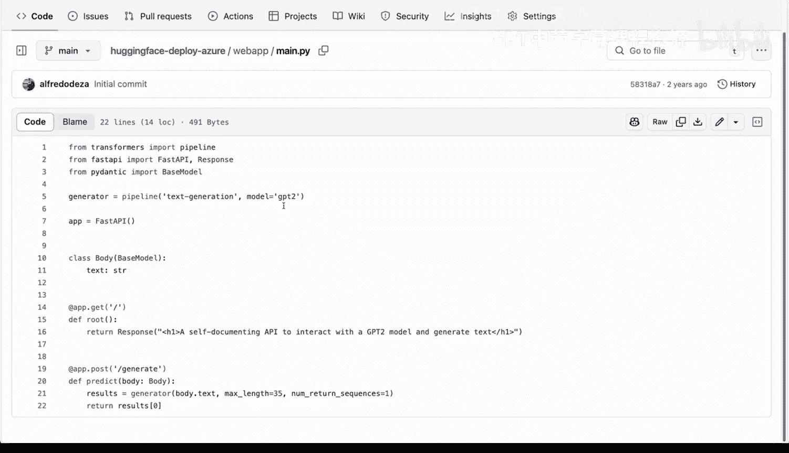
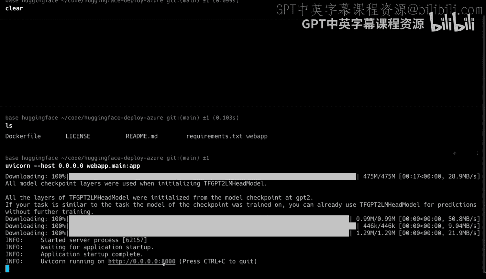
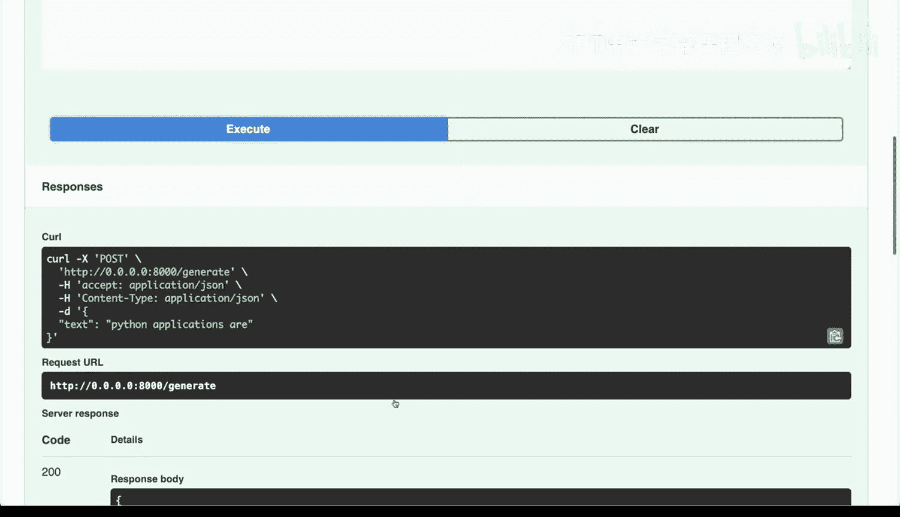
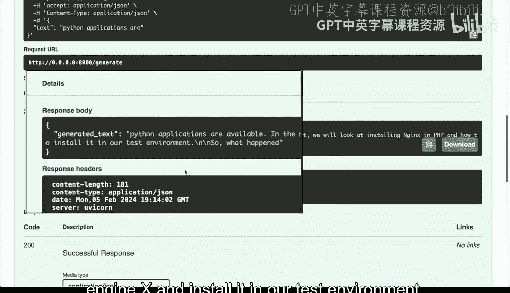
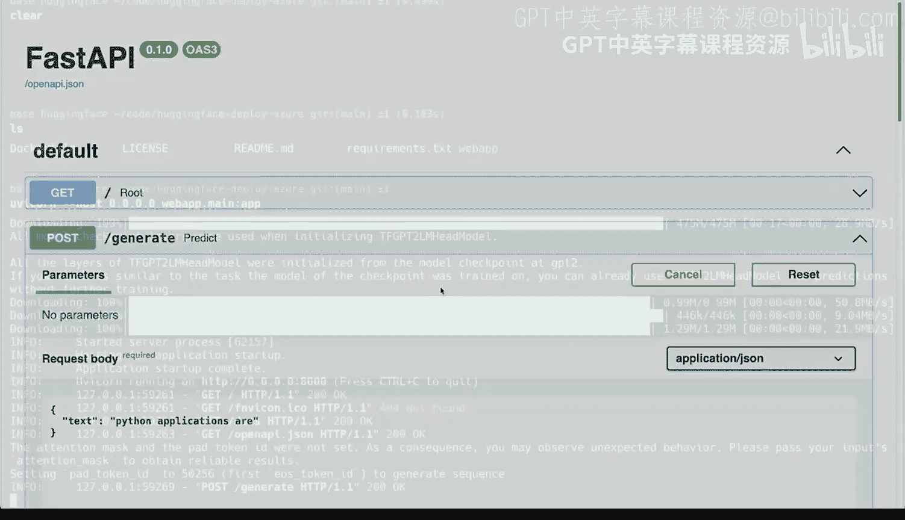
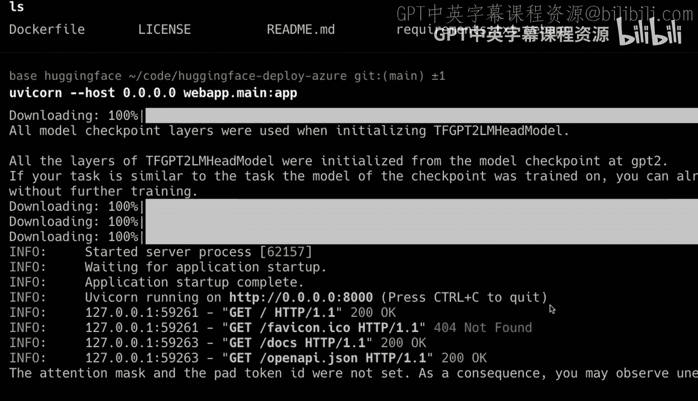
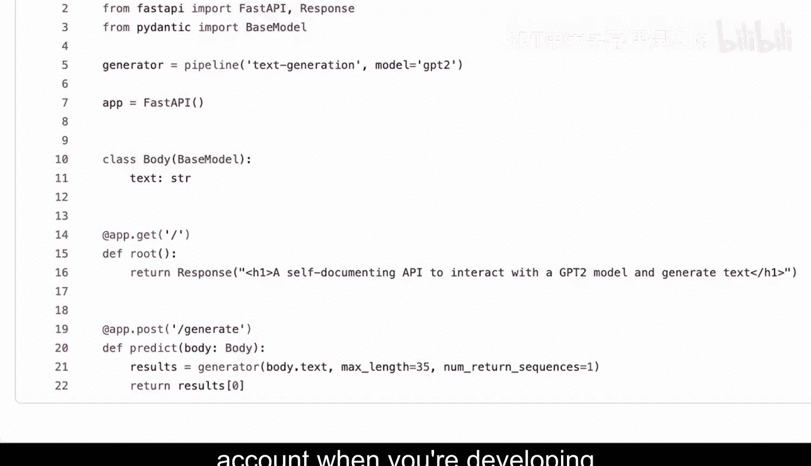
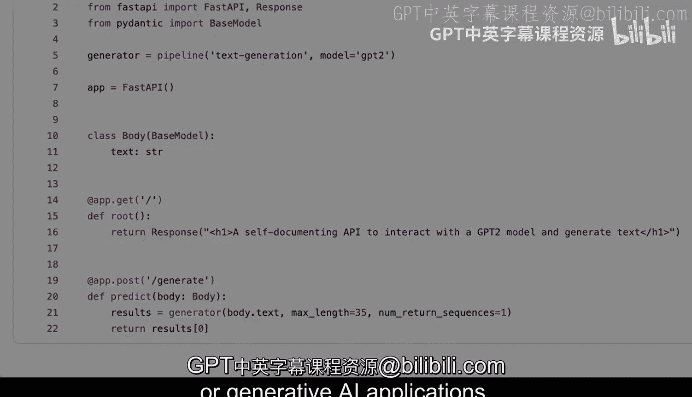

# 大型语言模型实践：1.3：嵌入式模型应用概览 🧩


在本节课中，我们将要学习什么是嵌入式模型应用。我们将通过一个具体的Python应用示例，来理解模型如何被“嵌入”到应用程序内部运行，并探讨这种架构的特点和考量。

---

## 什么是嵌入式模型应用？

上一节我们介绍了大型语言模型的基本概念，本节中我们来看看嵌入式模型应用的含义。嵌入式模型应用意味着大型语言模型本身被包含在应用程序的内部。

具体来说，模型文件将与应用程序代码一同部署和运行，而不是通过远程API调用外部服务。

## 一个Python应用示例

为了理解嵌入式模型，我们来看一个示例代码仓库。以下是该应用的核心部分：

```python
# 这是一个非常古老的模型，GPT-2
# 可以将其视为现代GPT-4的“曾祖父”
generator = pipeline('text-generation', model='gpt2')
```



这段代码使用Hugging Face的`transformers`库，通过`pipeline`函数动态加载`gpt2`模型。当应用运行时，这个模型会被下载并集成到应用内部。

以下是该应用API端点的关键设置：
*   **API路径**：`/generate`
*   **输入限制**：最大长度为35个token
*   **输出**：返回单个生成序列

这些参数是`gpt2`模型特有的配置。代码中的`generator`对象负责与模型进行交互。

## 运行嵌入式模型应用

现在，让我们看看运行这个应用时会发生什么。在终端中，我们使用`uvicorn`服务器来启动这个HTTP应用。

运行命令后，可以观察到以下过程：
1.  系统开始下载模型文件，总计约475MB。
2.  模型被下载到本地系统，并加载到应用程序的内存中。
3.  应用成功启动，在本地8000端口提供服务。

通过浏览器访问`http://localhost:8000/docs`，我们可以与应用的API进行交互。例如，输入“Python applications are”，模型会生成后续文本，如“available in the next part we will look at installing engineX and install it in our test environment”。



终端中显示的所有交互日志，都基于已下载并运行在应用内部的475MB模型文件。这就是“模型与应用程序共存”的含义。







## 嵌入式模型的考量

这种架构将模型和应用紧密耦合，带来了特定的优缺点。

以下是采用嵌入式模型架构时需要考虑的几个关键点：
*   **关注点分离**：这类应用通常不允许将模型服务与业务逻辑清晰分离。
*   **资源占用**：每次部署新的应用实例，都需要重新下载模型文件，导致部署包体积庞大。
*   **基础设施**：运行应用的机器需要具备足够的存储空间和内存来容纳模型文件，可能成为资源密集型的重型服务。

---







本节课中我们一起学习了嵌入式模型应用的概念。我们通过一个实际的Python示例，看到了模型如何被直接集成到应用代码中运行，并理解了这种架构带来的便利性与挑战，例如部署便捷性与资源开销之间的权衡。在设计和开发大型语言模型或生成式AI应用时，需要根据具体场景权衡是否采用嵌入式方案。