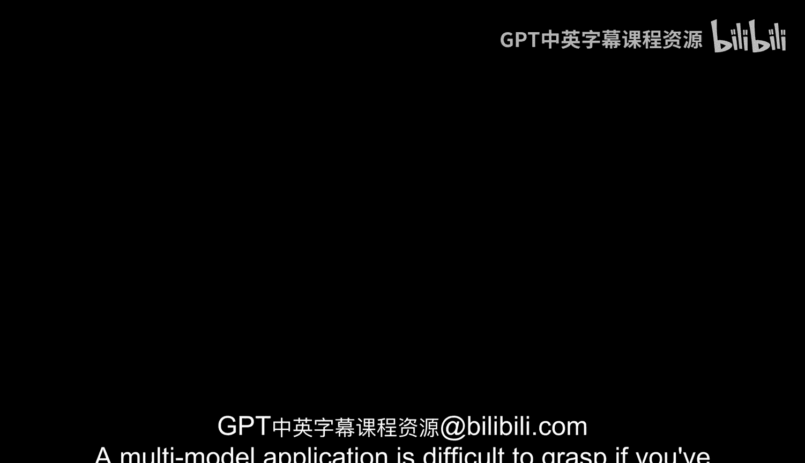
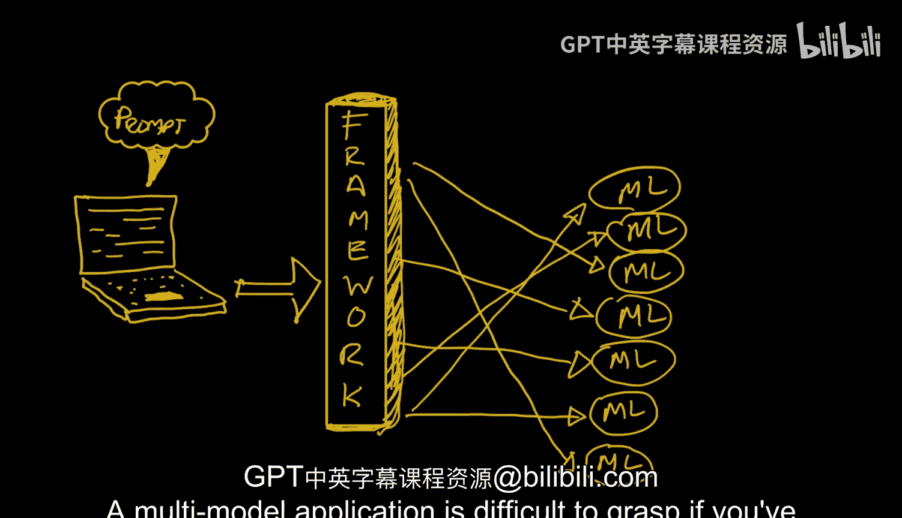
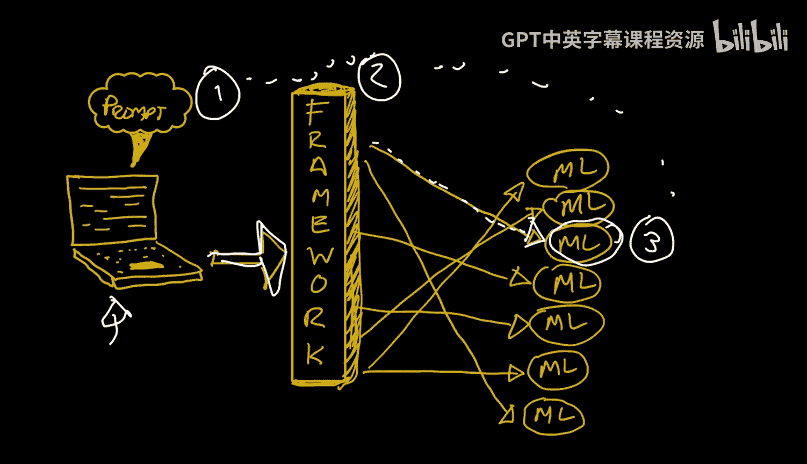
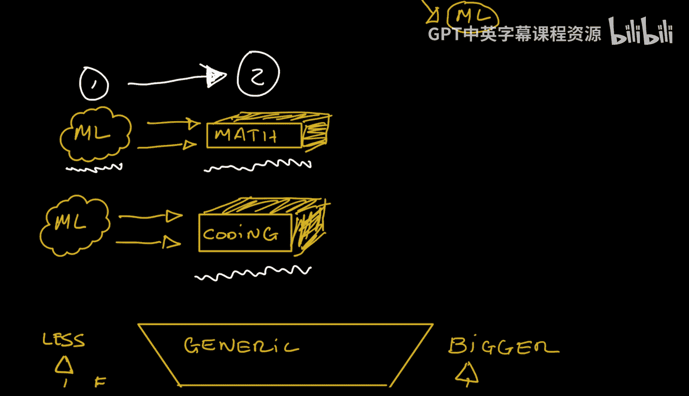
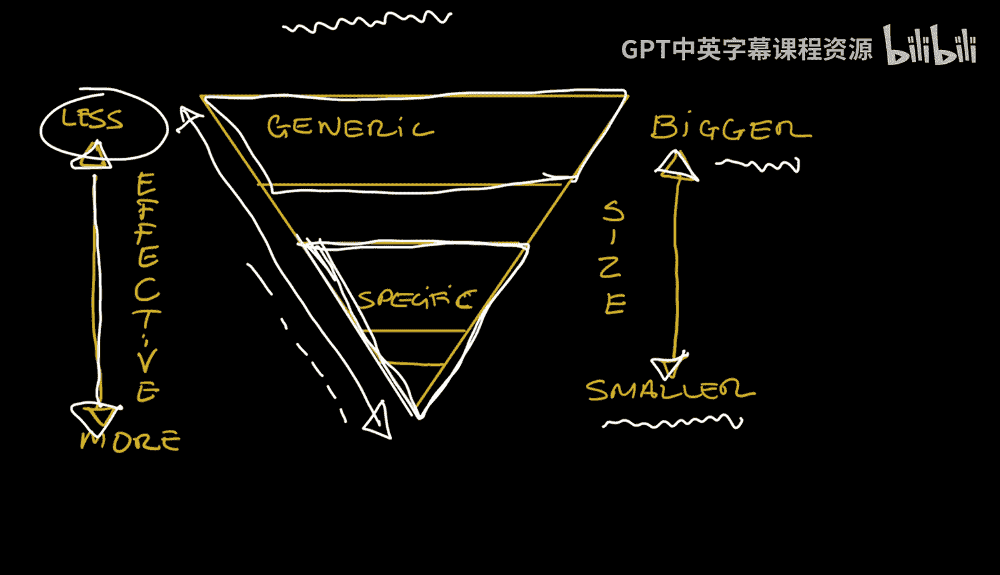
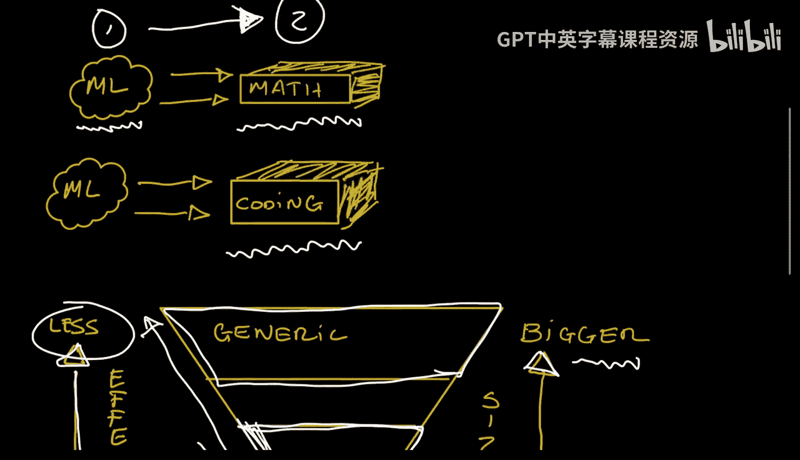
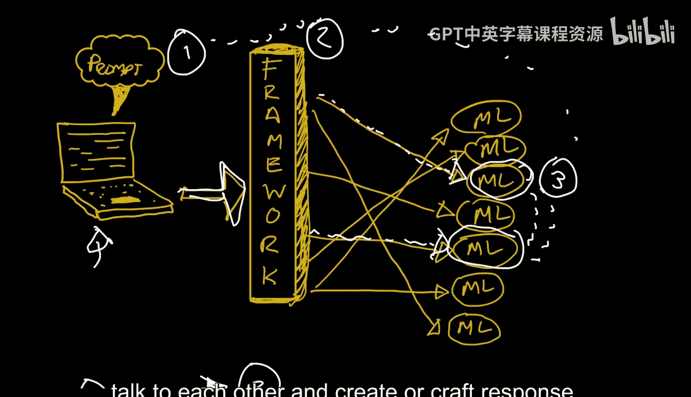
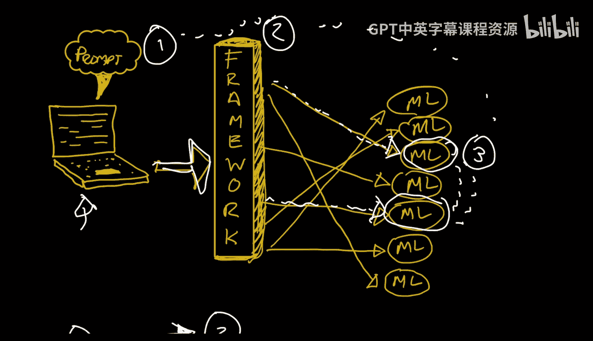
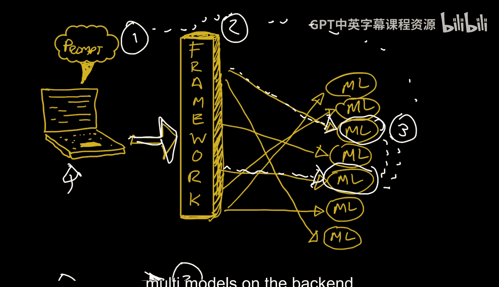
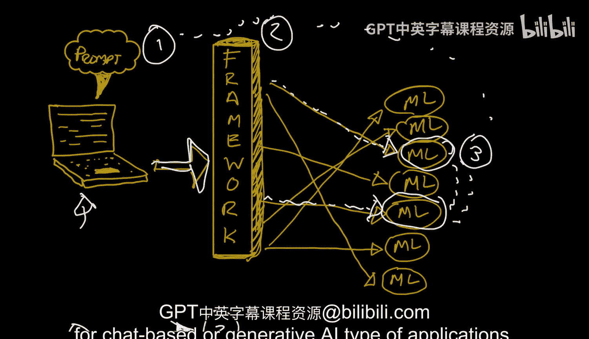

# 大型语言模型实践：P44：什么是多模型应用 🧠

在本节课中，我们将要学习多模型应用的基本概念、工作原理及其优势。多模型应用通过将用户请求路由到不同的、高度专业化的机器学习模型来处理复杂任务，从而提升效率和效果。

---

如果你从未接触过多模型应用，这个概念可能有些难以理解。特别是当你尝试扩展应用或思考如何扩展时。现在，让我们揭开它的神秘面纱，从一个非常基础的例子开始。

## 多模型应用的基本工作流程

首先，用户会发起一个提示。这个提示会发送到一个**框架**。框架接收到这个提示后，会根据提示的内容，决定将请求重定向到哪个机器学习模型。

例如，假设你有一个应用，它可以处理数学问题、编程问题或翻译任务。翻译实际上是生成式AI一个很好的例子。框架会根据输入内容来决定使用哪个模型。

以下是其工作流程的分解：

1.  **用户发起提示**：流程从用户输入开始。
2.  **框架接收并路由**：框架分析提示，并根据其内容（例如，是编程问题还是翻译请求）决定将请求发送给哪个专用模型。
3.  **模型处理并返回**：被选中的模型处理请求，生成响应。
4.  **响应返回用户**：响应通过框架返回给用户。

例如，如果是一个编程问题，框架会将其路由到专门的**代码生成模型**。该模型计算出正确答案后，通过框架将响应返回给用户。

有时，问题可能不是关于编程的，而是关于翻译的。我们可以有许多专门用于翻译的不同模型。

## 为何要使用多模型架构？

那么，为什么实现这样的架构是有用或有意义的呢？

原因在于这类专用模型非常高效。当模型专业化时，会带来几个关键优势：

*   **模型更小**：专用模型通常体积更小。对于机器学习模型而言，更小通常更好，因为这意味着消耗的计算资源更少，在扩展和优化时更高效。
*   **响应质量更高**：如果模型专门针对某个领域（如这里的数学或编程）进行训练，那么它在该领域的表现会**好得多**。你可以通过使用专用模型获得更好的体验。

我们可以这样理解：一个通才模型就像一个人，知道很多不同学科的知识，广度很大，但对任何特定领域的知识都缺乏深度。

## 从通用到专用：权衡与收益

随着我们从通用模型转向非常专用的模型，我们会获得一些收益，也面临一些挑战。这可以通过模型大小和有效性之间的关系来理解。

**模型大小 vs. 有效性**

*   **通用模型**：非常**大**。它试图成为许多不同领域的“专家”，因此必须涵盖所有相关知识，导致模型体积庞大。
*   **专用模型**：更加**小**。因为其专业性允许模型只专注于与其工作领域相关的重要部分。例如，一个数学模型只需要用数学知识训练，而无需包含小说或奇幻文学的自然语言信息，因此模型可以高度精简。

在有效性方面：

*   当模型**高度专用**时，其有效性会**高得多**。
*   当模型**更通用**时，其有效性会**降低**。

例如，一个专门用于**生成代码**的模型在协助编程语言方面会非常有效。但如果你向这个专用模型询问与编码无关的问题，它的回答就不会很好，有效性会很低。

这些都是我们在审视多模型架构时需要考虑的因素。

## 框架与模型协作

我特别想回到框架和提示的概念，看看机器学习框架如何与后端各种专用模型对话并生成响应。

在某些情况下，我们还见过一些实现，其中不同的模型可以相互对话，共同构建一个更完善的响应。这是一种更复杂、更深入的设置和架构。

但在最基本的层面上，根据你想要实现的目标来部署多个不同的模型，这种做法是有意义的，也值得理解。

这样，每当你需要处理大规模的问题时，你就有能力探索在聊天或生成式AI类应用的后端使用多模型架构的想法。

---

**总结**

本节课中，我们一起学习了多模型应用的核心概念。我们了解到，多模型应用通过一个智能框架将用户查询路由到后端的多个专用机器学习模型。这种架构的主要优势在于**专用模型更小、更高效，且在特定任务上表现更出色**。虽然通用模型覆盖面广，但专用模型在深度和效率上更具优势。理解这一架构有助于我们在构建需要处理多种复杂任务的可扩展AI应用时，做出更明智的设计决策。