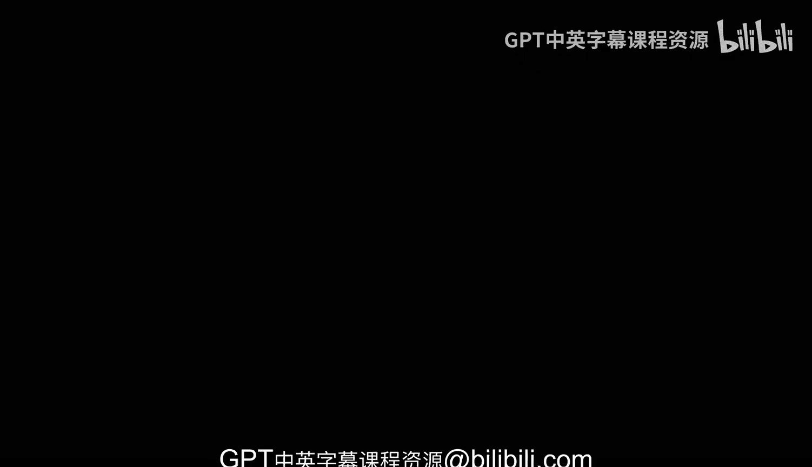
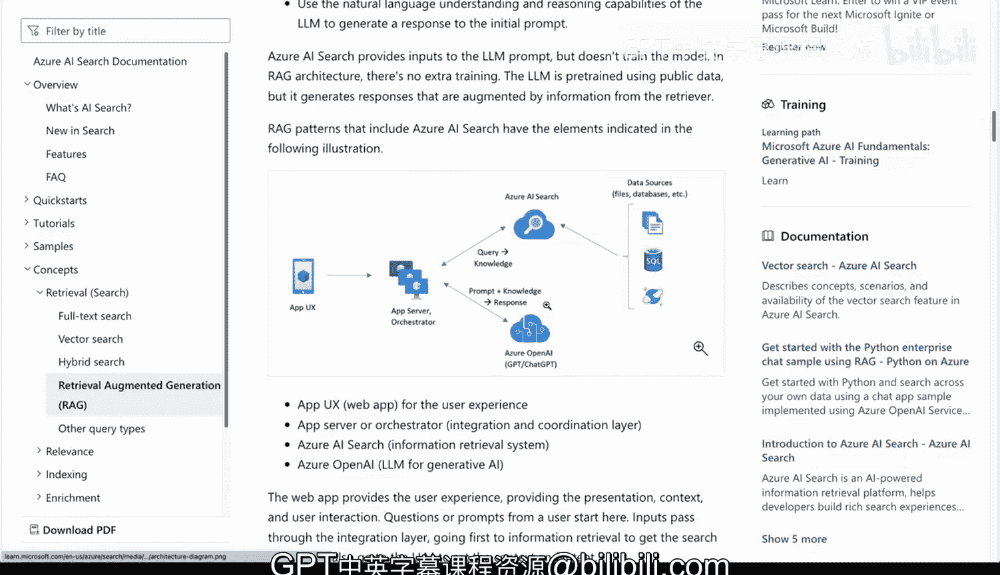

# 大型语言模型实践：1.3：什么是检索增强生成 🧠

在本节课中，我们将要学习一种名为“检索增强生成”的技术。这是一种通过结合外部知识库来提升大型语言模型回答准确性和时效性的重要方法。

---

检索增强生成是一种通过扩展、基于外部信息来改进结果的技术。它通常使用一个搜索数据库或搜索引擎，有时也称为向量数据库。

为了帮助理解，这里有一个很好的基础实现示例。用户提供输入，与大型语言模型的输出并行处理。通常，大型语言模型的输出与输入是一一对应的。但在RAG中，我们有一组文档，这些文档会被向量化并分割成模型可以理解的块。随后，我们可以利用这些文档来增强模型的回答。

上一节我们介绍了RAG的基本概念，本节中我们来看看它的工作原理。你可以将这个过程理解为对大型语言模型说：“嘿，大型语言模型，我要问你一个问题。”例如，询问关于美国当前的政治事件。当然，语言模型自身回答此类问题的能力是有限的，因为它可能没有使用最新的数据进行训练。

这时，数据库、搜索引擎或向量数据库就派上用场了。你可以通过它们来增强模型，使其获得最新、超级准确的信息。在处理用户请求时，你可以先查询这些文档，获取相关信息，然后再将问题和这些信息一同发送给大型语言模型。这样，模型就能同时接收到原始问题和来自文档的相关搜索结果。

以上就是我想展示的第一张示意图。另一张图来自Microsoft Learn，展示了Azure AI搜索中的检索增强生成流程。请注意，Azure AI搜索最近从“Azure认知服务搜索”更名而来，如果你熟悉旧名称，请记住这个变化。

让我们向下滚动，这张图详细展示了Azure AI搜索的组件，我们后续会深入讲解。但此刻，我想重点分析这个图表本身。

这是一个更完整的应用程序架构。请求首先进入应用程序，应用程序可能包含API、Python代码或容器来处理请求。处理流程如下：

以下是RAG在Azure中的一个典型工作流程：
1.  用户请求首先被提交到**Azure AI搜索**服务。
2.  Azure AI搜索利用预先加载的大量信息，生成用于增强请求的必要响应。
3.  这个增强后的请求随后被发送到**Azure OpenAI**或其他模型。
4.  模型生成答案后，经由**编排器**返回给用户。

本质上，这就是RAG的核心流程。当人们讨论搜索、向量数据库或检索增强生成时，他们通常指的是类似的实现方式。其核心目标都是通过预先加载的文档来增强模型的行为，为模型提供其当前所不具备的额外信息。

---

本节课中我们一起学习了检索增强生成。我们了解到，RAG通过将用户查询与外部知识库（如向量数据库）检索到的相关信息相结合，再交由大型语言模型处理，从而显著提升回答的准确性和时效性。这是一种弥补模型知识局限性的强大技术。