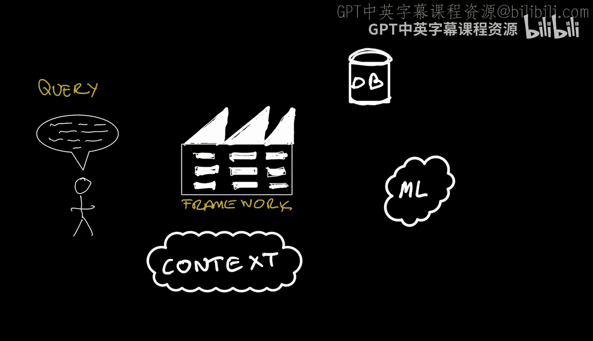
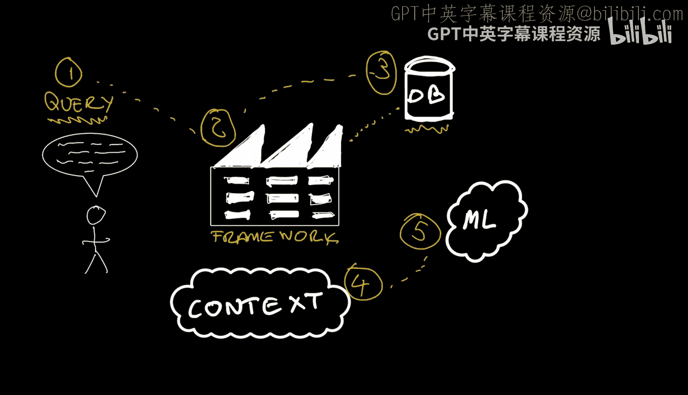
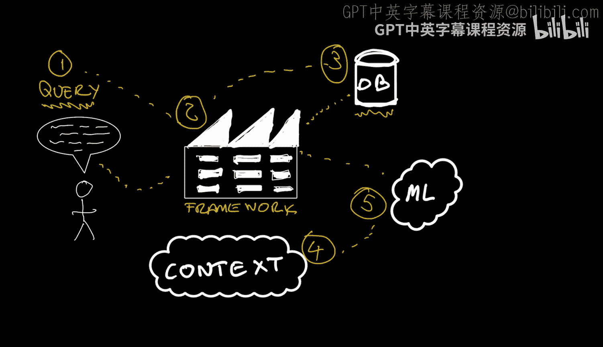
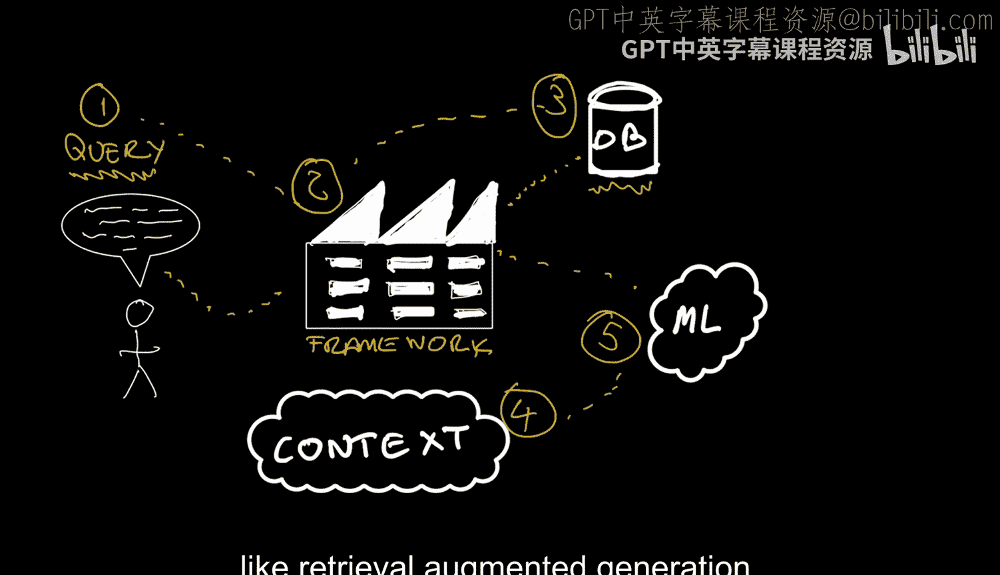

# 大型语言模型实践：P48：检索增强生成应用概览 🧠

在本节课中，我们将要学习检索增强生成（RAG）的基本工作原理。我们将通过一个清晰的流程概述，了解用户查询如何通过结合向量数据库的知识来获得更准确、更具上下文的回答。

## 概述

检索增强生成是一种将大型语言模型与外部知识源（如向量数据库）相结合的技术。其核心目的是为模型提供训练数据之外的最新或特定领域信息，从而生成更可靠的回答。下面，我们将一步步拆解这个流程。

## 工作流程详解

上一节我们介绍了RAG的概念，本节中我们来看看一个具体的查询是如何在这个系统中流动的。

整个过程始于用户的查询。通常，查询会直接发送给应用框架，然后由框架传递给机器学习模型（如大型语言模型）并返回结果。但在RAG架构中，流程有所不同。

### 第一步：查询接收与路由

用户提出一个查询。这个查询首先被发送到应用框架。这个框架可以是LangChain、Semantic Kernel等专门工具，也可以是一个直接调用API的普通应用程序。

### 第二步：转向向量数据库

框架接收到查询后，并不会直接将其发送给大型语言模型。相反，它会先将查询发送给**向量数据库**。

向量数据库将针对这个查询执行一次搜索。例如，假设用户的查询是“昨天的天气如何？”。向量数据库中可能存储了昨天的天气数据，而这些信息是大型语言模型在训练时未曾见过的。

### 第三步：构建增强上下文

搜索完成后，向量数据库将找到的相关信息（即“答案”）返回给应用框架，而不是直接给用户。

此时，框架会执行一个关键步骤：它将原始的用户查询和从向量数据库获得的答案结合起来，构建成一个**增强的上下文**。

### 第四步：语言模型加工与回答

这个包含了问题和已知答案的增强上下文，随后被发送给大型语言模型。

可以这样理解：这就像一个学生在考试时拿到了“小抄”。大型语言模型的任务不再是凭空生成答案，而是基于已有的“标准答案”（即上下文），以一种通顺、自然的方式组织语言，将其“包装”好。

最后，模型生成的良好格式的回答被送回框架，再由框架最终呈现给用户。

## 核心优势与特点

以下是RAG工作模式带来的主要好处：

*   **成本效益**：为大型语言模型进行再训练的成本非常高。而向向量数据库中添加或更新文档则相对简单且成本低廉。
*   **信息实时性**：模型可以获取其训练截止日期之后的最新信息。
*   **准确性提升**：通过提供确切的参考信息，减少了模型“幻觉”（即编造信息）的可能性。
*   **领域适应性**：可以轻松地为模型注入特定领域（如公司内部文档、专业资料）的知识。

## 总结

本节课中我们一起学习了检索增强生成（RAG）的应用概览。我们看到了一个用户查询如何通过框架被路由到向量数据库获取额外知识，然后这些知识与原始查询结合形成增强上下文，最终由大型语言模型加工成流畅的回答。这种架构巧妙地结合了数据库的精确检索能力和语言模型的强大生成能力。在后续课程中，我们将深入探讨如何实现向向量数据库中添加文档的具体过程。