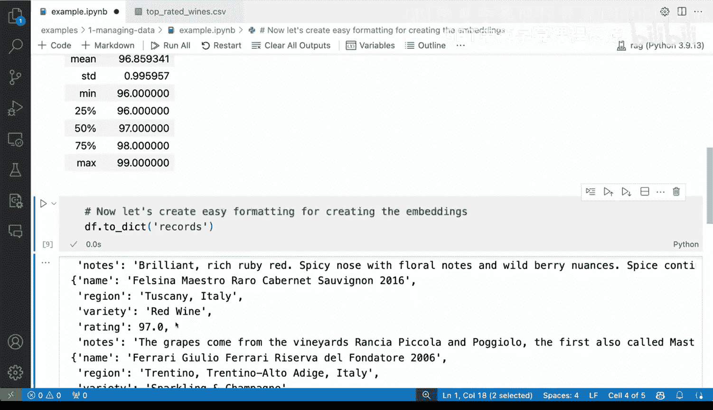

# 大型语言模型实践：第49课：管理检索增强生成的数据 🗃️


在本节课中，我们将学习如何为构建一个检索增强生成应用准备和管理数据。我们将从一个包含全球葡萄酒信息的CSV文件开始，使用Python的pandas库加载和处理数据，并将其转换为适合后续向量数据库使用的格式。

## 数据概览与加载

首先，我们需要理解将要使用的数据。数据是一个CSV文件，包含了来自世界各地的葡萄酒信息。具体来说，它包含以下列：`name`（葡萄酒名称）、`region`（产区）、`variety`（葡萄品种）、`rating`（评分）和`notes`（品酒笔记）。

例如，产区可能是“纳帕谷”。数据本身可以是任何内容，但这里我们有一个格式良好的CSV文件。我们将使用这些列来创建我们的数据集，该数据集将用于后续的应用开发。

我们将使用Python，特别是pandas库，来与这个逗号分隔值文件进行交互。文件位于项目仓库中。首先确保环境准备就绪，然后导入pandas。

```python
import pandas as pd
```

现在，从项目根目录加载这个CSV文件。

```python
df = pd.read_csv(‘wines.csv’)
```

运行代码后，我们可以看到数据的表示形式，包括名称、产区、品种、评分和笔记。这个数据集有很多条目。

```python
len(df)
```

数据显示我们有1365个条目。观察评分列，其范围通常从80多分到100分。你可以看到有很多96分和97分的记录，这是因为我们从一个更大的数据集中筛选出了评分在96分及以上的子集。

## 数据转换与格式化

我们已经将数据加载到pandas DataFrame中。接下来，我们将创建一个字典列表。我将展示这样做的原因。

```python
records = df.to_dict(‘records’)
```

运行这行代码需要一点时间，之后我们将得到数据的字典列表表示形式。

这个操作将在Python中创建一个字典列表。每个字典的键是列名（name, region, variety, rating, notes），对应的值是该行葡萄酒的信息。

我们为每一款葡萄酒都进行这个操作，是为了后续能将其加载到向量数据库中。我们将使用这种格式，以便在创建嵌入向量、对所有输入进行分词时，能够告诉向量数据库：“这是我们的数据，你需要以这种方式处理它，以便我们后续能更成功地搜索它。”

本质上，这就是我们所做的步骤。虽然数据量很大，但步骤非常简单。只用了三四个代码单元就完成了所有数据的加载和转换。

## 格式选择的重要性

如果在这里没有使用`‘records’`参数，而是使用其他方式，格式就不会完全正确。

例如，如果不指定`‘records’`，索引可能会成为键，而值会是其他内容，这不是我们想要的。这就是为什么我选择使用`‘records’`参数。重新运行正确的代码后，我们得到了完全符合向量数据库需求的格式。

## 总结



本节课中，我们一起学习了为检索增强生成应用管理数据的基础步骤。我们从加载一个结构化的CSV文件开始，使用pandas库将其读入DataFrame。接着，我们将DataFrame转换为字典列表格式，这是为了后续能顺利地将数据导入向量数据库并进行高效的语义搜索。这个过程虽然涉及数据转换，但通过使用正确的工具和方法，可以变得直接而高效。