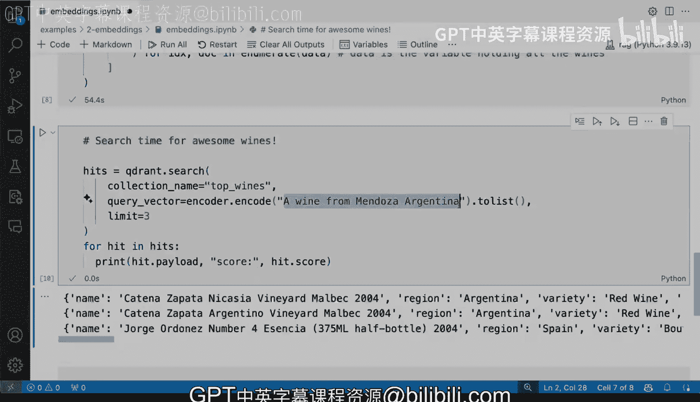

# 大型语言模型实践：P50：验证嵌入与搜索 🔍

在本节课中，我们将学习如何加载数据、创建向量数据库，并执行语义搜索。我们将使用Pandas处理数据，使用Sentence Transformers生成文本嵌入，并利用Qdrant构建一个内存向量数据库来存储和检索信息。

---

上一节我们介绍了数据处理的基本步骤，本节中我们来看看如何将处理后的数据转换为向量并存入数据库。

首先，我将重复一些步骤来加载CSV文件。

我将使用Pandas加载该文件，如下所示。我仍将对数据做一些调整，将其转换为字典格式。

此处的操作旨在确保数据中不包含“非数字”值。这意味着任何没有值的字段都将被删除。我通过这种方式有效地修剪数据集，以避免在后续序列化过程中出现问题。

运行这些代码。与之前类似，我将获取名称、地区和一些信息，共1300行数据。

现在，我将使用必要的软件来实现向量数据库搜索。我将使用Qdrant。具体来说，我需要导入以下模块：`models`、`QdrantClient`以及`sentence_transformers`。

我会详细解释每个部分的作用，以便你充分理解为何需要它们。

Sentence Transformers 使我们能够进行编码。编码是绝对必需的。我们将使用 `all-MiniLM-L6-v2` 模型，它会自动在本地下载机器学习模型，以便我们进行分词和生成嵌入向量，从而存入向量数据库。这是后续与大型语言模型对话所必需的。

接着，我们将使用QdrantClient。这个客户端是我们与数据库通信所需的工具。它代表从这里启动的数据库实例。这个导入项使我们能够与该数据库对话。一个很酷的功能是，我们可以使用内存数据库，无需创建基于文件或网络的数据库。这对于示例非常方便，也是我今天选择它来使演示更具吸引力的原因。

接下来，我将创建一个集合。这个集合将存在于数据库中。当我传入特定参数时，我们将设定“距离”度量，其基本作用是进行比较，以找出搜索词与存储数据中哪些短语更接近。

我将创建配置，实际上是集合的向量配置。向量大小由我们使用的模型决定，这里就是确保尺寸正确。我使用余弦距离。完成这些后，我就能创建索引，并将所有内容上传到我们的向量数据库中。

我们将集合命名为 `tab_wines`。我们将把“品酒笔记”作为向量传入。因此，我们需要对其进行编码，编码结果将作为向量。其余数据将作为元数据存入“载荷”中。我们将遍历所有数据，创建索引文档并进行枚举。运行此代码，这需要一些时间，因为我们要处理大约1300条记录。我将运行它，并等待完成。

在我的系统上，这花了54秒，时间相当长。我建议在演示时减少条目数量以节省时间，但为了完成演示，我不得不等待这54秒。

现在完成了。接下来是关键时刻：我们将执行搜索。为此，我们将使用这里的搜索函数。我们将指定我们的集合，并传入查询。查询同样会经过编码器处理。我们将结果限制为3条，然后查看返回的内容。

我们得到了“99分，来自纳帕谷的赤霞珠，带有碳烤味”等几条结果。你可以看到，向量数据库正在使用“品酒笔记”字段。它确保捕获的正是这里的“笔记”内容，并以此进行搜索，效果相当不错。

但我们也可以尝试改变搜索词，例如搜索“来自阿根廷门多萨的马尔贝克葡萄酒”。

再次运行搜索，这次会得到完全不同的结果，比如“卡氏家族艾拉莫马尔贝克”，这是一款非常出色的葡萄酒。现在你可以看到，这些结果被返回了。

那么，这为何有用且相关呢？因为我们配置的这个向量数据库能够理解我们的自然语言。后续，结合大型语言模型的自然语言处理能力，我们可以获得相关结果，从而增强大型语言模型的响应质量。

---

本节课中，我们一起学习了从加载数据到构建内存向量数据库并进行语义搜索的完整流程。我们了解了如何使用Sentence Transformers生成文本嵌入，以及如何利用Qdrant客户端配置集合、上传数据并执行基于余弦相似度的搜索。这个过程是将非结构化文本数据转化为机器可理解、可检索格式的关键步骤，为后续集成大型语言模型、实现更智能的问答和内容生成奠定了基础。