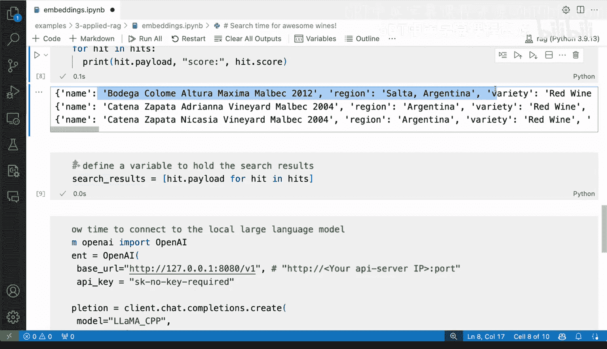

# 大型语言模型实践：P51：将检索增强生成与大型语言模型结合使用 🍷


在本节课中，我们将学习如何将检索增强生成技术应用于大型语言模型。具体来说，我们将把一份葡萄酒数据集导入向量数据库，然后让LLM基于数据库中的信息来生成更准确、更有意义的回答。

---

上一节我们介绍了向量数据库的基本操作，本节中我们来看看如何将其与大型语言模型结合，构建一个能提供专业建议的智能应用。

首先，我们需要将葡萄酒的CSV数据导入数据库。我们将使用Pandas库来处理数据。

```python
import pandas as pd
```

为了提升处理速度，我们将数据条目限制为700条。运行以下代码来完成数据加载。

接着，我们将使用Quadrant客户端。需要再次导入一些必要的工具。

```python
# 示例：导入必要的库和初始化客户端
from some_module import QuadrantClient, Encoder
```

然后，再次运行编码器，并创建向量数据库客户端。

我们将创建一个新的集合来存储数据。这次不是存储书籍，而是存储一些葡萄酒信息，我们将这个集合命名为“top_wines”。运行代码以创建集合，所有设置与之前类似。

创建完成后，我们将把所有数据上传到“top_wines”集合中。这个过程需要几秒钟，因为我们已将数据缩减到700条记录。

等待上传完成。完成后，我们将通过OpenAI API（或兼容的本地模型）来使用这些数据，从而获得有意义的查询结果。

上传已完成，耗时34秒。即使只处理700条记录，在我的机器上也花费了一些时间。现在，我们向下滚动到底部，开始进行查询。

我们将定义一个查询提示。例如：“suggest me an amazing Malbec wine from Argentina”（给我推荐一款出色的阿根廷马尔贝克葡萄酒）。我们将此提示定义为一个变量。

接下来，我们将在数据库中搜索相关信息。我们将获取一些搜索结果。

为了使过程更简便，我们将所有搜索结果应用到一个变量中。然后，连接到OpenAI（或本地模型，如Llamafile）。这里的关键是你可以连接到ChatGPT、OpenAI API或任何兼容的API服务。

在本例中，我运行一个本地模型，不需要API密钥。我们有以下提示设置：
- **系统提示**：你是一个聊天机器人，一名葡萄酒专家。你的首要任务是帮助引导用户选择出色的葡萄酒，并根据他们的请求提供指导。
- **用户内容**：我们之前定义的查询变量（“suggest me an amazing Malbec wine from Argentina”）。
- **助理角色/内容**：这将从我们数据库的搜索结果中获取。

运行查询。让我们看看大型语言模型返回了什么内容。

它回复道：“I suggest you try the Bodega Colomé Altura Máxima Malbec from Argentina. Oh, this is amazing! It has a rating of 96.”（我建议您尝试阿根廷的Bodega Colomé Altura Máxima Malbec。哦，这太棒了！它的评分是96分。）

模型利用了之前的所有上下文信息。如果我们滚动到顶部查看搜索结果，会发现第一条结果正是来自阿根廷Salta产区的一款酒，这证实了模型有效地利用了检索到的信息。

---

**总结**



本节课中我们一起学习了如何将检索增强生成与大型语言模型结合使用。我们完成了将特定数据集（葡萄酒信息）导入向量数据库，并让LLM基于该数据库的检索结果来生成准确、上下文丰富的回答。这种方法极大地增强了LLM回答的专业性和可靠性，因为它不仅依赖预训练知识，还能动态引用外部数据源。