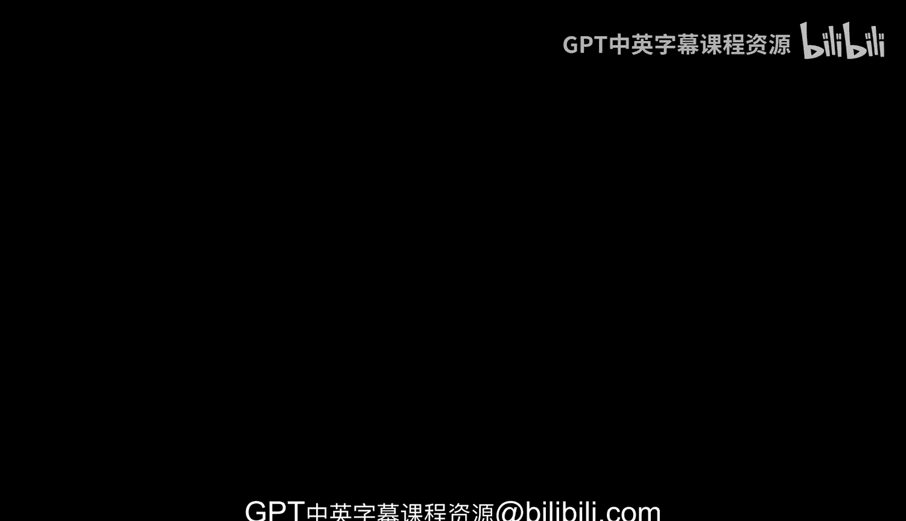

# 大型语言模型实践：P53：53_03_02_引言_9 🚀

## 概述
在本节课中，我们将学习如何构建一个基于云的生成式AI应用。我们将探索其核心架构，了解如何将其部署到云端，并验证其功能。课程将以Azure云平台为例，但所涉及的概念和步骤也适用于其他云服务提供商。

---

## 探索基于云的生成式AI应用架构

我们将要构建的生成式AI应用将是一个HTTP API。这意味着用户或客户端可以通过发送HTTP请求来与我们的AI模型进行交互。

上一节我们明确了应用的形式，本节中我们来看看实现这个API所需的所有组件。

以下是构建和运行此应用所需的核心组件：
*   **模型服务**：托管和运行大型语言模型的核心引擎。
*   **API网关/服务器**：接收外部HTTP请求，并将其转发给模型服务。
*   **计算资源**：在云端运行代码的虚拟服务器或容器。
*   **网络与安全配置**：确保API可以被安全地访问。

---

## 设置云端组件与环境

我们将使用Azure云平台来部署我们的应用。虽然具体操作界面可能不同，但在其他云平台（如AWS、GCP）上，类似的流程和概念同样适用。

以下是主要的设置步骤：
1.  创建或选择一个**资源组**，用于逻辑上组织所有相关资源。
2.  部署一个**计算服务**（例如Azure Container Instances、Azure App Service或虚拟机）来托管我们的应用。
3.  配置**网络设置**，如虚拟网络、安全组和公共IP地址，以允许外部访问。

---

## 部署流程与自动化

部署是指将我们开发好的应用程序代码和配置发布到云端环境，使其能够运行的过程。

一旦我们完成了代码开发，部署流程通常如下所示：
```bash
# 这是一个简化的部署命令示例
az webapp up --name my-genai-app --resource-group myResourceGroup
```
自动化部署（例如使用CI/CD管道）可以确保每次代码更新时，都能快速、可靠地将新版本发布到生产环境。

---

## 验证与功能测试

在应用成功部署到Azure并公开可用后，我们必须验证所有组件是否协同工作。

以下是验证步骤：
*   **检查部署状态**：在Azure门户中确认所有服务都处于“正在运行”状态。
*   **测试API端点**：使用工具（如`curl`或Postman）向我们的API发送一个测试请求。
*   **验证响应**：确保API返回了预期的、由AI模型生成的响应内容。




---

## 总结
本节课中，我们一起学习了构建和部署一个云端生成式AI应用的全过程。我们从定义HTTP API开始，逐步介绍了所需的架构组件、在Azure上的设置步骤、部署流程以及最后的验证方法。掌握这些步骤是运营生产级大型语言模型应用的基础。