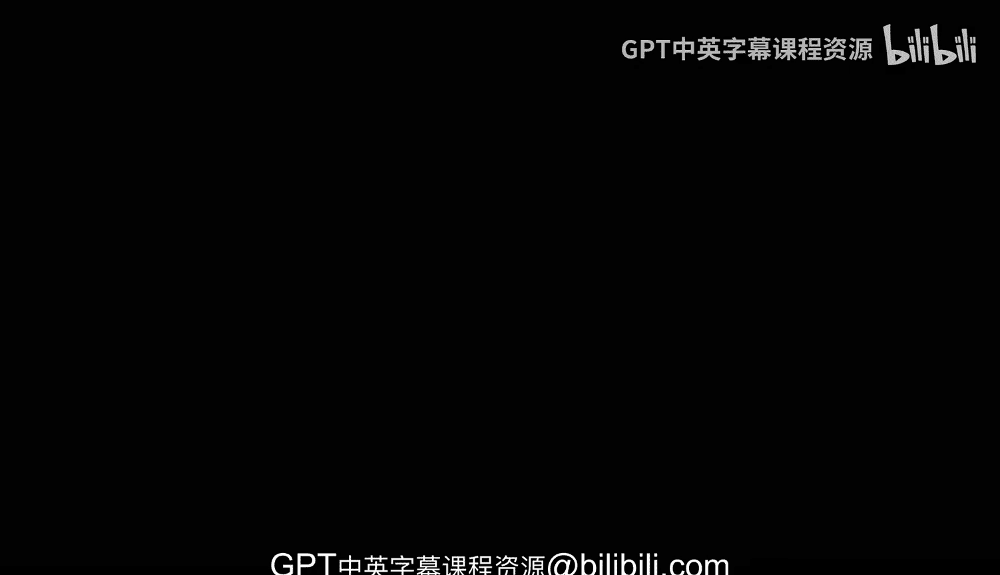
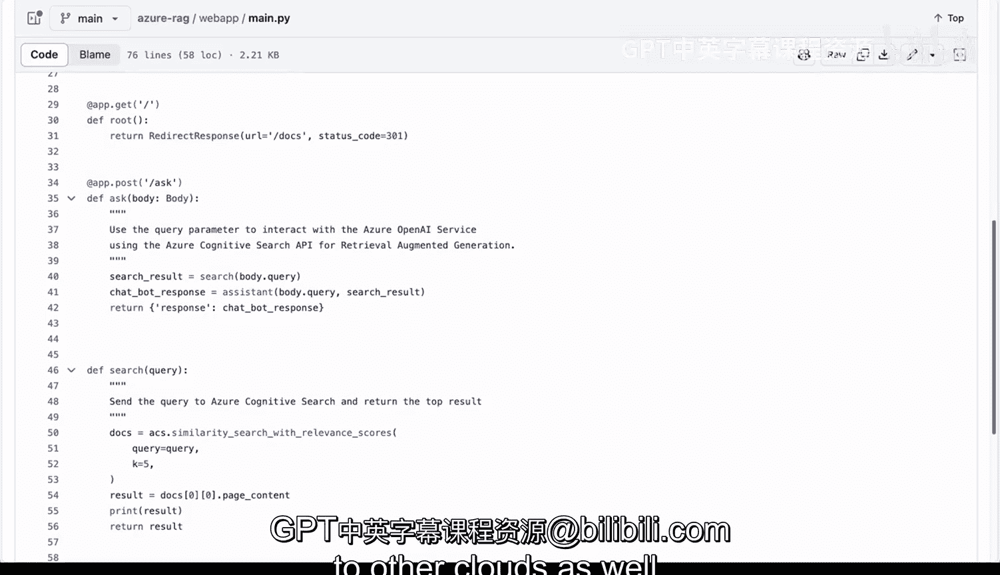

# 大型语言模型实践：P54：应用概览 🧠



在本节课中，我们将学习一个基于检索增强生成（RAG）模式的实际应用。这个应用专门为微软的Azure云平台设计，并展示了如何利用Azure OpenAI服务和Azure认知搜索来构建一个简洁、可部署的Web服务。

## 应用架构与工具概述

上一节我们介绍了RAG模式的基本概念，本节中我们来看看一个具体的实现。这个应用采用了容器化部署，其核心功能是处理用户查询，通过结合向量数据库检索和大型语言模型来生成回答。

以下是构建此应用所需的主要工具和库：

*   **Azure Identity**：用于处理与Azure服务身份验证相关的任务。
*   **LangChain**：一个用于简化与提示词工程和API交互的框架。
*   **Azure Search Documents**：客户端库，用于将数据嵌入并存储到具备向量搜索能力的Azure认知搜索中。
*   **OpenAI Python SDK**：用于与Azure OpenAI服务的API进行通信。
*   **FastAPI**：用于构建高效Web API的现代框架。
*   **Uvicorn**：用于运行FastAPI应用的ASGI服务器。
*   **Tiktoken**：OpenAI的分词器，用于帮助创建文本嵌入。

## 应用核心逻辑解析

这个Web应用非常精简，仅由一个约76行代码的文件构成。它被设计为部署到云环境，并从环境变量中获取所有敏感配置（如API密钥和端点地址），确保了安全性。

应用的核心是连接到两个外部服务：**Azure OpenAI服务**（用于调用大语言模型）和**Azure认知搜索**（作为向量数据库）。这种设计使得应用本身非常轻量且职责单一。

应用只暴露一个API端点：`/ask`。当用户向这个端点发送POST请求时，会触发以下处理流程：

1.  **接收请求**：从请求体中提取用户的`prompt`（问题）。
2.  **向量检索**：将`prompt`发送给Azure认知搜索进行相似性搜索，从预先存储的向量数据中找出最相关的5个结果。
3.  **调用大模型**：将检索到的上下文信息与原始`prompt`结合，构造一个增强的提示，然后调用Azure OpenAI的聊天补全API。
4.  **返回响应**：将大模型生成的最终答案返回给API调用者。

## 关键代码段说明

让我们深入看一下搜索和生成回答的关键部分。搜索功能通过以下逻辑实现：

```python
# 伪代码逻辑示意
def perform_search(user_query):
    # 使用Azure认知搜索进行相似性搜索
    search_results = azure_search.similarity_search(query=user_query, k=5)
    # 返回检索到的相关文本内容
    return search_results
```

检索到的内容随后被用于增强发送给大模型的上下文。提示词的构造类似于以下模式：

```python
enhanced_prompt = f"""
基于以下已知信息，请回答问题：
{search_results}

问题：{user_query}
"""
```

最终，这个`enhanced_prompt`被发送给如GPT-4这样的模型，模型会基于提供的上下文生成一个准确且相关的回答。

## 总结与扩展

本节课中我们一起学习了一个部署在Azure云上的RAG模式应用实例。该应用结构清晰、耦合度低，通过将向量数据库和大语言模型作为外部服务调用，实现了自身的轻量化。



这种模式的优势在于其灵活性和可扩展性。虽然本例基于Azure，但**相同的RAG模式和架构设计可以轻松迁移到其他云平台（如AWS、GCP）或使用不同的服务组件**。你只需要替换对应的服务端点和客户端库即可。这为构建生产级的生成式AI应用提供了一个实用且强大的蓝图。