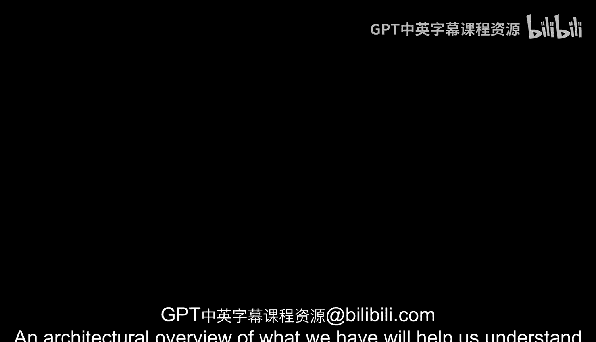
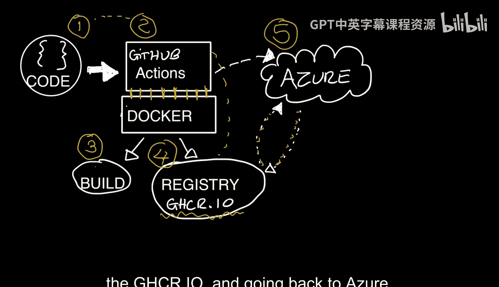
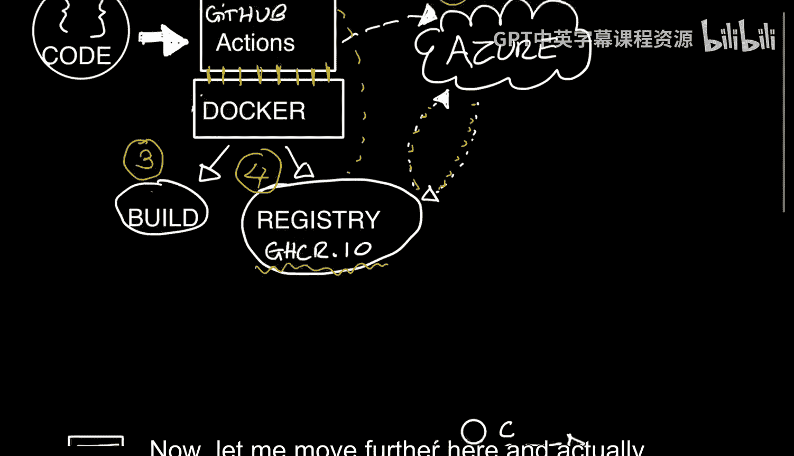
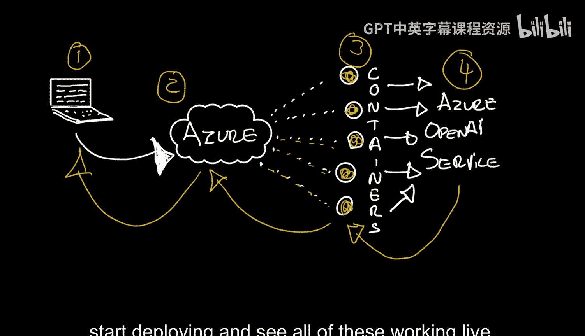

# 大型语言模型实践：P55：部署概览 🚀

在本节课中，我们将学习如何将一个基于大型语言模型的应用部署到云端。我们将了解从代码到最终服务的完整流程，以及各个组件（如GitHub Actions、Docker容器和Azure云服务）是如何协同工作的。

## 架构概览

理解我们拥有的架构概览将帮助我们明白所有组件将如何协同工作。

## 部署流程详解

上一节我们介绍了整体架构，本节中我们来看看具体的部署步骤。以下是部署流程的详细步骤：

1.  **代码与API**：我们从代码开始。我们的应用程序托管在GitHub上，它包含一个HTTP API，用于接收请求并与模型交互。

2.  **自动化构建**：接下来，我们使用GitHub Actions进行自动化。GitHub Actions将与Docker交互，设置一个Docker构建系统并执行命令。

3.  **容器化应用**：通过上述步骤，我们将能够构建我们的容器化应用程序。构建容器应用是至关重要的一步，目的是为了将其部署到Azure云上。

4.  **推送镜像**：容器构建完成后，我们将进入第四步：将生成的容器镜像推送到注册表。在本例中，我们使用GitHub容器注册表（GHCR）。你也可以使用其他注册表，但这里为了简化，我们使用GHCR，因为用户名和密码等配置已经预先设置好。

5.  **触发云服务**：当镜像成功推送到注册表后，GitHub Actions会通知Azure（具体是Azure容器实例服务）去拉取这个新镜像。这是一个触发效应。

6.  **服务发布与扩展**：Azure从注册表拉取容器镜像后，便会发布我们的应用。最终，用户可以与这个已部署的应用进行交互。Azure云能够根据请求量水平扩展我们的应用，即创建更多容器实例来处理涌入的请求。

7.  **处理用户请求**：当用户向应用发送提示或查询时，请求首先到达Azure云。云中的容器应用会处理这些请求，并与Azure OpenAI服务通信以获取AI响应，最后将结果返回给用户。

## 总结

本节课中，我们一起学习了将一个LLM应用部署到云端的完整流程。我们从代码开始，通过GitHub Actions实现自动化构建和推送Docker镜像，最终利用Azure云服务进行部署和水平扩展。这个流程清晰地展示了开发、运维和云平台如何紧密结合，让应用能够服务用户。接下来，我们将深入GitHub Actions，查看具体的工作流配置。