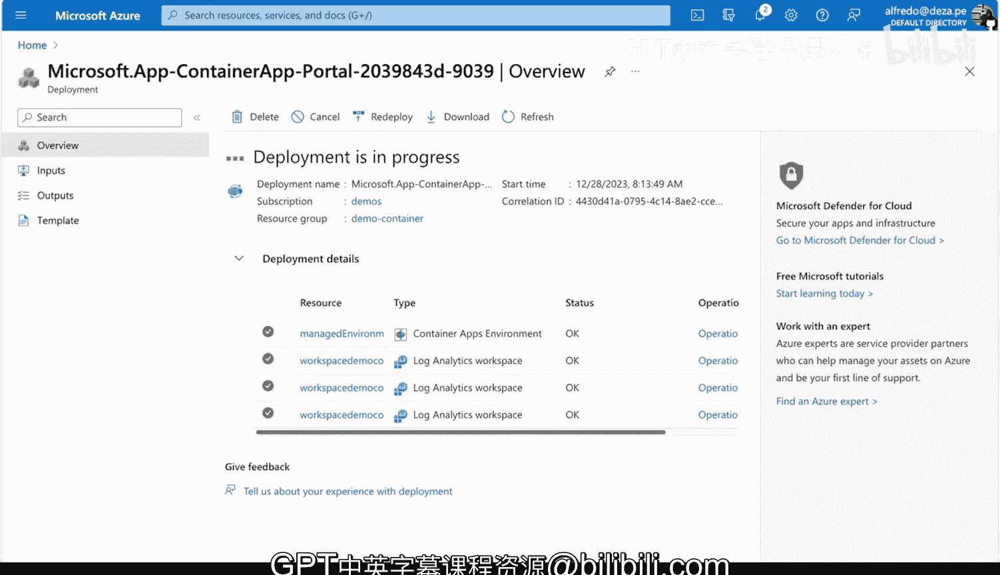

# 大型语言模型实践：P56：设置云组件 🚀

在本节课中，我们将学习如何在Azure门户中创建和管理容器应用服务，为后续部署连接Azure OpenAI服务的应用程序做准备。我们将重点关注资源组和容器应用名称的配置，以确保与自动化部署流程（如GitHub Actions）的正确集成。

---

上一节我们介绍了云应用部署的准备工作，本节中我们来看看如何在Azure门户中具体创建所需的容器应用服务。

我们再次进入Azure门户。为了启动我们的应用程序或将其部署到云端，我们需要开始创建所需的服务。我们将进入“容器应用”部分来创建一个新的容器应用。但在执行此操作之前，有一个非常重要的细节需要牢记：我们的自动化流程已经就位，但其一个关键方面需要我们注意。

我将切换到代码仓库界面，进入 `.github/workflows` 目录，查看我已经预先配置好的GitHub Action工作流文件。这里有一个重要的细节：你是否看到了 `group name` 和 `container app name`？这些名称至关重要。我需要确保在创建服务时正确输入它们，以便自动化流程能够匹配。创建服务的顺序并不重要（例如，我的自动化配置可能先于服务存在），但如果你还没有创建，请确保在创建容器应用时，这些名称与工作流文件中的定义保持一致。

以下是创建容器应用的核心步骤：

1.  在Azure门户中，导航至“容器应用”服务。
2.  点击“创建”按钮，开始新建一个容器应用。
3.  在创建过程中，选择合适的描述，并指定资源组。资源组名称应与你之前计划或工作流中定义的保持一致，例如 `demo-container`。
4.  容器应用名称也应设置为相同的值，例如 `demo-container`。
5.  选择你偏好的部署区域（例如“美国东部”而非“澳大利亚东部”）。
6.  完成上述配置后，点击“查看 + 创建”进行验证，最后点击“创建”按钮。

这个过程需要一些时间来完成部署。一旦容器应用就绪，我就能够开始使用我的自动化部署流程了。

这些就是我所需要创建的核心资源。我将回到GitHub Action的配置界面进行说明。这个GitHub Action将使用GitHub容器注册表（GHCR）。任何我构建的容器镜像都将存储在GitHub自身的注册表中。这是一种架构组件或编排方式，允许我将容器放置在特定的位置。这并不意味着你必须使用GitHub容器注册表，它同样可以部署到Azure容器注册表。但在此例中，我们将利用GitHub提供的这种非常简便、直接的容器注册表服务。

你将看到，一旦部署开始，这些流程将逐步推进。当所有步骤都完成后，我们将准备好继续推进，尝试部署并自动化我们的应用程序，该程序最终将连接到Azure OpenAI服务。

---

本节课中我们一起学习了在Azure门户中创建容器应用服务的具体步骤，强调了资源组和应用名称与自动化脚本保持一致的重要性，并介绍了如何利用GitHub容器注册表来简化容器镜像的管理和部署流程。