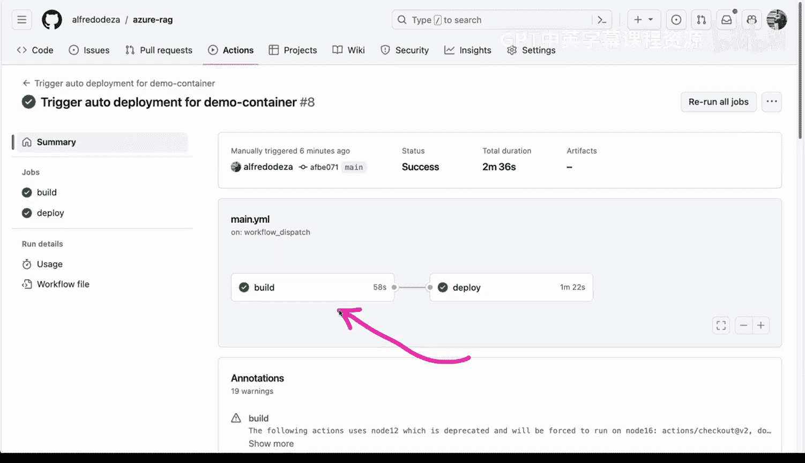
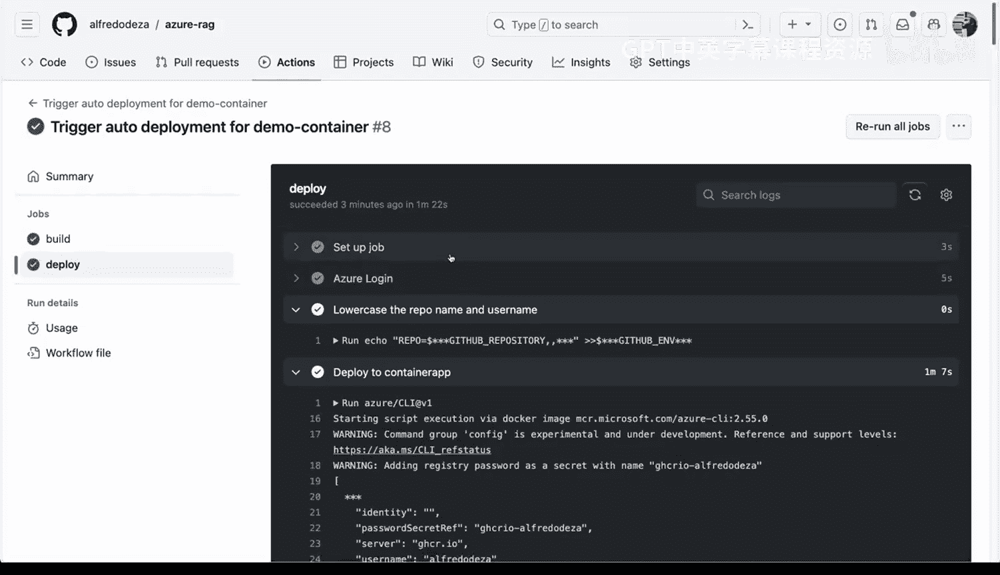
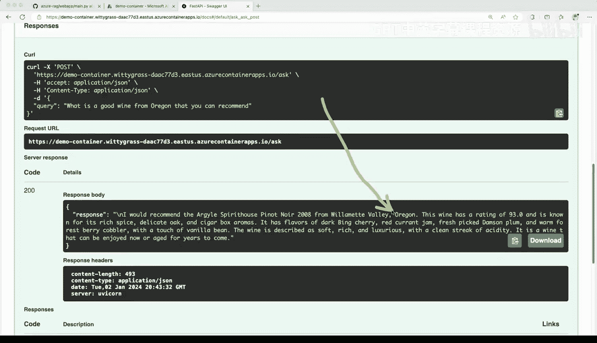
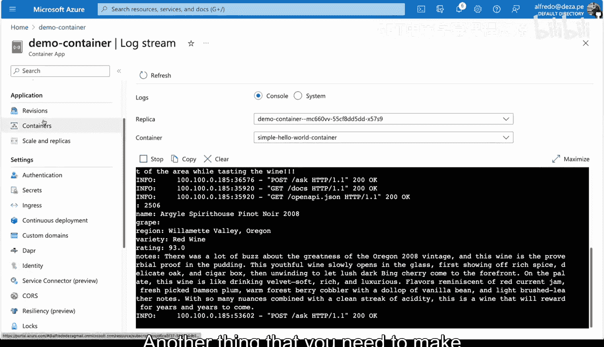
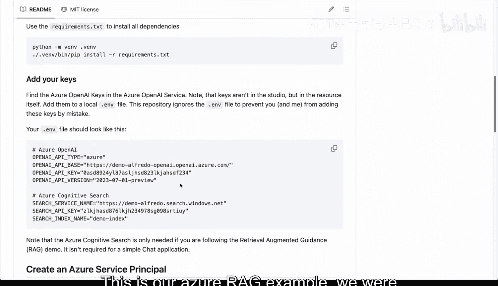
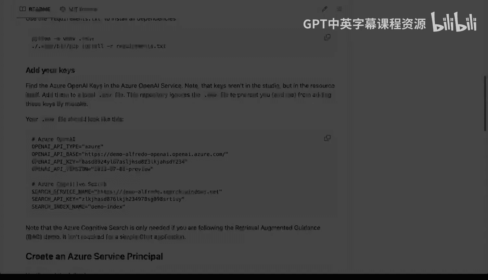

# 大型语言模型实践：03：使用Azure云进行部署 🚀

在本节课中，我们将学习如何将我们的应用程序最终部署到Azure云平台。我们将回顾自动化部署流程，排查常见问题，并验证部署是否成功。

## 概述

现在，我们已准备好部署应用程序。这是我们的最后一步。我们有一个之前创建资源时已部署过的演示容器应用程序。接下来，我们需要前往代码仓库，在Actions步骤中触发部署工作流。

在开始之前，我想展示一个关于构建自动化时的现实情况。当我向下滚动时，你会看到许多失败记录。这完全正常。你很少能从一开始就一切顺利，一次成功。你会遗漏一些变量，出现一些拼写错误，需要通过一些失败才能达到目标。虽然我已经触发了工作流，但让我展示刚开始时的样子，并看看其中的一些组件。

## 触发部署工作流

我们将点击这里，手动触发部署。`Run workflow`按钮是手动触发器。我将点击它，从`main`分支运行这个工作流，这会触发所有流程。我已经执行了这个操作。与其等待两分三十秒，我们不如直接查看这里发生了什么。

以下是工作流的主要步骤：

*   **构建步骤**：创建容器，将所有内容打包到容器中，并安装依赖项。
*   **部署步骤**：与Azure通信，完成部署。

如果我点击其中一次运行，可以看到日志输出。构建步骤的日志会显示设置Docker、构建镜像、登录GitHub容器注册表等信息。部署步骤的日志则会显示进行Azure登录、将仓库名称转换为小写、以及部署到容器应用程序等操作。这里的一些设置会以星号显示，以防止密钥信息泄露。

好的，部署已完成，一切顺利。

## 在Azure门户中验证与配置

接下来，看看云端容器这边的情况。我将回到Azure门户，进入容器应用部分，然后在“概览”部分找到应用程序URL。

如果我点击这个URL并在新标签页中打开，可能会遇到第一个问题。我们的容器内部使用的是**端口8000**，而外部访问默认尝试使用**端口80**。

我们需要返回Azure门户进行检查和配置。以下是需要检查的配置项：

1.  **入口（Ingress）设置**：这是设置的一部分。点击进入后，需要一直向下滚动。`目标端口`指的是容器内部的端口，对我们来说就是**端口8000**。我将保存这个更改，等待入口更新完成，然后就能验证应用程序是否正常运行了。更新成功后，使用相同的地址重新加载页面，我们的应用程序就出现了。

2.  **测试应用程序**：这是我们的FastAPI应用，它正运行在Azure容器应用上。让我们测试一下。像之前一样点击`Try it out`，输入问题，例如“What is a good one from Oregon? You can recommend.”，然后执行。它会联系我们的索引，实际上是联系Azure OpenAI服务，并获取来自俄勒冈州的回复。完美，这表明一切都在正常运行，并且该应用是公开可用的。

3.  **检查日志与配置**：最后，我想展示一些你可能遇到的潜在错误。查看日志流是发现潜在问题的好方法。在这里，我们可以看到一切运行良好，它正在打印一些响应信息，这很好。当出现问题时，这个终端输出也会显示错误信息，帮助你排查。另外，你需要确保在“容器”部分检查你的环境变量属性是否正确。最后，在“缩放和副本”部分，如果你需要进行扩展，可以看到这里范围是0到10，你可以增加副本数以获得更多带宽来应对请求。

## 总结

本节课中，我们一起完成了应用程序的成功部署。这是我们的Azure示例。我们能够使用GitHub Actions将一切整合起来，实现自动化，并部署到Azure云平台。