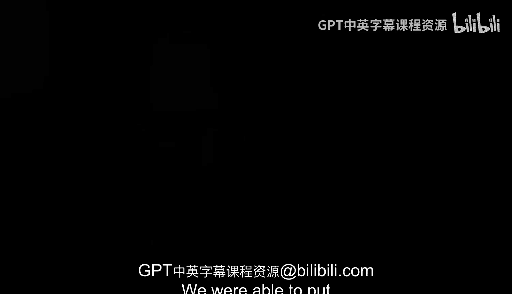

# 大型语言模型实践：5.8：总结与展望 🎯

在本节课中，我们将回顾并总结如何将所有组件整合起来，构建并部署一个基于HTTP API的生成式AI应用程序到云端。

---

## 概述

上一节我们介绍了部署验证的具体步骤。本节中，我们将对整个模块进行总结，并展望后续的学习方向。

我们成功整合了创建一个基于HTTP API的生成式AI应用程序所需的所有必要组件。我们将其部署到了云端，并运用了包括自动化在内的一系列最佳实践。

我们使用了GitHub Actions，了解了其含义，并在Azure云上为此次部署设置了相应的组件。这是将所有内容整合起来，与Azure云等平台协同工作的最后一步。

需要说明的是，我并未深入探讨你需要执行的所有具体步骤的每一个细节，因为本课程旨在为你快速概述整个过程的全貌。

如果你想进一步探索，当然有更多课程可供你深入学习。但在本课程中，我们选择为你提供一个快速、简要的概览。

我们介绍了你需要哪些组件、整个流程将如何呈现，以及部署完成后如何验证该部署。

希望这能让你对整个过程如何发生有一个相当清晰的认识。

---

## 核心要点回顾

以下是本模块涵盖的核心内容：

*   **组件整合**：我们学习了如何将模型、API接口、业务逻辑等组件组合成一个完整的应用。
*   **云端部署**：我们将应用部署到了Azure云平台，利用了云服务的可扩展性与可靠性。
*   **最佳实践**：我们引入了自动化部署流程，例如通过**`GitHub Actions`**来实现CI/CD（持续集成/持续部署）。
*   **部署验证**：我们探讨了在应用部署后，如何通过访问端点、测试功能等方式来验证部署是否成功。

---

## 总结

本节课中，我们一起学习了构建和部署一个生成式AI Web应用的全流程概览。我们从整合组件开始，到利用自动化工具将其部署至云端，最后完成了部署验证。这为你理解如何将大型语言模型投入实际生产环境奠定了坚实的基础。记住，这只是开始，后续还有更多深入的知识等待你去探索。