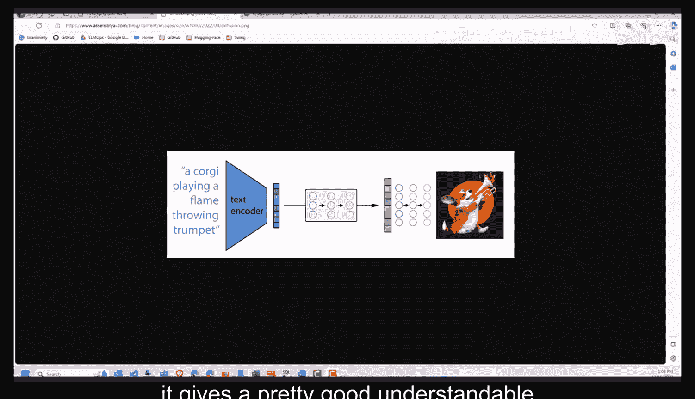
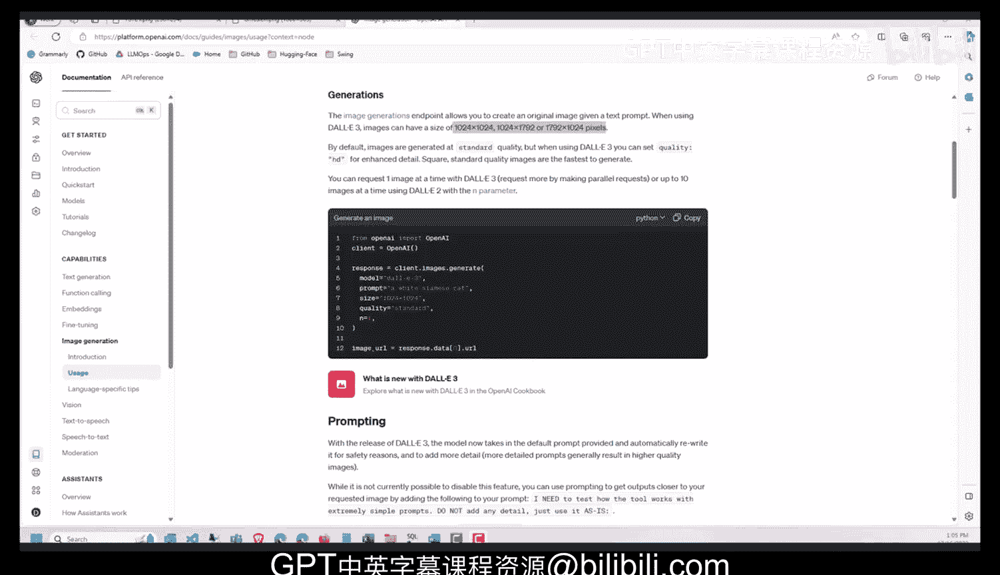

# 大型语言模型实践：04：DALL-E概览 🖼️

在本节课中，我们将要学习OpenAI的DALL-E模型。这是一个能够根据文本描述生成图像的AI系统。我们将了解它的基本工作原理、核心参数以及如何通过API调用它。

在深入实际环境和设置代码空间，并进行一些DALL-E的具体实现之前，我们先快速概览一下它是什么以及它是如何工作的。

## DALL-E是什么？

DALL-E是一个图像生成AI。它的简短工作原理如下：它接收文本输入。

以下是其工作原理的更详细说明，我也会提供更多文档链接。这方面有相当多的科学研究。它的流程包含几个核心步骤：

1.  **文本编码器**：它接收文本提示（prompt）。
2.  **模型映射**：模型将文本编码映射到对应的图像编码。
3.  **图像解码器**：最后使用图像解码器生成最终的图像。

这是一个完整的处理流程示意图（例如，描述“一个吹奏喷火喇叭的人”）。这张图来自一个名为“Assembly AI”的优秀网站，它清晰地解释了这一过程。这张图虽然关联DALL-E 2，但其工作原理与DALL-E 3相同。该网站还深入介绍了一些改进，并对这些模型的工作方式提供了易于理解的解析，我会确保包含这个链接。

## API调用参数

接下来，我们快速看一下调用参数。这来自OpenAI的官方文档。

其调用方式与标准的OpenAI文本生成API调用类似。你需要指定模型并传入提示（prompt）。与此不同的是，许多参数是基于图像的，而非文本。

以下是核心参数：

*   **`size`**：指定生成图像的尺寸。目前只有三种可选尺寸（例如1024x1024）。
*   **`quality`**：图像质量，可选“standard”（标准）或“hd”（高清）。请注意，这项技术发展非常迅速。
*   **`n`**：请求生成图像的数量，例如 `n=1`。

API的响应以JSON格式返回。你在底部看到的那个高亮命令，就是用于打印出图像URL的方法，点击该URL即可查看生成的图像。

## 环境准备

好了，让我们切换到实际的操作环境。

本节课中我们一起学习了DALL-E图像生成模型的基本概念。我们了解了它从文本到图像的生成流程，包括文本编码、模型映射和图像解码三个核心阶段。同时，我们也预览了调用其API时需要关注的主要参数，如图像尺寸、质量和生成数量。接下来，我们将进入实践环节，设置环境并开始编写代码。