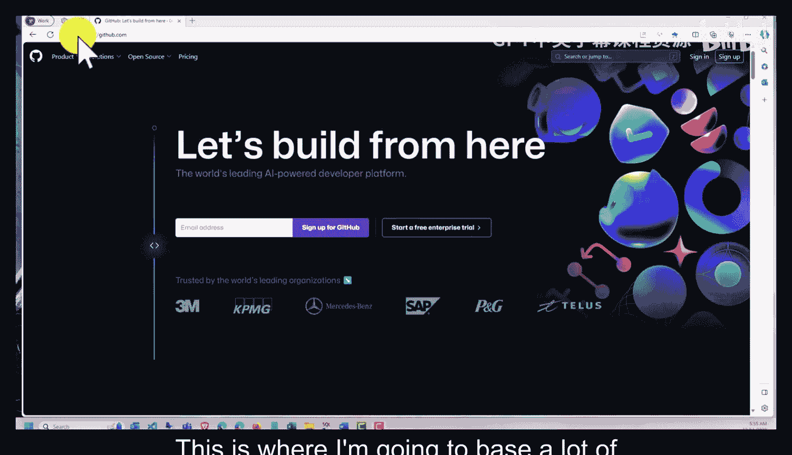
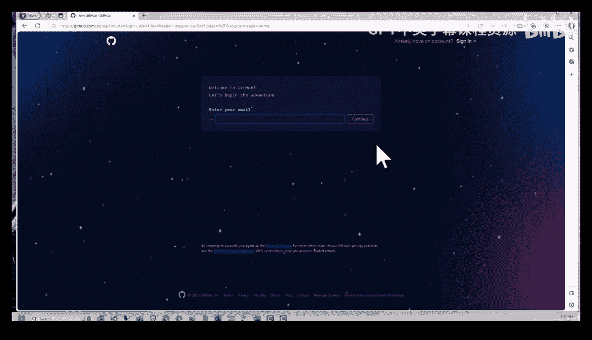
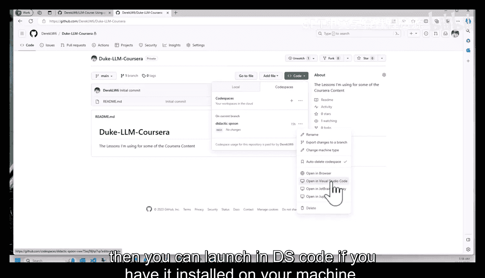
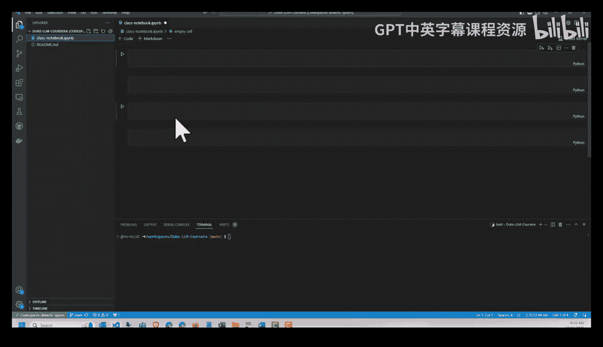

# 大型语言模型实践：P61：演示环境设置 🛠️

在本节课中，我们将学习如何设置一个基于GitHub Codespaces的开发环境，以便为后续的LLM项目开发做好准备。我们将从注册GitHub账户开始，逐步介绍如何使用Codespaces功能来创建一个便捷的云端开发环境。

## 注册GitHub账户

首先，我们需要访问GitHub网站。如果你还没有GitHub账户，需要点击“Sign up”按钮进行注册。注册过程会要求你填写一系列信息以创建账户。由于我已经拥有账户，我将跳过注册步骤，直接展示登录后的界面。








## 认识GitHub与Codespaces

登录后，你将看到GitHub的主界面。GitHub是一个在线的代码仓库平台。我推荐使用它的一个重要原因是它提供了名为“Codespaces”的强大云端开发环境功能。

虽然本课程使用的代码仓库是私有的，但你仍然可以了解其基本操作。我已经创建了相关的README文件。要启动开发环境，你需要点击“Code”选项卡，然后选择“Codespaces”。





## 配置Codespaces开发环境

启动Codespaces后，你的本地机器（实际上是云端环境）将加载一个类似VS Code的编辑器界面。在本课程中，我使用Jupyter Notebooks进行演示，因此文件扩展名通常是`.ipynb`。使用Notebook可以让我清晰地按单元格执行和展示代码，这非常方便。

Codespaces的一个优点是它的智能感知功能。当你创建一个具有特定扩展名（例如`.py`或`.ipynb`）的文件时，环境会自动提示你安装相应的依赖库。

你可以在集成的终端中执行命令，例如使用`pip install`来安装Python包。同时，Codespaces与Git的集成非常顺畅。当你修改代码后，可以轻松地提交更改。




以下是使用终端安装包和提交代码的基本流程：

1.  **打开终端**：在Codespaces界面中，找到并打开终端面板。
2.  **安装依赖**：使用`pip`命令安装项目所需的Python库。
    ```bash
    pip install package_name
    ```
3.  **提交代码**：使用Git命令将更改提交到仓库。
    ```bash
    git add .
    git commit -m “Your commit message”
    git push
    ```

这种工作流使得持续集成和代码版本管理变得非常简单。接下来，我将在这个环境中进行一些准备工作，为使用Dolly模型配置好环境，然后我们将进入第一个实践项目。

## 总结


本节课中，我们一起学习了如何设置基于GitHub Codespaces的开发环境。我们从注册GitHub账户开始，介绍了Codespaces作为云端开发环境的优势，并演示了其基本操作，包括创建环境、安装依赖以及与Git的协同工作。这个环境将为我们后续的大型语言模型实践项目打下坚实的基础。