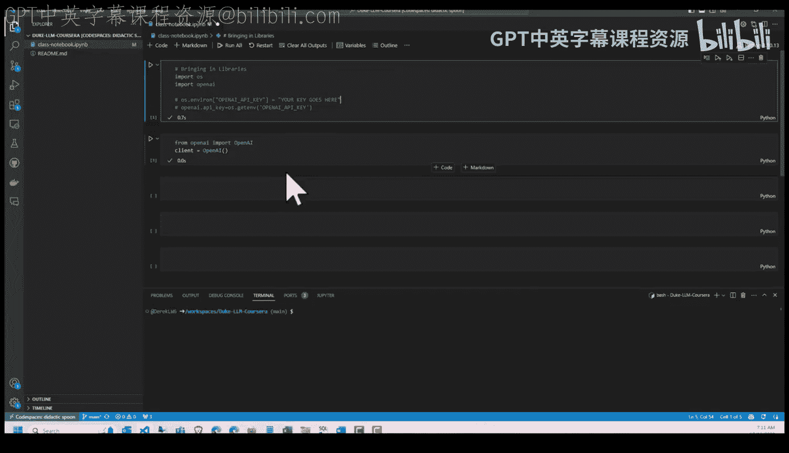
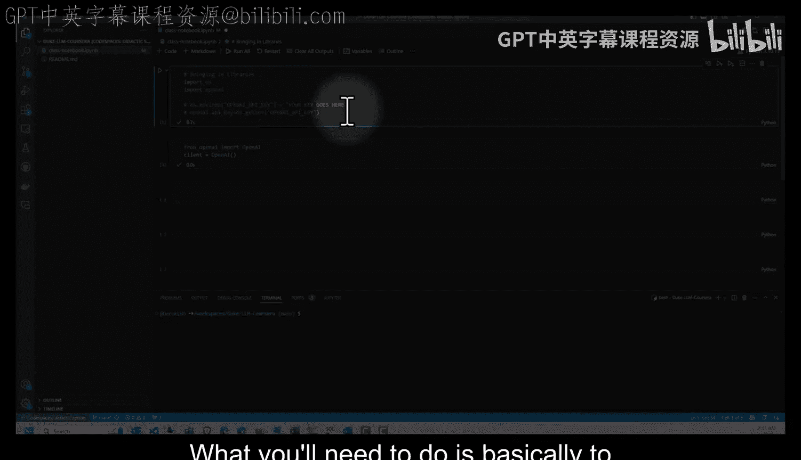
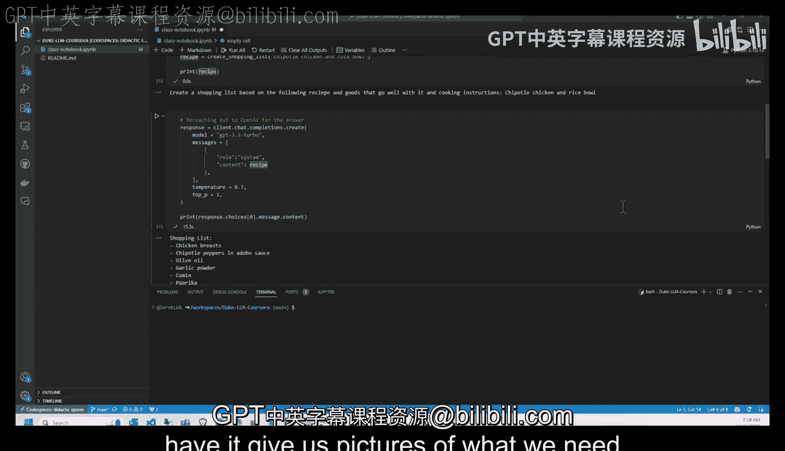

# 大型语言模型实践：第4章：使用OpenAI API生成购物清单 🛒

在本节课中，我们将学习如何利用OpenAI的API，根据一份食谱自动生成一份购物清单。我们将编写一个函数来构建提示词，调用GPT模型，并获取结构化的响应。整个过程旨在展示如何将自然语言指令转化为具体的、可执行的任务列表。

---

## 准备工作 🛠️

在开始编写代码之前，我们需要完成一些基础设置。这包括导入必要的库，并安全地配置我们的API密钥。

首先，我们需要导入`openai`库和`os`库。`openai`库用于与OpenAI的API进行交互，而`os`库则用于安全地管理环境变量。



```python
import openai
import os
```



接下来，我们需要设置OpenAI的API密钥。为了安全起见，最佳实践是将密钥设置为环境变量，而不是直接硬编码在脚本中。你可以通过运行一个单独的代码单元来设置它，完成后再删除该单元，这样密钥就保存在环境变量中而不会在代码中暴露。

```python
# 在你的环境中设置此变量，例如：os.environ[‘OPENAI_API_KEY’] = ‘your-api-key-here’
# 设置完成后，请删除或注释掉这行代码。
```

---

## 构建提示词函数 ✍️

上一节我们完成了环境设置，本节中我们来看看如何构建一个函数来生成发送给AI的提示词。这个函数的核心是创建一个清晰的指令，告诉模型我们想要它做什么。

以下是构建提示词函数的步骤。该函数将接收一个食谱作为输入，并请求模型基于此食谱生成一份购物清单。

1.  定义一个函数，例如 `create_shopping_list_prompt(recipe)`。
2.  在函数内部，构建一个字符串格式的提示词（`prompt`）。
3.  提示词应明确指示模型的任务，例如：“基于以下食谱，创建一份购物清单，并列出与之搭配良好的食物和烹饪说明。”
4.  函数最终返回这个构建好的提示词字符串。

```python
def create_shopping_list_prompt(recipe):
    prompt = f"""
    基于以下食谱，创建一份购物清单，并列出与之搭配良好的食物和烹饪说明。

    食谱：
    {recipe}
    """
    return prompt
```

---

## 调用OpenAI API 🤖

现在我们已经有了生成提示词的函数，接下来我们看看如何实际调用OpenAI的API来获取模型的响应。我们将使用`gpt-3.5-turbo`模型，它是目前性价比较高的选择之一。

以下是调用API的关键步骤：

1.  使用 `openai.ChatCompletion.create()` 方法。
2.  在参数中指定模型，例如 `model=“gpt-3.5-turbo”`。
3.  构建 `messages` 列表，其中包含一个系统消息（`role: “system”`）和一个用户消息（`role: “user”`），用户消息的内容就是我们上一步生成的提示词。
4.  可以设置其他参数，如 `temperature`（控制输出的随机性）和 `top_p`（控制输出的多样性）。
5.  从API的响应对象中提取出模型生成的内容。

```python
# 假设 recipe_text 是您的食谱字符串
prompt = create_shopping_list_prompt(recipe_text)

response = openai.ChatCompletion.create(
    model="gpt-3.5-turbo",
    messages=[
        {"role": "system", "content": "你是一个有用的助手。"},
        {"role": "user", "content": prompt}
    ],
    temperature=0.7,
    top_p=1
)

# 提取并打印AI的回复
shopping_list = response.choices[0].message.content
print(shopping_list)
```

运行代码后，API会返回一个响应对象。我们从中提取出`choices[0].message.content`，这就是模型为我们生成的购物清单。这份清单通常会很详细，包含所需的食材以及烹饪建议。你可以根据需求，通过调整`max_tokens`等参数来控制响应的长度和细节程度。

---

## 总结与展望 📝

本节课中我们一起学习了如何利用OpenAI API将一份食谱转化为结构化的购物清单。我们首先设置了开发环境，然后构建了清晰的提示词函数，最后通过调用`gpt-3.5-turbo`模型成功获得了所需的清单。



这个过程展示了大型语言模型在理解自然语言指令并执行具体任务方面的强大能力。生成的购物清单可以作为一个起点，你可以进一步处理它，例如将其发送给像DALL-E这样的图像生成模型，来获取需要购买的食材的图片，使得整个购物计划更加直观和生动。在接下来的课程中，我们可以探索如何实现这一扩展功能。