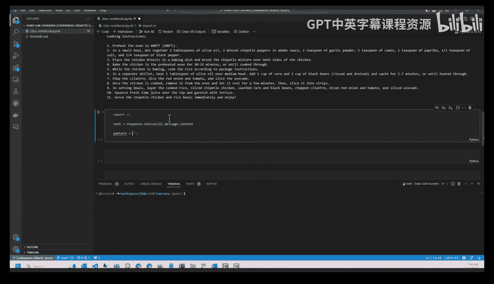
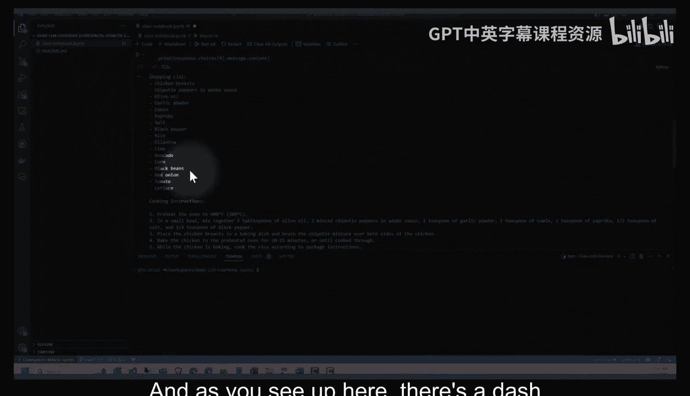
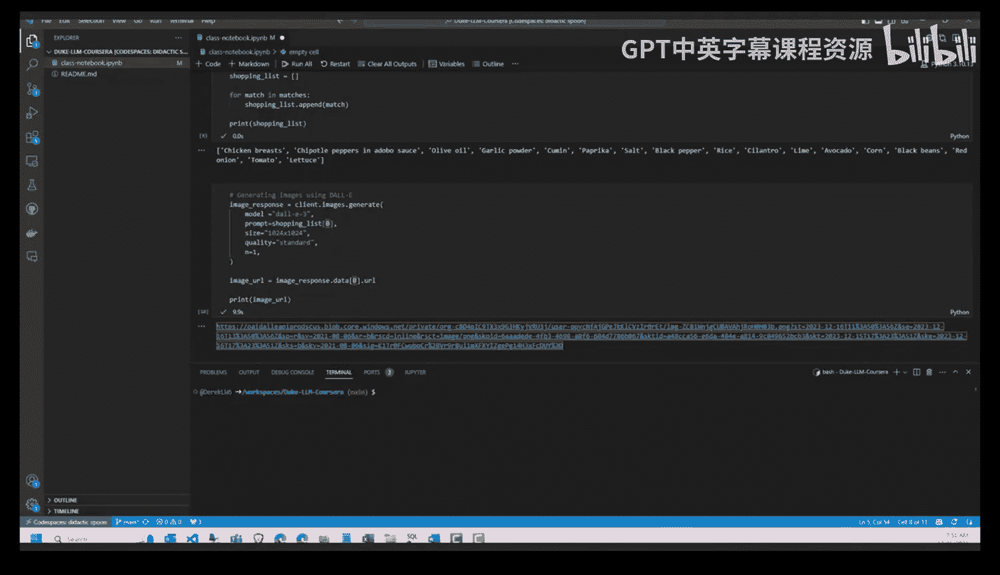

# 大型语言模型实践：P63：演示DALL-E生成图像 🖼️

在本节课中，我们将学习如何结合OpenAI的文本生成与DALL-E图像生成API，从一份食谱中提取购物清单，并自动生成所需食材的图片。我们将使用正则表达式处理文本，并调用DALL-E API来创建图像。

## 概述

我们将首先使用OpenAI模型生成一份食谱及其购物清单，然后通过正则表达式从响应中精确提取出购物清单。接着，我们会将清单中的每一项作为提示词，传递给DALL-E模型，以生成对应的食材图片。这个过程展示了如何将不同的AI服务串联起来，构建一个实用的应用原型。

## 提取购物清单



上一节我们获得了包含食谱和购物清单的文本响应。本节中，我们来看看如何从中精确提取出购物清单部分。



我们观察到，在模型的响应中，每个食材项都以一个破折号和空格（“- ”）开头。我们将利用这个模式，使用正则表达式来匹配并提取所有食材。

以下是提取购物清单的步骤：

1.  从OpenAI的响应对象中获取文本内容。
2.  定义一个正则表达式模式来匹配以“- ”开头的行。
3.  使用`re.findall`函数找到所有匹配项。
4.  将匹配结果存储在一个列表中供后续使用。

相关代码如下：
```python
import re

# 假设 response 是来自 OpenAI API 的响应对象
text_content = response.choices[0].message.content

# 定义正则表达式模式，匹配以破折号和空格开头的行
pattern = r"- .+"

# 查找所有匹配项
shopping_list = re.findall(pattern, text_content)

# 打印查看结果
print("提取的购物清单：")
for item in shopping_list:
    print(item)
```

运行代码后，我们将得到一个清晰的食材列表，为下一步的图像生成做好准备。

## 调用DALL-E生成图像

成功提取购物清单后，我们现在可以将其用于图像生成。本节中，我们将学习如何调用DALL-E 3模型，根据购物清单中的食材描述来创建图片。

我们将使用OpenAI的Python客户端库。需要为图像生成指定模型、提示词、尺寸和质量等参数。

以下是调用DALL-E生成图像的核心步骤：

1.  导入OpenAI库并设置客户端。
2.  从购物清单中选取一个项目作为提示词（例如第一个项目）。
3.  配置API调用参数，包括模型、图片尺寸和生成数量。
4.  发送请求并获取包含图片URL的响应。

相关代码如下：
```python
from openai import OpenAI

# 初始化客户端，假设已设置好API密钥
client = OpenAI()

# 使用购物清单中的第一项作为提示词
prompt = shopping_list[0]

# 调用DALL-E API生成图像
image_response = client.images.generate(
    model="dall-e-3",  # 指定模型
    prompt=prompt,      # 图像描述提示词
    size="1024x1024",   # 生成图像的尺寸
    quality="standard", # 图像质量
    n=1,                # 生成图像的数量
)

# 从响应中获取图像的URL
image_url = image_response.data[0].url
print(f"生成的图像URL: {image_url}")
```

执行上述代码后，我们会获得一个指向生成图片的URL。点击该链接，就能看到DALL-E根据食材描述创建的图像。在本例中，生成的图像准确描绘了需要从商店购买的物品。

## 总结与扩展

本节课中，我们一起学习了如何构建一个从文本到图像的AI工作流。我们首先使用OpenAI的文本模型生成购物清单，然后通过正则表达式提取清单内容，最后利用DALL-E模型为清单项目生成对应的视觉图像。

这个过程清晰地展示了将大型语言模型与图像生成模型结合的可能性。以此为基础，你可以轻松地扩展此应用：例如，遍历整个购物清单，为每一项食材生成图片；或者构建一个完整的应用程序，让用户输入食谱名称，自动输出烹饪步骤和所有食材的图片。



通过正则表达式和API调用的组合，我们能够将AI的能力串联起来，解决更复杂、更贴近实际需求的问题。