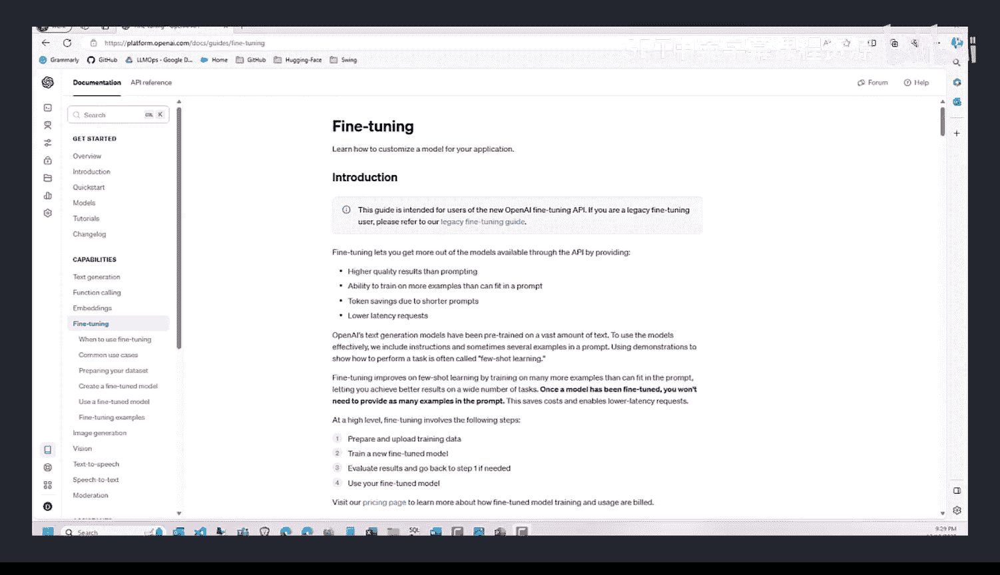
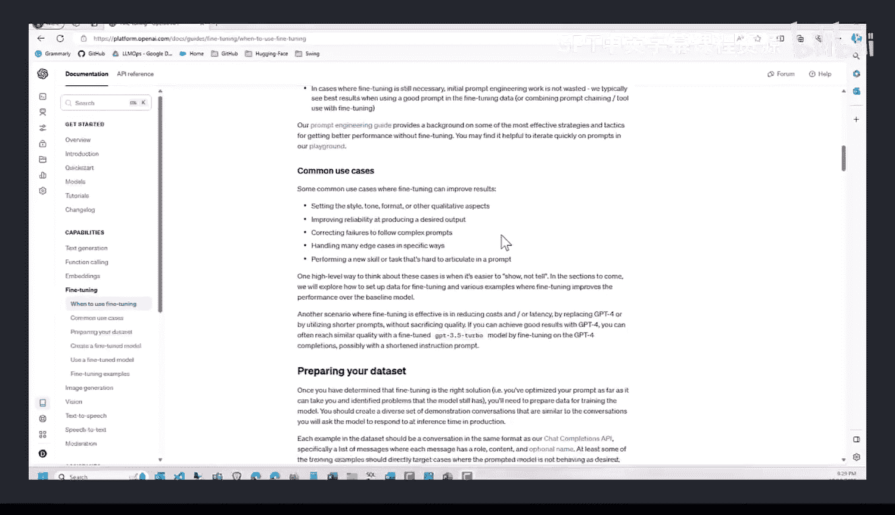
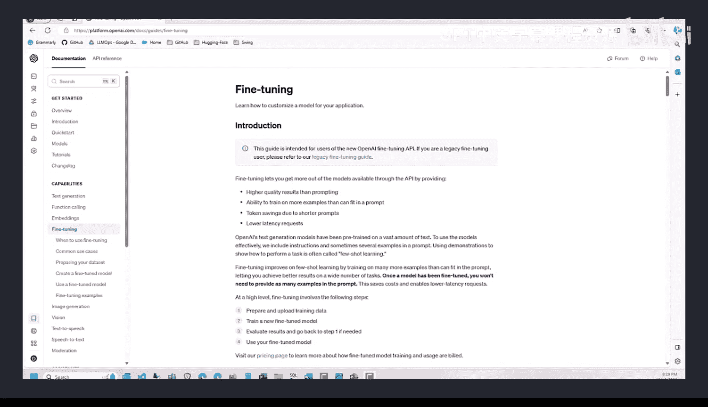
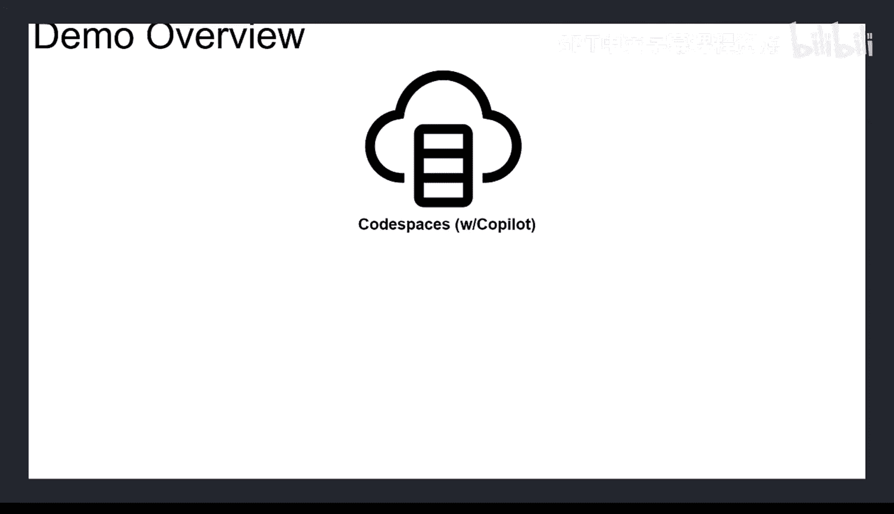
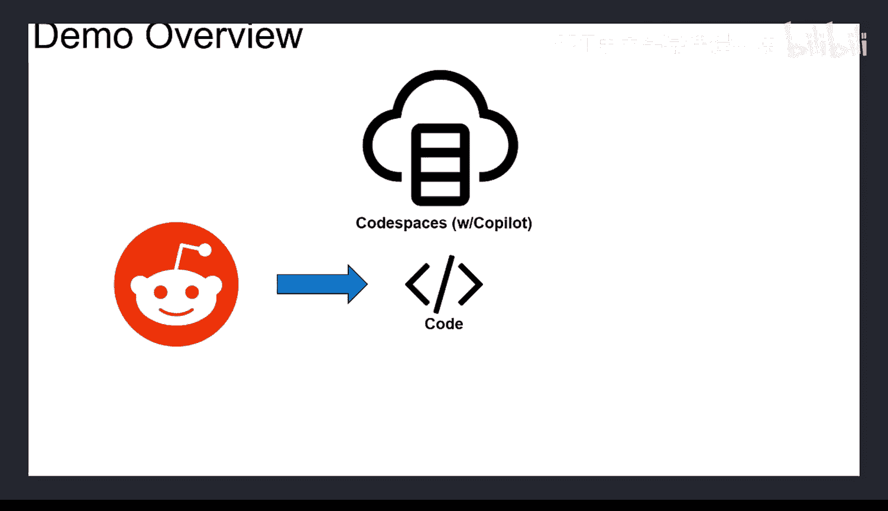
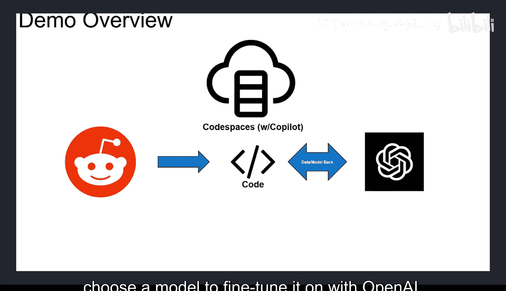
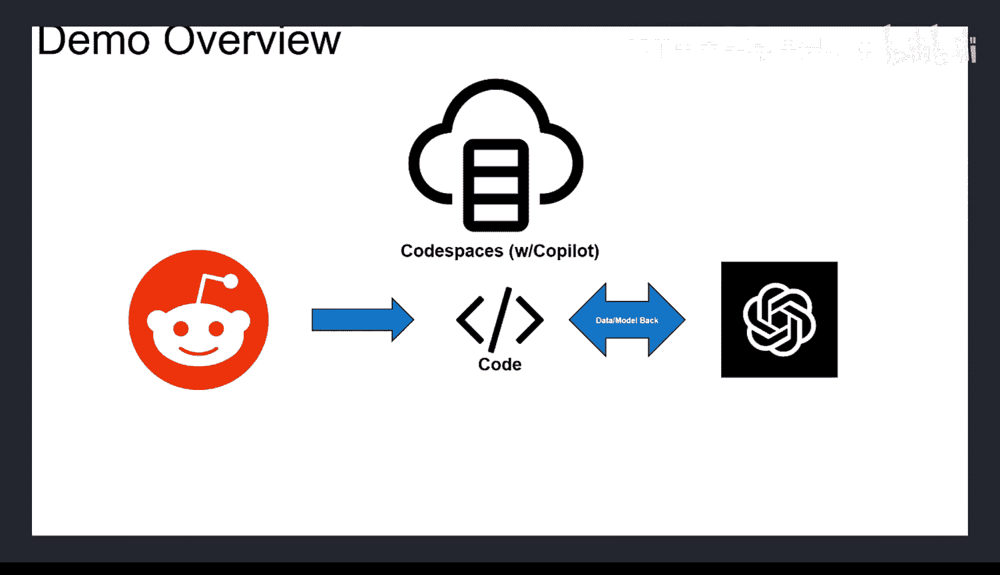
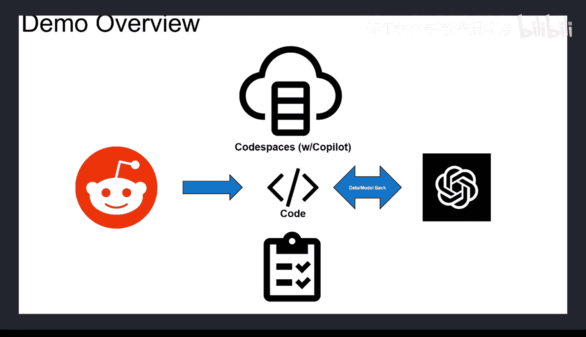

# 大型语言模型实践：P65：OpenAI微调与项目介绍 🎯

在本节课中，我们将学习微调（有时也称为迁移学习）的过程。这是一个将预训练的大型语言模型（LLM）根据特定应用（例如医疗数据或Reddit问答）进行定制化的技术。

上一节我们介绍了大型语言模型的基础概念，本节中我们来看看如何通过微调来定制模型。

## 项目概述 📋

我们将使用来自Reddit的问答数据，在CodeSpaces环境中运行代码，通过OpenAI API选择一个基础模型进行微调，最终获得一个定制化的模型，并对其进行测试。

以下是项目的主要步骤流程图：

## 核心概念与流程

微调的核心是**迁移学习**。其基本公式可以概括为：

**定制模型 = 预训练模型 + 特定领域数据 + 微调过程**

以下是实现此流程的关键步骤列表：

1.  **准备数据**：获取并导入Reddit的问答数据到开发环境。
2.  **选择模型**：通过OpenAI API选择一个适合的基础模型（例如 `gpt-3.5-turbo`）。
3.  **执行微调**：将准备好的数据发送给OpenAI，在所选模型上运行微调作业。
4.  **接收与测试**：获取返回的定制模型，并编写代码对其进行效果测试。

## 进入实践环节

了解基本流程后，接下来我们将进入CodeSpaces环境开始动手实践。

---

本节课中我们一起学习了微调（迁移学习）的概念，了解了将一个通用大型语言模型根据特定数据（如Reddit问答）定制化的完整项目流程。从数据准备、模型选择到执行微调和最终测试，我们梳理了每个关键步骤。接下来，我们将在代码环境中具体实现这一过程。