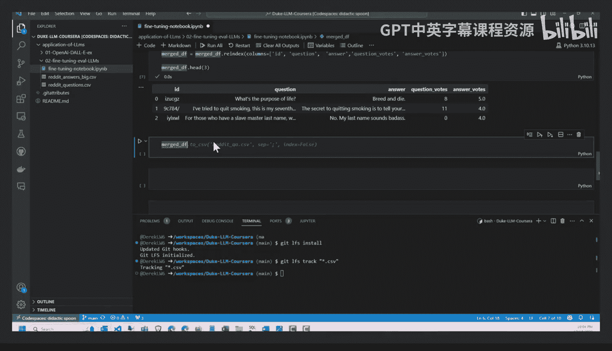
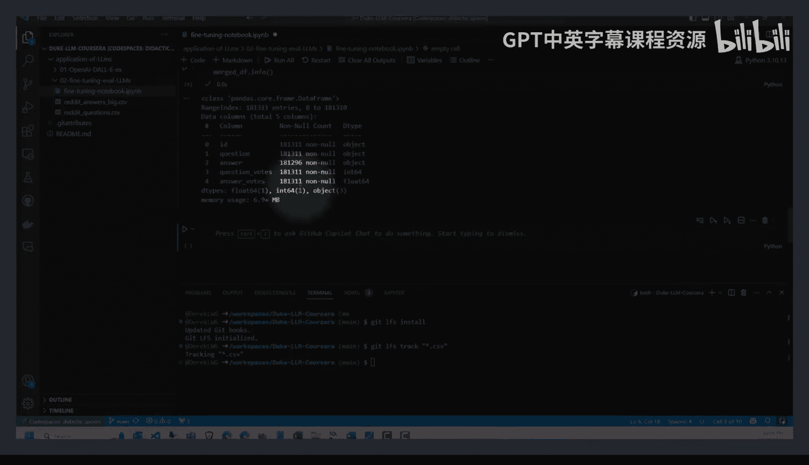
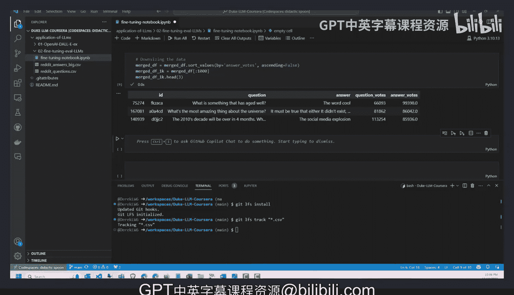

# 大型语言模型实践：04：微调项目第一部分：环境与数据准备 🛠️

在本节课中，我们将学习如何为大型语言模型的微调项目准备开发环境和数据。我们将导入必要的库，设置Git LFS来管理大型数据文件，并读取、清洗和合并来自Reddit的问题与答案数据集，最终为后续的微调步骤准备好格式规整的数据。

## 导入必要库

首先，我们需要导入项目所需的Python库。这些库将帮助我们处理数据和文件。

以下是需要导入的库：

```python
import json
import pandas as pd
```

## 设置Git LFS管理大型文件

上一节我们导入了必要的库，本节中我们来看看如何管理项目中的大型数据文件。由于我们将使用的Reddit数据集文件较大，需要先设置Git LFS（大文件存储）来跟踪这些CSV文件。

以下是设置Git LFS的步骤：

1.  安装Git LFS（如果尚未安装）。
2.  在项目目录中，使用命令 `git lfs track “*.csv”` 来跟踪所有CSV文件。
3.  将大型的Reddit数据文件（如 `reddit_answers.csv` 和 `reddit_questions.csv`）拖放或移动到当前工作目录中。

完成这些步骤后，我们就可以在笔记本中读取这些文件了。

## 读取并处理答案数据

环境设置好后，我们现在可以开始读取数据。首先，我们读取包含答案的文件。

```python
answers = pd.read_csv(‘reddit_answers.csv’, sep=‘;’)
print(answers.head())
```

观察数据可以发现，文件没有明确的列标签，并且每个问题ID对应多个答案及其点赞数。我们的目标是选取每个问题下点赞数最高的答案，以控制后续发送给OpenAI API的令牌数量，从而控制成本。

以下是处理答案数据的步骤：

1.  按问题ID（`q_id`）和点赞数（`votes`）对答案进行分组。
2.  使用 `idxmax()` 函数获取每个问题下点赞数最高的答案的索引。
3.  使用 `loc` 方法根据索引筛选出这些“最佳答案”。
4.  重命名列名，使其含义更清晰，便于后续操作。

```python
# 获取每个问题下点赞数最高的答案
top_answers = answers.loc[answers.groupby(‘q_id’)[‘votes’].idxmax()]

# 重命名列
top_answers.rename(columns={
    ‘q_id’: ‘id’,
    ‘votes’: ‘answer_votes’,
    ‘answer’: ‘answer’
}, inplace=True)

print(top_answers.head(3))
```

## 读取并处理问题数据

处理完答案数据后，接下来我们需要读取对应的问题数据，以便将问题和最佳答案匹配起来。

```python
questions = pd.read_csv(‘reddit_questions.csv’, sep=‘;’)
print(questions.head())
```

与答案数据类似，我们也需要重命名问题数据的列，使其更直观。

以下是重命名问题数据列的步骤：

1.  将 `q_id` 重命名为 `id`，以便与答案数据合并。
2.  将 `votes` 重命名为 `question_votes`，以区别于答案的点赞数。

```python
questions.rename(columns={
    ‘q_id’: ‘id’,
    ‘votes’: ‘question_votes’
}, inplace=True)
print(questions.head())
```

## 合并问题与答案数据

现在，我们有了处理好的问题数据和答案数据。本节中我们将把这两个数据集合并起来，创建一个包含问题及其最佳答案的完整数据集。

我们基于共同的 `id` 字段来合并两个DataFrame。

```python
merged_df = pd.merge(questions, top_answers, on=‘id’)
print(merged_df.head())
```

合并后，数据集中包含一些我们不需要的列（如时间戳）。为了使数据结构更清晰，我们需要进行清理和重排。

以下是清理和重排数据的步骤：

1.  删除多余的列，例如 `timestamp_x` 和 `timestamp_y`。
2.  按照 `id`、`question`、`answer`、`question_votes`、`answer_votes` 的顺序重新排列列。

```python
# 删除多余的列
columns_to_drop = [‘timestamp_x’, ‘timestamp_y’, ‘Unnamed: 0’]
merged_df.drop(columns=columns_to_drop, axis=1, inplace=True)

# 重新排列列的顺序
desired_order = [‘id’, ‘question’, ‘answer’, ‘question_votes’, ‘answer_votes’]
merged_df = merged_df[desired_order]





print(merged_df.head())
```

## 筛选与缩减数据集

数据合并并整理好后，我们查看一下数据规模。由于数据集很大（约18.8万行），直接用于微调会产生较高的令牌成本和计算时间。为了教学演示和成本控制，我们将筛选出最受欢迎的答案来创建一个较小的子集。

我们根据 `answer_votes` 对数据进行降序排序，然后选取前1000行。

```python
# 按答案点赞数降序排序
merged_df_sorted = merged_df.sort_values(by=‘answer_votes’, ascending=False)

# 选取前1000行数据
merged_df_1k = merged_df_sorted.head(1000)

print(merged_df_1k.head(3))
print(f”缩减后的数据集大小: {merged_df_1k.shape}”)
```

## 总结



本节课中我们一起学习了为LLM微调项目准备环境和数据的完整流程。我们首先导入了必要的库，然后配置Git LFS来管理大型数据文件。接着，我们逐步读取了Reddit的答案和问题数据，进行了数据清洗、列重命名和合并操作，最终创建了一个包含问题及其最受欢迎答案的规整数据集。最后，为了控制成本和提高效率，我们通过排序和切片得到了一个包含1000条高质量样本的精简数据集，为下一阶段的模型微调做好了准备。