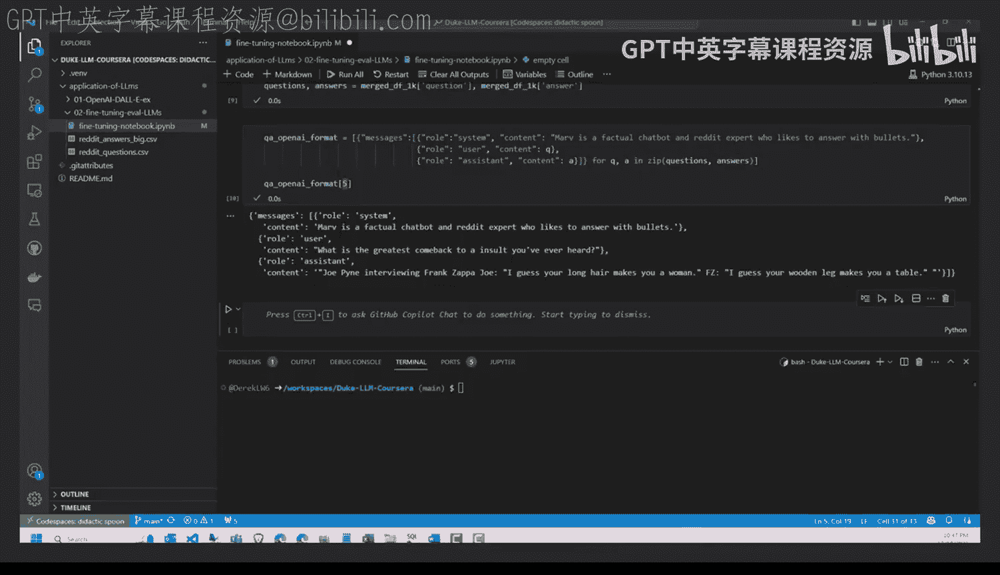
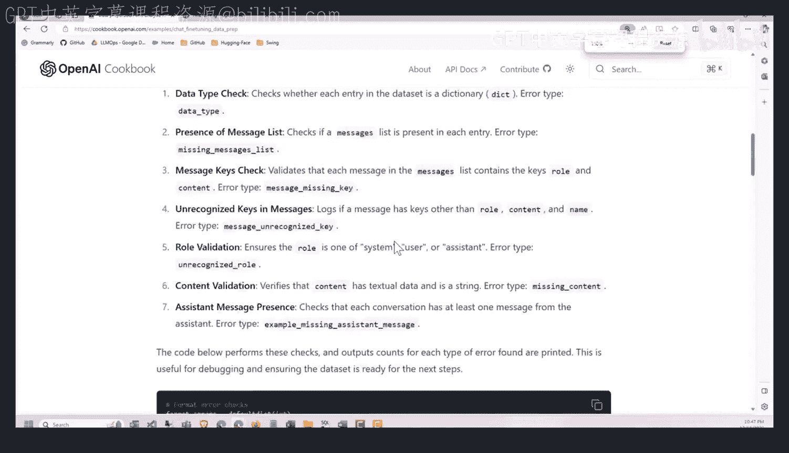
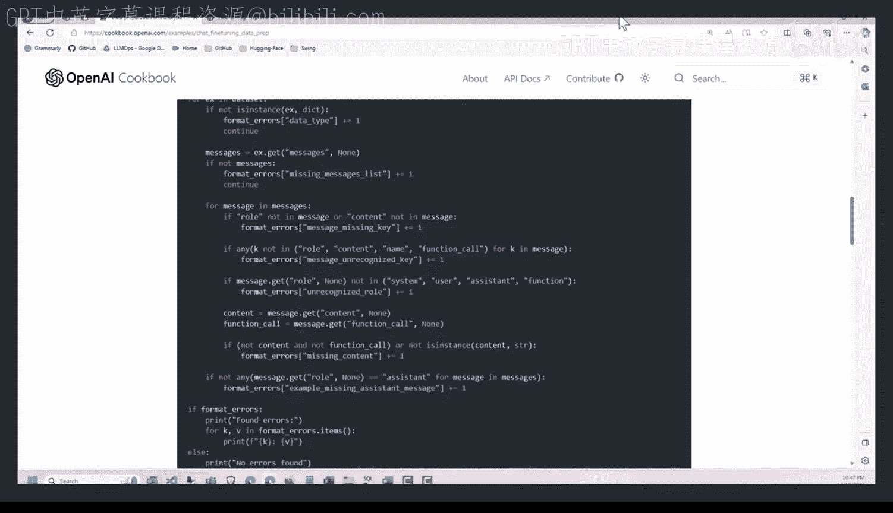
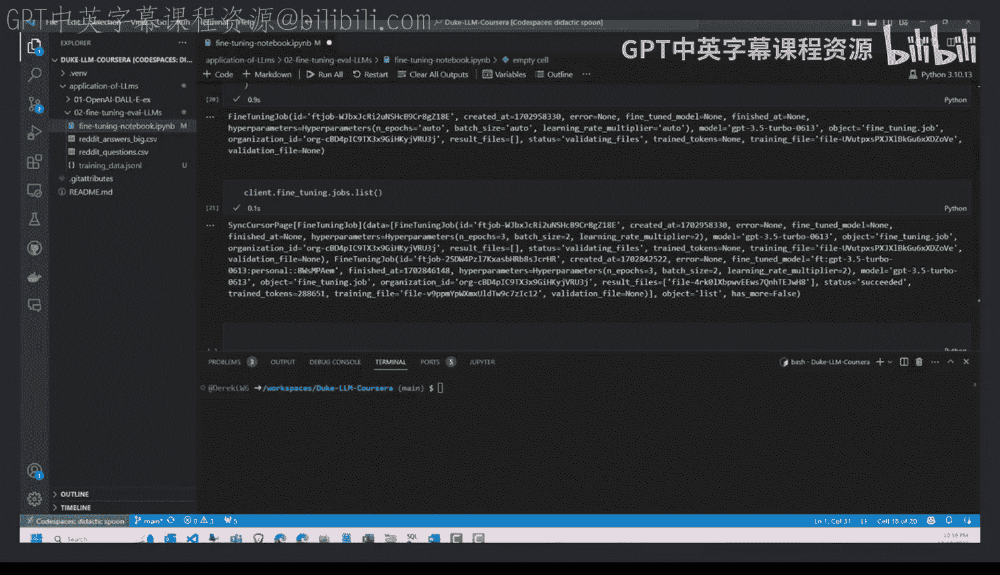

# 大型语言模型实践：04：微调项目第二部分：开始微调 🚀

在本节课中，我们将学习如何将准备好的数据集转换为OpenAI微调所需的格式，并启动一个微调任务。我们将涵盖数据格式化、格式验证以及通过OpenAI API提交微调作业的完整流程。

---

上一节我们准备了缩短的数据集，本节中我们来看看如何将其转换为正确的格式并开始微调过程。

首先，我们需要将数据集转换为OpenAI微调所要求的格式。通常，最佳格式是包含“问题”和“答案”对的列表。

以下是转换数据格式的步骤：

1.  **创建格式化列表**：我们将使用列表推导式，基于原始数据创建一个包含“提示”和“答案”的字典列表。
2.  **定义系统提示**：为模型定义一个角色，例如“事实聊天机器人专家”。
3.  **组合用户问题**：将用户的问题放入“用户”角色的内容中。
4.  **组合助手答案**：将对应的答案放入“助手”角色的内容中。

以下是实现上述步骤的示例代码：

```python
# 假设 questions_and_answers 是一个包含 (question, answer) 元组的列表
qa_ai_formatted = []
for q, a in questions_and_answers:
    message_list = [
        {"role": "system", "content": "你是一个事实聊天机器人专家，喜欢用项目符号列表回答问题。"},
        {"role": "user", "content": q},
        {"role": "assistant", "content": a}
    ]
    qa_ai_formatted.append({"messages": message_list})
```

运行此代码后，`qa_ai_formatted` 列表中的每个元素都将是一个符合OpenAI要求的消息字典。





---



接下来，我们需要将格式化后的数据写入一个JSONL文件，这是提交给OpenAI的标准格式。

以下是写入文件的代码：

```python
import json

with open('fine_tune_data.jsonl', 'w') as f:
    for entry in qa_ai_formatted:
        json_line = json.dumps(entry)
        f.write(json_line + '\n')
```

执行此操作后，会在当前目录下生成一个名为 `fine_tune_data.jsonl` 的文件。

---

在将文件发送给OpenAI之前，验证其格式是否正确至关重要。OpenAI提供了实用的检查函数。

以下是验证文件格式的步骤：

1.  **导入检查工具**：从OpenAI的示例代码库中获取格式验证函数。
2.  **运行验证**：对生成的JSONL文件运行验证检查，确保没有缺失字段或格式错误。

验证过程会检查文件是否包含所有必需的参数，并且数据完整无误。相关的验证代码将包含在课程资料中供您使用。

---

验证通过后，我们就可以开始真正的微调过程了。这需要通过OpenAI API分两步完成。

以下是启动微调的具体步骤：

1.  **上传文件**：首先，将格式正确的JSONL文件上传到OpenAI。
    ```python
    import openai
    openai.api_key = ‘你的API密钥’

    file_response = openai.File.create(
        file=open(“fine_tune_data.jsonl”, “rb”),
        purpose=‘fine-tune’
    )
    file_id = file_response.id
    ```
    执行成功后，您会获得一个文件ID，这是下一步所必需的。

2.  **创建微调作业**：使用上传后获得的文件ID来创建一个新的微调任务。
    ```python
    fine_tune_job = openai.FineTuningJob.create(
        training_file=file_id,
        model=“gpt-3.5-turbo”
    )
    job_id = fine_tune_job.id
    ```
    创建作业后，您会收到一个作业ID。微调过程将在OpenAI的服务器上开始，这可能需要一些时间。

您可以通过以下方式查看作业状态：
```python
# 列出所有作业
jobs = openai.FineTuningJob.list(limit=10)
# 或检索特定作业
job_status = openai.FineTuningJob.retrieve(job_id)
```
当微调完成后，OpenAI通常会发送邮件通知。完成后的模型就可以像其他API模型一样被调用使用了。

---



本节课中我们一起学习了微调GPT模型的核心实践步骤。我们从**数据格式化**开始，将问答对转换成特定的消息结构。接着，我们**写入并验证了JSONL文件**，确保其符合平台要求。最后，我们通过OpenAI API**上传文件并创建了微调作业**，启动了模型的训练过程。整个过程强调了准备工作的严谨性，这是获得良好微调结果的基础。