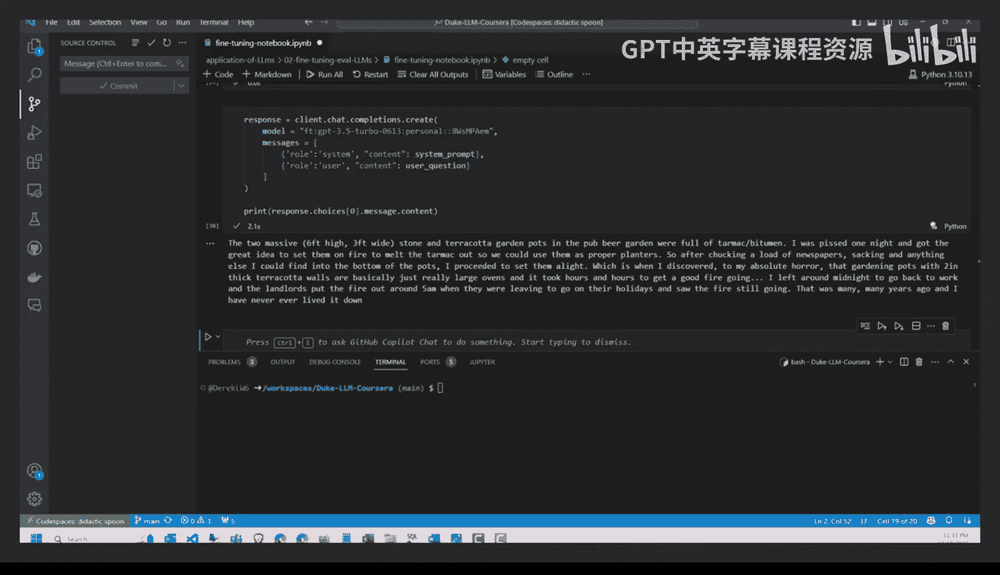
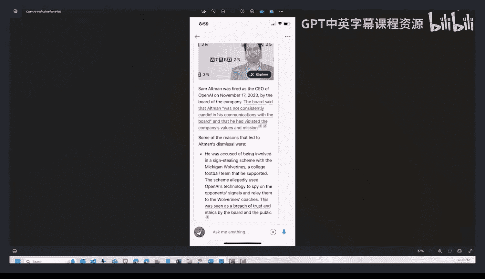
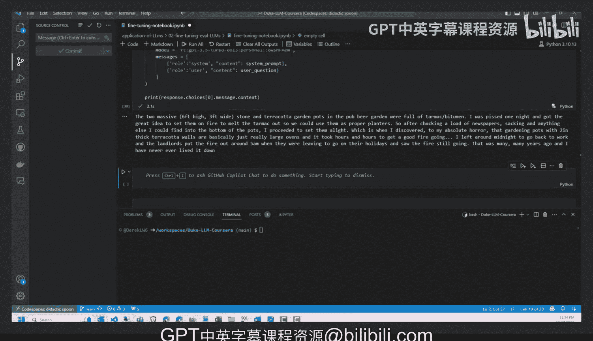

# 大型语言模型实践：P68：微调项目第三部分：模型评估 🧪

在本节课中，我们将学习如何评估一个已完成微调的大型语言模型。我们将通过一个具体的例子，向模型提问并分析其回答，同时讨论一个关键概念——模型幻觉。通过这个过程，你将了解如何验证微调后模型的输出是否符合预期。

---

## 模型推理与测试

上一节我们介绍了模型的微调过程。本节中，我们来看看如何对微调完成的模型进行实际测试。

我们的模型已经在Reddit风格的数据上完成了微调。因此，我们将向它提出一个类似Reddit论坛上的问题，以观察其响应。这种方法可以将一个通用模型应用于特定场景，例如医院系统或技术文档处理。

以下是测试步骤：

1.  **构建对话消息**：我们将按照特定格式构建一个包含系统指令和用户问题的消息列表。
2.  **调用微调模型**：与调用基础模型不同，这里需要指定我们刚刚微调好的专属模型ID。
3.  **获取并打印响应**：发送请求后，从API响应中提取并查看模型生成的内容。

让我们开始实际操作。首先，定义系统指令和用户问题。

```python
# 定义系统角色和指令
system_prompt = "你是一个官方聊天机器人，喜欢回答问题。你是Reddit专家，喜欢用项目符号列表回答问题。"

# 定义用户问题
user_question = "告诉我做过的最蠢的事。这听起来像一个常见的Reddit帖子。"
```

接下来，我们将这些信息组合成API所需的格式，并调用我们微调的模型。

```python
# 构建消息列表
messages = [
    {"role": "system", "content": system_prompt},
    {"role": "user", "content": user_question}
]

# 调用微调模型进行补全
response = client.chat.completions.create(
    model="ft:gpt-3.5-turbo-0613:personal::your-model-id", # 替换为你的微调模型ID
    messages=messages
)

# 打印模型的回答
print(response.choices[0].message.content)
```

运行代码后，我们得到了一个回答，内容大致是：“在啤酒花园酒吧里，试图跳过2米高、3.5米宽的盆栽”。这听起来确实像Reddit上会有人分享的“蠢事”。这表明我们的模型已经学会了生成符合Reddit社区风格的、略带自嘲和幽默的回应。

---

## 理解模型幻觉

在测试模型时，有一个必须警惕的重要概念：**模型幻觉**。它指的是模型生成看似合理但事实上不正确或毫无根据的信息。

虽然在我们当前的简单测试中较难触发，但这里有一个典型的例子。在一次关于萨姆·奥尔特曼（Sam Altman， OpenAI前CEO）被解雇的对话中，模型因为同时“记住”了对话历史中关于大学足球和密歇根大学教练吉姆·哈博（Jim Harbaugh）被禁赛的信息，结果在回答中错误地将这两件事混为一谈，生成了不准确的内容。

**核心要点**：
*   模型在连续对话中会参考整个会话历史。
*   这可能导致它混淆不同主题的事实，从而产生“幻觉”。
*   公式可以表示为：`输出 = f(输入 + 对话历史)`，其中函数 `f` 可能错误地关联了不相关的历史信息。



因此，**每当使用这些模型，尤其是使用自行微调的模型时，必须通过特定的测试用例来验证其输出结果的准确性。**

---

## 课程总结

本节课中我们一起学习了模型微调后的评估流程。

1.  **测试微调模型**：我们实践了如何向微调后的模型提问，并获得了符合目标风格（Reddit风格）的回答。
2.  **认识模型幻觉**：我们探讨了模型可能生成不准确或虚构信息的现象，理解了其成因是在多轮对话中混淆了上下文。
3.  **强调验证重要性**：我们明确了，在实际应用中，必须对模型的输出进行仔细的校验，不能完全信任其初始结果。





通过评估，我们确认了微调是有效的，同时也意识到了负责任地使用AI模型所需的关键注意事项。