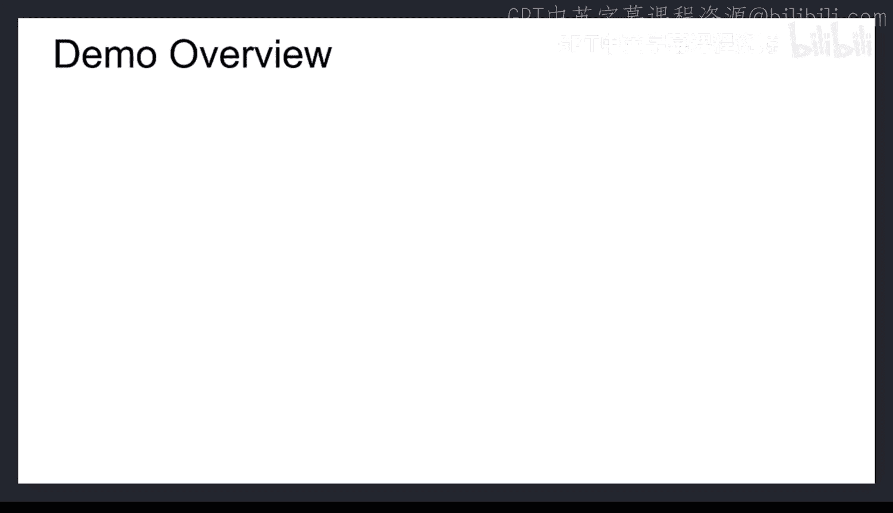
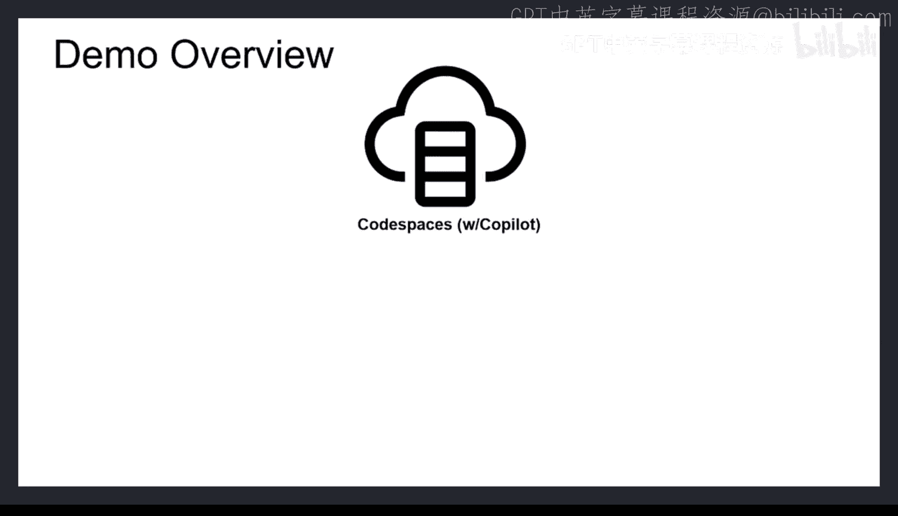
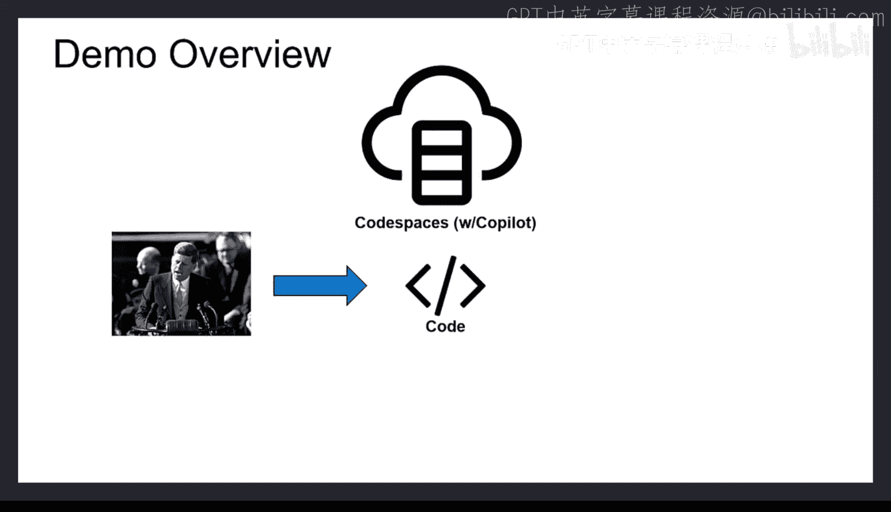
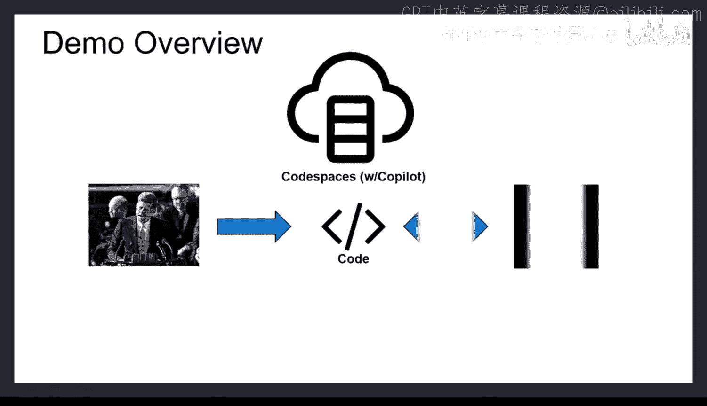
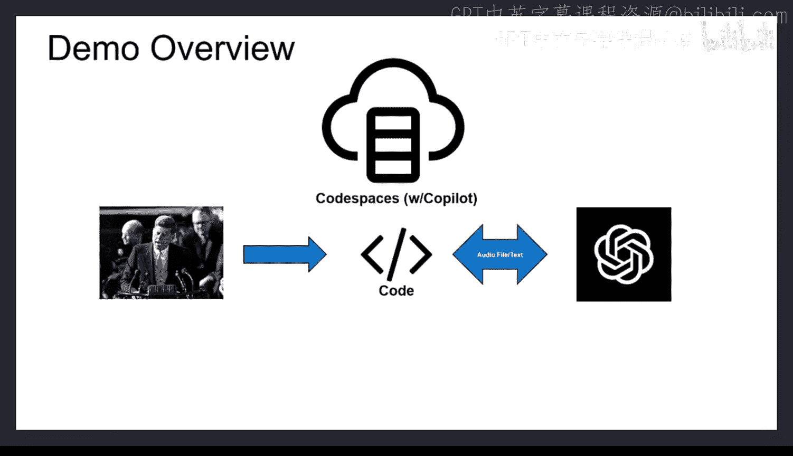
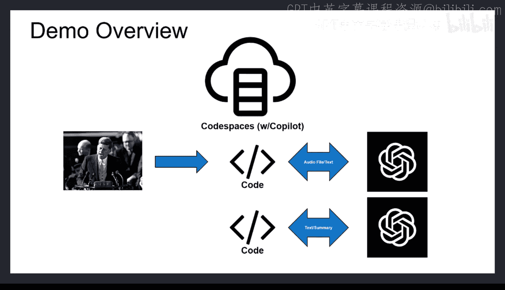

# 大型语言模型实践：P70：OpenAI Whisper模型项目概览 🎤

在本节课中，我们将学习如何使用OpenAI的Whisper API进行语音识别，并构建一个简单的音频转录与摘要应用。我们将从环境设置开始，逐步完成一个完整的项目演示。

上一节我们介绍了课程的整体结构，本节中我们来看看一个具体的API应用项目。

## Whisper API简介

Whisper是由OpenAI开发的一个通用语音识别模型。它在大型数据集上训练而成，能够处理多种任务。该模型可以接收音频输入，甚至支持MP4等视频格式，并且具备翻译功能。

## 项目演示概览

接下来，我们将快速浏览本次课程要完成的演示项目流程。

以下是项目的主要步骤：

1.  我们将从Code Spaces和Copilot环境开始。
2.  我们将导入一段罗伯特·F·肯尼迪的就职演讲音频文件到环境中。
3.  我们将把该音频文件传递给OpenAI的Whisper API。
4.  API将返回识别出的文本。
5.  我们将编写更多代码，把得到的文本发送出去以获取摘要。

如果你能理解这个流程，就会发现这是构建会议纪要或视频摘要类应用程序的雏形。这就是本项目的目的。

现在，让我们切换到开发环境并开始动手实践。